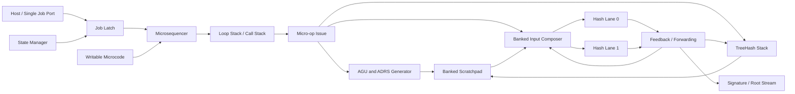

# μHBS: Loop-Compressed Microcoded HBS Engine

(Microcoded Hash-Based Signature Engine)

> The former product cores are retained only as reference/oracle material.
> Active development targets the independent Unified V2 core.

面向 LMS、XMSS 与 SLH-DSA 的循环压缩、微码驱动共享加速器。

> 当前状态：V2 重构中。正式目标为一个 512×128-bit ROM、单 Sequencer、
> 五宏执行器和两条等价 U2 Keccak lane；旧顶层不属于生产综合闭包。

> 分阶段实施、独立性契约和论文 Gate 见 [Execution Plan](Execution_Plan.md)；当前局部实测与收益边界见 [Expected Benefits](docs/Expected_Benefits.md)。两项已固定的架构取舍见 [Layout Expression Tradeoff](docs/Layout_Expression_Tradeoff.md) 与 [Static P2 Tradeoff](docs/Static_P2_Tradeoff.md)。
> SLH-DSA 周期的已计入范围和未计入边界见 [SLH-DSA Cycle Measurement](docs/SLH_DSA_Cycle_Measurement.md)。

快速验证命令：

```bash
make sim-lms
make sim-xmss
make sim-slh-dsa
make sim-slh-dsa-cycles
make export-slh-dsa-layouts rtl-slh-dsa-full-test
make rtl-unit-test
make ci
```

`make sim-xmss` 从一条 Job 自主执行 XMSS-SHAKE256 H10 Sign，并将
3,431,950 次 SHAKE 输入/输出 trace 与独立 RFC 8391 oracle 对账。
随后从另一条 Job 执行未修改核心模型而新增的 Verify 微码，
有效签名的 1,835 次 SHAKE 有序 trace 与独立验证 oracle 一致，
单 bit 签名变异重建出不同 root。当前签名在 Job admission 时
一次性锁存固定宽度字段；消息只通过 payload valid/ready stream 写入内部
Scratchpad，不依赖 DMA，也不允许软件逐步输入算法任务。
官方 C 参考实现只用于生成已固定 KAT，不在项目的构建或执行依赖链中。

`make sim-slh-dsa` 从一条 Job 自主执行最终 FIPS 205
SLH-DSA-SHAKE-128f Keygen，并将 4,495 次 SHAKE 与独立 oracle 对账，
最终 root 匹配 NIST ACVP tc31。ACVP-Server 不在构建或执行依赖链中。
随后以 144-word Sign 微程序从同一条 Job 自主展开 FORS 和 22 层
Hypertree，重建 deterministic SigGen tc137 的完整 17,088-byte 签名，
并逐一核对 104,937 个 SHAKE 输入/输出。主机不提供 FORS index、WOTS
chain length、树决策、task 或 Hash descriptor。

早期 capability slice、被否决的宽表达式/P2 实验和测试 stub 已从
`rtl/` 删除；历史结论仍保留在文档与 Git 历史中。XMSS/LMS 当前产品顶层
分别为 `micro_hbs_horizontal_xmss_top` 与
`micro_hbs_horizontal_lms_top`。

## 1. 项目背景

LMS、XMSS 和 SLH-DSA 都以哈希函数为主要计算核心，但它们在以下方面存在差异：

- LM-OTS、WOTS+ 和 FORS 的链长及输入格式不同；
- LMS 使用前缀进行域分离，XMSS/SLH-DSA 还使用结构化地址和可调哈希；
- Merkle Tree、L-tree、FORS Tree 和 Hypertree 具有不同的循环层次；
- LMS/XMSS 需要安全维护签名索引，SLH-DSA 不需要持久化签名状态；
- 不同阶段对并行度、反馈延迟和存储容量的需求不同。

传统实现主要有三类：

1. **算法专用 FSM**：面积和性能较好，但控制逻辑与算法流程绑定，新增算法通常需要修改 RTL。
2. **任务级统一架构**：把算法分解为 WOTS、FORS、Merkle 等任务，通过共享 Hash 数据通路减少硬件重复。
3. **RISC-V + Hash Core**：由软件执行算法循环和地址计算，灵活性高，但可能产生逐 Hash 的指令、访存和握手开销。

本项目研究位于任务级 FSM 和通用处理器之间的设计点：执行过程可以在单次 Hash 边界进行配置和调度，但静态程序不保存完整 Hash trace，而是用微码、嵌套循环和公式化地址生成器在线展开。

## 2. 核心思想

本项目遵循以下原则：

> Fine-grained at execution time, hierarchically compressed at representation time.

即：

- **动态执行粒度**可以细化到一次 Hash、一次地址更新或一次 TreeHash 合并；
- **静态存储粒度**是循环体和输入模板，而不是每一次动态 Hash；
- 高频连续运算通过反馈旁路和融合执行避免逐指令控制气泡；
- 算法差异尽量保存在可加载微码和描述符中，而不是算法专用 FSM 中。

以一次包含 104,937 次 Hash 的 SLH-DSA-128f 签名为例，如果每次 Hash 保存一条 64-bit 描述符，展平 trace 约需：

```text
104,937 × 8 Byte ≈ 820 KiB
```

本项目不保存该 trace，而是保存类似以下循环关系：

```text
CALL FORS_SIGN_ROOT(k=33, a=6)

LOOP layer = 0 .. 21
    CALL XMSS_SIGN_ROOT(tree_height=3, len=35)
END
```

动态 Hash 数仍然很大，但静态程序预计只需要几十到数百条微指令。

## 3. 设计目标

- 共享 LMS、XMSS 和 SLH-DSA 的 Hash、输入构造、地址生成、TreeHash 和存储通路；
- 主机每次 Keygen/Sign/Verify 只提交一条粗粒度 Job，不参与逐 Hash 调度；
- 只在 IDLE 初始化阶段整幅加载或切换微码/layout 镜像，任务执行阶段不依赖软件 runtime，也不依赖 FPGA bitstream 重配置；
- 新增 Verification、HSS 或 XMSS-MT 时尽量不修改核心 RTL；
- 通过硬件循环使控制存储规模与循环结构相关，而不是与动态 Hash 数相关；
- 通过跨阶段转发减少重复 Hash 和中间结果 RAM 往返；
- 通过流式 TreeHash 将树计算的工作存储从完整树的 `O(2^h)` 降低到接近 `O(h)`；
- 为 LMS/XMSS 提供独立、可验证的安全状态管理接口；
- 在面积、延迟、吞吐率和可编程性之间形成可量化的 Pareto 折中。

## 4. 非目标

- 不实现完整的通用 RISC-V ISA；
- 不允许任意整数程序在微码引擎上执行；
- 不通过存储完整 Hash trace 获得可编程性；
- 不把算法名称直接固化成大量专用 opcode 或 sub-FSM；
- 初始版本不承诺同时支持所有 SHA-2 和 SHAKE 参数；
- 初始版本不宣称具备侧信道、故障注入或密码模块认证能力。

## 5. 顶层架构



主要模块如下。

### 5.1 Single Job Port

接收一条粗粒度 Job，包含已验证的程序入口、参数、消息、密钥、签名输出地址和状态句柄。不设通用任务队列；每个 Keygen/Sign/Verify 操作只接受一次 Job。

示意描述符：

```text
JobDescriptor {
    program_entry,
    operation,
    parameter_set,
    message_ptr,
    message_length,
    secret_key_ptr,
    public_key_ptr,
    signature_ptr,
    state_handle,
    flags
}
```

### 5.2 Microsequencer

按 Job 中已验证的 `program_entry` 执行微程序。它只负责程序执行、调用和循环配置，不包含 `if algorithm == FORS` 一类的大规模算法专用状态机。

### 5.3 Loop Stack

硬件循环栈在线展开 FORS tree、Hypertree layer、leaf、chain、step 和 tree height 等嵌套循环。

每层循环状态可包含：

```text
LoopContext {
    start_pc,
    current,
    bound,
    stride,
    condition,
    flags
}
```

初始目标为支持 5～6 层嵌套循环。

### 5.4 AGU and ADRS Generator

地址生成器根据循环计数器计算 Scratchpad 地址，并更新 XMSS/SLH-DSA 的结构化地址字段。

典型表达式：

```text
memory_address = base
               + counter0 × stride0
               + counter1 × stride1
               + level_offset
```

典型 ADRS 操作：

```text
SET_FIELD(field_id, immediate)
COPY_COUNTER(field_id, counter_id)
INC_FIELD(field_id)
CLEAR_FIELDS(field_mask)
```

### 5.5 Banked Input Composer

SHAKE256 的 1088-bit rate buffer 划分为 17 个 64-bit bank。prefix、seed、ADRS、消息、中间节点和 padding 按 layout template 写入指定 bank，避免在整个 1088-bit 数据宽度上使用高扇入 MUX。

典型模板：

```text
WOTS_CHAIN : domain | seed | ADRS | chain_value | padding
TREE_NODE  : domain | seed | ADRS | left | right | padding
LMS_NODE   : I | node_number | domain | left | right | padding
```

### 5.6 Hash Lanes

初始评估覆盖以下配置：

- 1 lane、unroll-1；
- 1 lane、unroll-2；
- 2 lane、unroll-1；
- 2 lane、unroll-2。

Hash 输出可直接反馈到下一次链迭代，也可以发送给 TreeHash、Scratchpad 或输出流。

### 5.7 TreeHash Stack

TreeHash 单元执行：

- 节点 push/pop；
- 相同高度节点检测；
- 父节点 Hash 请求生成；
- 认证路径节点捕获；
- 根节点返回；
- 中间节点生命周期管理。

设计目标是不保存完整 Merkle Tree，同时支持可选的快速签名缓存模式。

### 5.8 State Manager

State Manager 与计算引擎分离，负责 LMS/XMSS 的安全签名索引。预期协议为：

```text
RESERVE_INDEX
    → PERSIST_COMMIT
    → RELEASE_TO_SIGNER
    → CONSUMED
```

其职责包括：

- 单调索引；
- 原子预留；
- 掉电恢复；
- 防回滚；
- 并发请求隔离；
- 已预留索引不得重新使用；
- 私钥和临时敏感值清零。

## 6. 微指令模型

当前 Micro-ISA v0.2 仅保留 12 条被实际程序使用的通用指令：

| 类别 | 指令 | 功能 |
|---|---|---|
| 标量 | `SET_REG`, `ADD_IMM` | 控制参数与计数地址 |
| 流程 | `LOOP_BEGIN`, `LOOP_END`, `CALL`, `RETURN`, `HALT` | 有界循环、子程序和结束 |
| Hash | `HASH` | 按 layout descriptor 构造输入并启动等价 Hash lane |
| 数据 | `DATA_LOAD`, `DATA_MOVE` | 受界数据加载、解析、变换和复制 |
| TreeHash | `TREE_PUSH` | 参数化 Merkle 栈入栈和等高归约 |
| 输出 | `OUTPUT` | 输出签名段或重建根 |

`NOP/XOR/FAIL/WAIT/BARRIER/JUMP` 因九个已编译程序均未使用，
已从 v0.2 删除。编码保留为非法空洞。

指令格式示意：

```text
MicroOp {
    opcode,
    lane_mask,
    layout_id,
    src0,
    src1,
    dst,
    address_mode,
    domain_id,
    repeat_source,
    flags
}
```

允许使用融合执行优化热点，但基础架构不依赖带有算法名称的指令。候选融合操作包括：

- Hash 输出反馈；
- `DATA_LOAD + HASH + DATA_MOVE`；
- `TREE_PUSH + TREE_REDUCE`；
- Hash 完成后自动更新 ADRS；
- 根据 Base-w digit 设置动态循环上界。

## 7. SLH-DSA-128f 执行示例

以下 Hash 数用于说明控制规模问题，最终结果必须由参考实现 trace 和标准测试向量重新验证：

```text
SLH-DSA-128f Sign: 104,937 Hash
├─ FORS: 6,304
│  ├─ FORS signature/authentication path: 6,072
│  └─ FORS public-key recovery: 232
└─ Hypertree: 98,631
   ├─ 22 XMSS authentication paths: 86,482
   ├─ WOTS signatures/public-key recovery: 12,086
   └─ XMSS authentication-path recovery H: 63
```

对应的程序不应包含 104,937 条 Hash 指令，而应由以下循环层次生成：

```text
FORS_SIGN:
    LOOP fors_tree, K
        LOOP leaf, 2^A
            HASH FORS_PRF
            TREE_PUSH
            TREE_REDUCE
        END
        TREE_CAPTURE
    END
    HASH FORS_ROOTS

HT_SIGN:
    LOOP layer, D
        CALL XMSS_SIGN_ROOT
        FORWARD root TO next_layer_message
    END
```

需要重点验证签名阶段是否可以直接复用 TreeHash 已生成的 FORS/XMSS 根，从而消除标准伪代码字面执行中可能出现的 `pkFromSig` 重复计算。任何复用都必须证明与标准恢复结果逐位一致。

## 8. 与任务级 FSM 的区别

| 方面 | 任务级统一 FSM | 本项目 |
|---|---|---|
| 控制绑定 | 综合时固化 | IDLE 初始化阶段整幅加载/选择已验证微码；Job 期间锁定 |
| 基本抽象 | 算法任务/sub-FSM | 正交微操作、循环和 layout |
| 循环意义 | 与 task 固定绑定 | 由微码配置 |
| 输入格式 | `task_type` 选择固定通路 | 数据驱动 layout template |
| 地址计算 | task-specific 逻辑 | 通用计数器和公式化 AGU |
| 新算法 | 修改控制 RTL | 优先仅增加微码 |
| 跨任务转发 | 受 task 边界限制 | 显式 forwarding 和生命周期管理 |
| 控制存储 | 主要编码在 LUT/FF | 小型微码 ROM/RAM＋通用译码器 |

如果实现中仍大量使用 `case(task_type)`，或者新增 Verification 必须增加新的 sub-FSM，则本项目尚未实现上述区别。

## 9. 与 RISC-V + Hash 的区别

| 方面 | RISC-V + 基础 Hash Core | 本项目 |
|---|---|---|
| 主机干预 | 可能随 Hash 数增长 | 每个签名一次或少量命令 |
| 循环执行 | CPU branch/loop | 硬件 loop stack |
| ADRS/地址 | CPU 指令计算 | AGU 自动生成 |
| 输入拼接 | CPU、DMA或外围逻辑 | banked composer |
| 链反馈 | 通常经过寄存器或存储 | Hash-to-Hash 旁路 |
| TreeHash | 软件栈或专用外设 | 内建流式 TreeHash |
| 通用性 | 可执行任意程序 | 仅表达 HBS 数据流 |
| 控制开销 | fetch/decode/branch/load/store | 描述符配置后自主执行 |

如果本项目加入完整 ALU、通用寄存器组、任意分支和通用 load/store，它将逐渐退化为 HBS ASIP 或小型 RISC-V，领域专用优势也会减弱。

公平评估必须包含紧耦合 RISC-V 自定义 Hash 指令以及 RISC-V + 描述符式加速器，不能只与逐次 AXI/MMIO 启动 Hash 的弱基线比较。

## 10. 中间值复用与跨阶段转发

候选优化包括：

- FORS 签名和 FORS root 联合生成；
- XMSS 签名、认证路径和 tree root 联合生成；
- 当前 XMSS root 直接成为下一 Hypertree 层的 WOTS+ 消息；
- WOTS/LM-OTS 链结果直接进入公钥压缩；
- TreeHash 节点只在其生命周期内保存在栈或 Scratchpad；
- 签名片段完成后立即流式输出。

这些优化的目标是减少：

- 重复 Hash；
- Scratchpad 读写；
- task 边界同步；
- 峰值中间存储；
- Hash lane 空闲周期。

## 11. 预期接口

控制接口可以采用 AXI4-Lite、APB 或简单寄存器接口；消息、密钥和签名数据可以采用 AXI Stream 或 DMA。

最低限度寄存器包括：

```text
CONTROL
STATUS
PROGRAM_ENTRY
OPERATION
PARAMETER_SET
MESSAGE_ADDR / MESSAGE_LENGTH
SECRET_KEY_ADDR
PUBLIC_KEY_ADDR
SIGNATURE_ADDR
STATE_HANDLE
MICROCODE_ADDR / MICROCODE_DATA
ERROR_STATUS
```

实现必须区分：

- 算法完成；
- 输出流完成；
- 状态提交完成；
- Hash/存储异常；
- 非法微码或参数；
- 状态索引耗尽。

## 12. 功能验证

### 12.1 参考模型

- 使用标准兼容的软件参考实现产生预期输出；
- 软件模型同时输出逐 Hash trace；
- RTL 在仿真中输出等价的 Hash request trace；
- 按 `opcode/layout/address/input/output` 逐项差分。

### 12.2 测试范围

- 官方 KAT/测试向量；
- 空消息、短消息、跨 SHAKE rate 边界消息和长消息；
- 所有目标参数集；
- OTS 最小、平均和最大链长；
- 各树高度和边界叶索引；
- 并发任务与 lane 冲突；
- RAM 读写冲突；
- 复位、掉电和状态恢复；
- 非法程序及非法参数。

### 12.3 断言和形式检查

- LMS/XMSS 索引永不重用；
- Hash 输入域分离和 ADRS 字段正确；
- TreeHash 栈不溢出、不下溢；
- 同一 Scratchpad bank 不发生未解决冲突；
- 每次签名的根与参考实现一致；
- 敏感寄存器在任务结束或异常时清零。

## 13. 论文评估计划

### 13.1 内部基线

| 基线 | 描述 |
|---|---|
| B0 | LMS、XMSS、SLH-DSA 独立专用实现 |
| B1 | 只共享 Keccak，各算法保留独立控制器 |
| B2 | 任务级统一 FSM |
| B3 | 展平 Hash descriptor trace |
| B4 | 本项目的循环压缩微码引擎 |
| B5 | RISC-V + MMIO Keccak |
| B6 | RISC-V + 紧耦合 Hash 指令 |
| B7 | RISC-V + 描述符式 HBS 后端 |

### 13.2 消融实验

- 固定 FSM 与可加载微码；
- 展平 trace 与循环压缩；
- 大宽度 MUX、双路径 HIL 与 banked composer；
- 开启和关闭链反馈旁路；
- 开启和关闭跨阶段 root forwarding；
- 完整树、TreeHash 栈和子树缓存；
- 1/2 个 Hash lane 与不同 unroll；
- 静态调度与多上下文动态调度。

### 13.3 指标

- LUT、FF、BRAM、DSP、Fmax；
- 控制 ROM/RAM bit 数；
- Keygen/Sign/Verify 周期和实际延迟；
- Hash lane 利用率和平均气泡；
- 动态 Hash 数；
- Scratchpad 读写次数和数据移动字节数；
- 主机指令、MMIO 和命令数；
- 峰值存储；
- 动态功耗和每次签名能量；
- 新增算法所需微码、RTL 修改模块数和增量面积。

程序压缩率定义为：

```text
Compression Ratio = Dynamic Hash Count / Static Microinstruction Count
```

统一面积节省率可定义为：

```text
Area Saving = 1 - A_unified / (A_LMS + A_XMSS + A_SLH-DSA)
```

除 ATP 外，还应同时报告绝对面积、周期、Fmax、吞吐率和能量，避免单一综合指标掩盖设计取舍。

## 14. 判断项目是否成功

本项目至少应证明以下三项中的两项：

1. 相对任务级 FSM，以可接受的控制存储换取更低 LUT/FF 或更低扩展成本；
2. 相对 RISC-V + 紧耦合 Hash，显著减少逐 Hash 控制、数据移动和能量；
3. 新增 Verification、HSS 或 XMSS-MT 时无需修改核心数据通路 RTL。

理想结果形式如下：

```text
- 相对三个独立实现，总面积降低 X%；
- 相对任务级统一 FSM，控制 LUT/FF 降低 Y%；
- 相对紧耦合 RISC-V + Hash，Hash lane 利用率提高 Z%；
- root forwarding 减少 A 次 Hash 和 B% Scratchpad 访问；
- 新增一种 HBS 流程只增加 C Byte 微码，核心 RTL 修改为零；
- 所有目标参数通过标准测试向量。
```

如果最终只支持固定三种算法、一次执行一个请求，并且新增算法仍需修改 RTL，那么硬编码 task-FSM 很可能具有更好的面积—性能表现，不应将微码本身作为主要创新。

## 15. 建议的实现阶段

### Phase 1：执行模型

- 建立软件参考模型和 Hash trace 格式；
- 定义基础微指令、layout 和地址描述符；
- 证明完整 trace 可以由循环压缩程序重建；
- 统计静态程序规模和理论控制气泡。

### Phase 2：单 Hash Lane RTL

- 实现 microcode fetch/decode；
- 实现 loop stack 和 call stack；
- 实现 AGU、ADRS 和 banked input composer；
- 接入一个 Keccak/SHAKE lane；
- 首先打通 LM-OTS/LMS。

### Phase 3：XMSS 与 SLH-DSA

- 加入 WOTS+、mask 和 L-tree；
- 加入 FORS、Hypertree 和 TreeHash stack；
- 实现分段签名输出；
- 验证 root forwarding 和重复计算消除。

### Phase 4：性能扩展

- 增加第二个 Hash lane；
- 加入反馈旁路和融合操作；
- 评估静态双发或多上下文调度；
- 完成不同 parallelism/unroll 的设计空间搜索。

### Phase 5：系统与安全

- 接入 State Manager；
- 验证掉电恢复和索引不可重用；
- 增加敏感值清零和错误处理；
- 进行功耗、故障和侧信道初步评估。

## 16. 计划中的目录结构

```text
.
├── README.md
├── docs/
│   ├── architecture.md
│   ├── micro_isa.md
│   └── evaluation.md
├── model/
│   ├── reference/
│   ├── compiler/
│   └── traces/
├── rtl/
│   ├── frontend/
│   ├── sequencer/
│   ├── input_composer/
│   ├── hash_lane/
│   ├── treehash/
│   ├── memory/
│   └── state_manager/
├── tb/
│   ├── unit/
│   ├── integration/
│   └── formal/
├── microcode/
│   ├── lms/
│   ├── xmss/
│   └── slh_dsa/
└── scripts/
    ├── synth/
    └── reports/
```

当前已创建并验证 `model/`、`microcode/`、`rtl/sequencer`、`rtl/hash_lane`、`rtl/treehash`、`rtl/memory`、`rtl/state_manager` 和相应测试；尚未实现的命令会显式返回非零，不伪装成 Pass。

## 17. 研究定位

本项目不应只宣称“粒度比任务级架构更低”。更准确的研究问题是：

> 如何在保持单 Hash 级控制和跨算法可编程性的同时，通过循环压缩、公式化地址生成和流式数据转发，避免细粒度控制序列的存储膨胀及通用处理器的逐 Hash 开销？

预期论文贡献可概括为：

1. 循环压缩、可加载的 HBS 微指令执行模型；
2. 模板驱动的 Hash 输入构造和结构化地址生成；
3. 面向 TreeHash 和 OTS 链的数据转发与中间值生命周期管理；
4. 相对 task-FSM 与 RISC-V + Hash 的统一、同平台实验评估。
