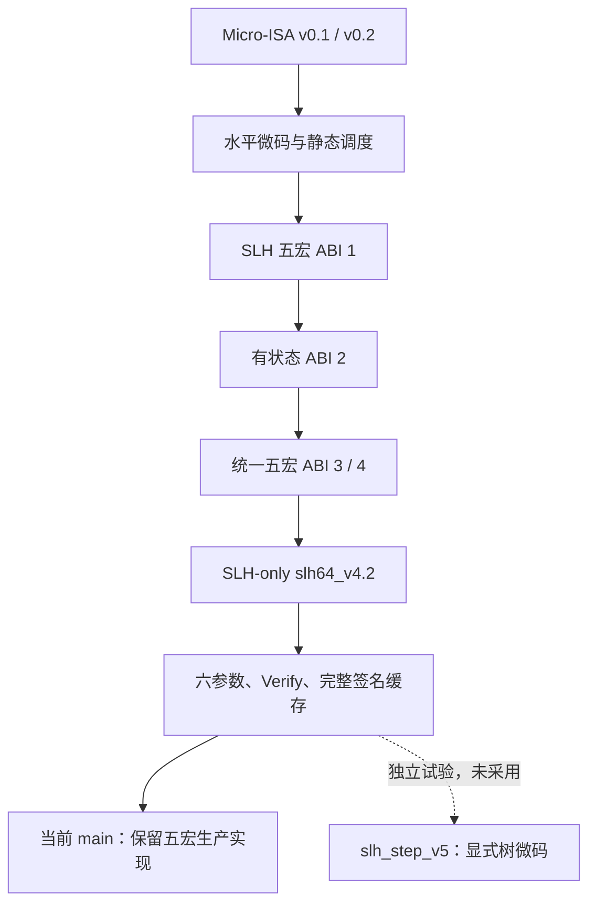

# mHBS main：微码与 ABI 的 Git 演进

核对日期：2026-10-06。当前生产基准：本仓库 `main`，提交 `e917f54a`。

本文仅沿本仓库 `main` 的第一父提交链，依据编码器、解释器、RTL 和归档报告整理。历史路径均从本仓库根目录开始。历史结果标明其来源，区分软件模型、RTL 仿真和布线测量。

## 1. 结论与当前状态

main 的演进主线是：**Micro-ISA v0.x → 水平微码 → SLH 五宏／有状态扩展 → 统一五宏 ABI 3／4 → SLH 专用 `slh64_v4.2` → 六参数、Verify 与完整签名缓存**。

早期 Micro-ISA v0.1 用循环、CALL/RET 和无条件 JUMP 表达控制流；v0.2 删除了未使用的 JUMP。随后五宏架构将链步、树遍历和归约交给宏执行器，微码主要组织宏之间的顺序与有界循环。2026-10-03 又归档了显式分支与节点操作的 TREE-free 实验，但没有采用。

当前生产实现仍是五宏：`HASH / CHAIN / TREE / TRANSFORM / EMIT`。支持 SLH-DSA-SHAKE 的 **128f、192f、256f、128s、192s、256s**，以及 Keygen、Sign、Verify。当前格式为 **`slh64_v4.2`、布局修订 3**。TREE-free 的 `slh_step_v5` 只是已拒绝、已归档的实验格式。

## 2. 区分指令集、镜像 ABI 与工程版本

| 名称 | 编码／实现对象 | 主要证据 |
|---|---|---|
| Micro-ISA v0.1／v0.2 | 64 位细粒度微指令、layout、Scratchpad、循环／调用 | `973ed7b1`、`76dcfa52` 的 `docs/Micro_ISA.md` |
| 五宏 IMAGE ABI 1／有状态 ABI 2 | SLH 或 XMSS/LMS 的 token/template/descriptor 契约 | `765c838c`、`642600e5` 的 Python 编码器 |
| 五宏 Unified HBS ABI 3／4 | 三算法统一描述符；随后扩展到七参数点 | `5d881ee1`、`3d06e8e9` 的 `docs/Unified_HBS_ABI.md` |
| 工程 v4.1／v4.2 | main 路线的共同核、接口和镜像压缩阶段 | `3d06e8e9` 至 `55f0d920` 等 |
| `slh64_v4.2`／Program16 | 当前五宏的紧凑物理格式及容量 | 当前 [ABI.md](ABI.md) |
| `slh_step_v5` | 显式节点操作与分支的 TREE-free 候选 | `e917f54a`，未采用 |

Micro-ISA 版本、IMAGE ABI 和工程提交标题不是同一个编号体系。比如 `3d06e8e9` 的标题是工程 v4.1，其镜像逻辑 ABI 已为 4；当前 `slh64_v4.2` 延续五宏语义，但采用更紧凑的物理编码。旧镜像必须按对应版本解码，不能仅改版本号后复用。

## 3. 本仓库关键 Git 节点

下表选用 `git log --first-parent main` 中的提交；日期来自对应提交。

| 提交 | 日期 | 变化／核对范围 |
|---|---|---|
| `973ed7b1` | 2026-09-16 | Micro-ISA v0.1，SLH 微程序与 RTL sequencer |
| `76dcfa52` | 2026-09-17 | Micro-ISA v0.2，裁剪未使用指令及 K2U2 优化 |
| `738d0250` | 2026-09-17 | 水平控制字、SINGLE/RUN/LOOP/HALT 与双 lane 调度 |
| `546fbcd6` | 2026-09-18 | 静态微码 K2U2 signer 过渡阶段 |
| `765c838c` | 2026-09-18 | SLH 通用五宏，IMAGE ABI 1 |
| `642600e5` | 2026-09-19 | 有状态 ABI 2，XMSS/LMS 宏执行核 |
| `00a8f24e` | 2026-09-19 | 三 profile 检查点；SLH 与 stateful 仍有不同执行核 |
| `5d881ee1` | 2026-09-24 | 五宏 ABI 3，共享 `uhbs_hbs` 源码及三算法验证／PPA |
| `3d06e8e9` | 2026-09-24 | 工程 v4.1，此时逻辑格式已为五宏 ABI 4、七参数点 |
| `e7217203` | 2026-09-25 | v4.1 SLH-only 路线 |
| `621bad05` | 2026-09-26 | v4.2 SLH-only |
| `55f0d920` | 2026-09-26 | `slh64_v4.2` 布局修订 3、外部 Job／消息接口；program 为 32 字 |
| `373dc5c5` | 2026-09-27 | `uhbs` → `mhbs` 命名调整 |
| `a96ecd69` | 2026-09-28 | Verify 实现阶段；已可核对 Program16 和 256 位节点接口 |
| `25b1173d` | 2026-09-30 | 六参数 f/s 支持 |
| `fcfe690d`／`b1f5555e` | 2026-10-02 | 优化及精简／报告阶段 |
| `efc3ffe4` | 2026-10-02 | 完整签名缓存及节点读回接口 |
| `e917f54a` | 2026-10-03 | 归档 TREE-free 试验及拒绝证据；生产 RTL 未切换 |

以下只表示 main 上的架构阶段，省略中间提交：



## 4. Micro-ISA v0.1／v0.2：较早的细粒度编排

### 4.1 v0.1：循环、调用、直接跳转

`973ed7b1:docs/Micro_ISA.md` 的指令格式是：

```text
opcode[63:56] | flags[55:48] | rd[47:40] | rs[39:32] | imm[31:0]
```

执行器包含 PC、R0–R7、六层循环栈和四层调用栈。主要指令有 HASH_LAYOUT、LOOP_SETUP/LOOP_END、CALL/RET、JUMP、MOVI/ADDI、LOAD/STORE/XOR、TREE_PUSH、EMIT/HALT。

- HASH_LAYOUT 由 layout 组织输入。
- LOOP_SETUP 支持固定界或 Scratchpad 动态界；动态界为零时可跳过循环。
- JUMP 是直接地址的无条件跳转；没有一般 CMP/BEQ/BNE。
- TREE_PUSH 已包含等高节点归约，所以这一版也不是把所有树内部步骤都拆成基础指令。

`microcode/slh_dsa/slh_dsa_shake_128f_sign.json` 的有效静态指令为 144 条，包含 18 对循环、5 个 CALL、2 个 RET；该程序实际未使用 JUMP。必须区分 ISA 支持的指令与具体镜像实际使用的指令。

### 4.2 v0.2：删除未使用指令

`76dcfa52` 保留 12 类：

```text
SET_REG / ADD_IMM / HASH / LOOP_BEGIN / LOOP_END / CALL / RETURN
DATA_LOAD / DATA_MOVE / TREE_PUSH / OUTPUT / HALT
```

NOP、XOR、FAIL、WAIT、BARRIER、JUMP 被移出 ISA，保留编码空洞。此时仍有子程序和有界循环，但没有一般条件分支；不能写成“v0.2 支持任意控制流”。

## 5. main 五宏路线：ABI 1、2、3、4

### 5.1 ABI 1：SLH 五宏

依据 `765c838c:model/generic_hbs_macrocode.py` 和同提交 `docs/Generic_HBS_Macrocode_Implementation.md`。

控制分为 128 位 token、128 位 template、64 位 descriptor。token 使用 SINGLE/RUN/LOOP/HALT；宏命令为：

```text
macro:4 | descriptor_id:8 | route_id:8 | flags:4 | coordinate:24
```

五类宏为 HASH、CHAIN、TREE、TRANSFORM、EMIT。TREE 内部包含叶生成、链调用、树归约与认证路径捕获，语义明显粗于早期 TREE_PUSH。

首版 SLH-128f Sign 为 11 个 token、9 个 template、102 个展开宏字；Keygen 为 3／2／3，两者各有 118 个 descriptor 字。这些是该版镜像长度，不是当前 ROM 容量。首版 IMAGE 版本表达式含 `1 << 52`，不能套用后来的 ABI 3/4 头部字段。

外层流程仍由微码安排：消息 Hash → FORS TREE 重复 → 根列表 Hash → 各 hypertree 层的 TRANSFORM/TREE → HALT。微码不再逐项调度宏内部链步与父节点推进。

### 5.2 有状态 ABI 2

依据 `642600e5:model/stateful_hbs_macrocode.py`。IMAGE_V2 引入版本 2、Keygen/Sign 双入口和输出长度；扩展到 XMSS/LMS 的 n=32、h=10、ω=4，以及 masked Hash 和列表输入等配方。

`00a8f24e` 的 README 明确说明：stateful 两种算法共享 RTL 核，而 SLH 仍使用独立 n=16 核。这个节点不是三算法已经共用一个物理执行核的证明。此处 LMS-SHAKE 是非标准研究变体，不能等同于标准 LMS。

### 5.3 五宏 ABI 3：三算法统一

依据 `5d881ee1:docs/Unified_HBS_ABI.md` 和 `model/unified_hbs.py`。三算法采用同一五宏语义及共享 `uhbs_hbs` 源码；镜像保持独立 token/template/descriptor。

IMAGE 记录包含：

```text
version[59:56] = 3
keygen_entry[55:47] / sign_entry[46:38]
keygen_bytes[35:18] / sign_bytes[17:0]
```

descriptor kind 为 HASH=1、SEGMENT=2、CHAIN=4、TREE=5、ROUTE=6、TRANSFORM=8、EMIT=9、IMAGE=10、PROFILE=11。ABI 1/2 镜像被拒绝。128 位 template 表达一个独占 48 位宏命令，不能因历史水平字段仍存在就声称有两个独立宏并行执行。

共同源码不等于共同面积：这一阶段对算法分别静态综合，lane 数、可达路径及参数裁剪可能不同。历史 stateful 缓存策略也必须结合该节点读取，不能与当前 SLH 接口或任意索引连续签名混用。

### 5.4 五宏 ABI 4：七参数点

`3d06e8e9` 的提交标题是 v4.1，但 `docs/Unified_HBS_ABI.md` 已明确为 **image ABI 4**。

五宏及 token 控制方式不变，PROFILE 增加 family、n、ω、子树高度、FORS a/k、层数 d、摘要长度 m 和总高度 h。支持 SLH 的 128f/192f/256f，以及 XMSS/LMS 的 ω=2/4，合计七点。ω 表示每个 Winternitz 数字的位数，ω=2 对应 base=4。

Hash 最大块数从 5 位扩至 6 位；n=24、更长摘要和 133 链端点等也需要真实 RTL 支持，不能只更改镜像数字。后续共同网表与 ROM INIT 流程解决的是硬件/综合边界，不能归因于 ABI 版本号本身。

## 6. 当前 main：SLH 专用物理格式与六参数

### 6.1 从七点到 SLH-only

工程 v4.1/v4.2 的 SLH-only 路线去掉生产 XMSS/LMS、索引 q、stateful 缓存与 guard 等能力，采用三份紧凑 64 位镜像。`55f0d920` 的布局修订 3 已将 Job／消息从 program 数据区移到外部接口。

随后 Program16、Verify 和六参数支持陆续加入。生产格式和逐位定义以当前 [ABI.md](ABI.md) 为准。

| 存储 | `55f0d920` 历史布局 | 当前容量 |
|---|---:|---:|
| program | 32 × 64 bit | **16 × 64 bit** |
| template | 16 × 64 bit | **16 × 64 bit** |
| descriptor | 32 × 64 bit，双读 | **32 × 64 bit，双读** |
| 三份逻辑容量合计 | 640 B | **512 B** |

当前 template 仅低 16 位承载编码，高位要求为零；它仍由文件加载。不能把已撤回的固定 template 试验写成生产行为。

### 6.2 当前执行与接口

- SINGLE/RUN/LOOP/HALT 编排一条在途宏命令；没有通用条件跳转或 CALL/RET。RUN 表示按次数和坐标增量重复发射宏命令。
- CHAIN/TREE 内部可并行使用双 Hash lane；单宏在途不等于单 lane。
- program 纯指令；Job 从顶层参数进入，消息走 64 位 valid/ready 接口；Sign 的公钥根由外部提供。
- `OPERATION=0/1/2` 分别是 Keygen/Sign/Verify。输出为 256 位节点及 `out_bytes`，Verify 接收节点流。
- 顶层是 `mhbs_top`，没有旧七点 `mhbs_processor`；同步高有效复位。
- 格式检查主要由离线工具完成，物理镜像没有运行时 ABI 版本字。布局修订号相同也不能忽略容量变化，旧 32 字镜像应按对应工具重新生成。

### 6.3 完整签名缓存

`efc3ffe4` 增加独立签名缓存，不改变五宏、Hash 调度和原输出流。容量为 1558 个 256 位节点槽，支持同步读回，可编译关闭。现有压缩存储组织为 1024＋512 项 BRAM 区和 22 项 LUTRAM 尾区。

因此“计算共同核 0 BRAM”和“含完整签名缓存的顶层 0 BRAM”是不同命题。当前缓存包含 11 BRAM36＋1 BRAM18；完整协议与验证见 [Signature_Storage.md](report/Signature_Storage.md)。

## 7. TREE-free 实验：slh_step_v5 未进入生产

`e917f54a` 保存了软件先行、随后隔离 RTL 的试验。64 位基础指令加入显式节点读写、整数更新、分支、单次父 Hash 和输入／输出；六参数三操作共用 123 个有效字，取 128 字 program 容量。软件解释器和候选 RTL 都将树调度展开为微码循环。

结果见 [Tree_Microcode_Experiment.md](report/Tree_Microcode_Experiment.md)：

| 门槛 | 结果 |
|---|---|
| 软件门禁／RTL 输出与计算次数 | 通过 |
| 六参数 Sign 周期增幅 ≤10% | 失败：+10.0078%～+42.2028% |
| 其他周期 | 128s、192s Verify 也超过 10% |
| 共同核面积 | 21,043 → 24,112 LUT；6252.250 → 7004.875 等效 Slice |
| 包含三份 ROM 的面积 | 六参数均增加 |
| 是否应用生产 | **否** |

不能把实验编码名中的 v5 解释成当前项目已经升级 ABI 5。生产 TREE 宏和原镜像均保留。

## 8. 控制能力对照

| 实现 | 循环 | 条件跳转 | 调用／返回 | 树计算位置 | 实现边界 |
|---|---|---|---|---|---|
| Micro-ISA v0.1 | 循环栈、动态界 | 循环判断；无一般条件分支 | CALL/RET | TREE_PUSH 内归约 | 有模型及 RTL 路径；JUMP 支持但所列 Sign 未使用 |
| Micro-ISA v0.2 | 有界循环 | 无一般条件分支 | CALL/RETURN | TREE_PUSH 内归约 | 删除未用 JUMP |
| 五宏 ABI 1–4 | token RUN/LOOP | 无一般条件分支 | 无 | TREE 宏内部 | 当前 main 的架构来源 |
| 当前 slh64_v4.2 | SINGLE/RUN/LOOP/HALT | 无一般条件分支 | 无 | TREE 宏内部 | 六参数、三操作、签名缓存 |
| 实验 slh_step_v5 | 显式整数操作＋分支 | BEQ/BNE/JMP | 单返回槽 CALL/RET | 微码显式遍历与归约调度 | 验证完成，周期／面积失败，未采用 |

## 9. 周期与 ATP 的使用规则

ABI 版本号不能直接用来排序 ATP。比较时必须固定算法、参数、消息、Hash 工作量、K/U、缓存策略、面积边界和频率依据。

1. **同源性**：面积与周期必须来自同一实现；旧 README、测试断言和 manifest 可能属于不同优化阶段。例如 `76dcfa52` 的签名 testbench 已断言 U2 为 999,340 周期，不能自动与更早记录的面积配对。
2. **模型与 RTL**：TREE-free 候选的采用判定使用 RTL 实测周期，不能用软件解释器的动态指令数替代。
3. **面积范围**：共同核、共同核＋三份 ROM、含签名缓存完整顶层应分开报告。LUTRAM 已包含在总 LUT 中，不重复相加；完整签名缓存的 BRAM 不能漏计。
4. **频率范围**：某个 K2U2 候选通过 112 MHz，不代表随后修改的执行核或完整顶层也已通过。没有匹配布线证据的频率只能列为假设。

当前 TREE-free 试验既没有新的布线频率，又已在周期和综合面积上失败，因此报告止于对应门槛，不编制虚构的实测 ATP。完整结果及测量口径见 [试验报告](report/Tree_Microcode_Experiment.md)。

## 10. 证据索引与复查

以下“提交号:路径”均来自 `main` 的第一父提交链，并可在本仓库直接读取。历史路径无需添加旧仓库的目录前缀。

| 提交 | 主要证据路径 |
|---|---|
| `973ed7b1` | `docs/Micro_ISA.md`；`rtl/sequencer/micro_hbs_sequencer.sv`；`microcode/slh_dsa/slh_dsa_shake_128f_sign.json` |
| `76dcfa52` | `docs/Micro_ISA.md`；`tb/integration/tb_micro_hbs_slh_dsa_top.sv` |
| `738d0250` | `docs/Horizontal_Microcode_Architecture.md` |
| `765c838c` | `model/generic_hbs_macrocode.py`；`docs/Generic_HBS_Macrocode_Implementation.md` |
| `642600e5` | `model/stateful_hbs_macrocode.py` |
| `00a8f24e` | `README.md`；`docs/Stateful_HBS_Microcode_Extension.md` |
| `5d881ee1` | `docs/Unified_HBS_ABI.md`；`docs/Unified_HBS_Results.md`；`model/unified_hbs.py` |
| `3d06e8e9` | `docs/Unified_HBS_ABI.md`；`model/profiles.py` |
| `55f0d920` | `docs/ABI.md`；`model/slh64_external.py` |
| `a96ecd69` | `rtl/top/mhbs_top.sv`；`rtl/top/mhbs_hbs.sv` |
| `25b1173d` | `model/profiles.py`；`docs/v4.2/S_Parameters.md` |
| `efc3ffe4` | `docs/report/Signature_Storage.md`；`rtl/memory/mhbs_signature_store.sv` |
| `e917f54a` | `docs/report/Tree_Microcode_Experiment.md`；`manifests/experiments/tree_microcode_20261003_v1/result.json` |

无需切换分支即可复查：

```bash
# 当前主线
git log --first-parent --oneline main

# 早期控制指令及五宏语义
git show 973ed7b1:docs/Micro_ISA.md
git show 765c838c:model/generic_hbs_macrocode.py
git show 5d881ee1:docs/Unified_HBS_ABI.md
git show 3d06e8e9:docs/Unified_HBS_ABI.md

# 当前格式及未采用实验
git show e917f54a:docs/ABI.md
git show e917f54a:docs/report/Tree_Microcode_Experiment.md

# 完整提交号与源码树标识
git show -s --format='%H %T %s' 973ed7b1 5d881ee1 e917f54a
```

当前文档入口：[生产 ABI](ABI.md)、[架构](Architecture.md)、[Job／签名缓存接口](Job_Interface.md)、[TREE-free 试验](report/Tree_Microcode_Experiment.md)。

main 的主要取舍是把规则性强的 Hash 子图放入五宏执行器，将跨宏流程、参数和数据组织留在镜像中。后续显式树微码试验提供了一个反例：控制更细并未自动带来更小面积或更低周期，因此生产实现继续保留 TREE 宏。
