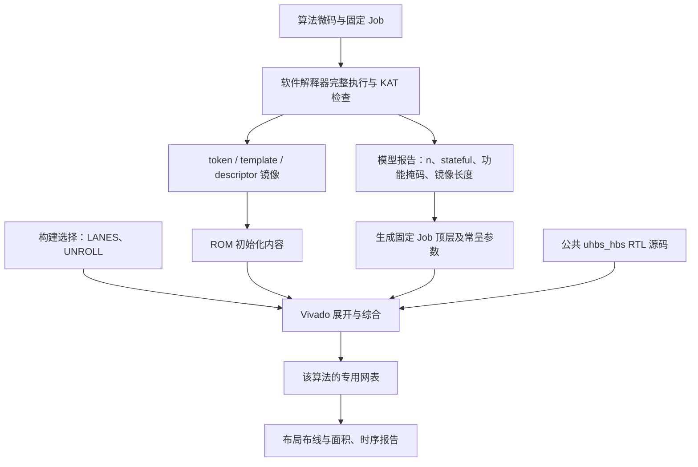

# 为什么微码会影响当前 μHBS 的综合面积？

本文针对当前工程的 ABI 3 实现，解释微码、RTL 参数、综合电路和执行周期之间的关系。

## 1. 先把结论说清楚

**微码运行时不会改变硬件数量。当前三种算法面积不同，是因为它们使用同一份参数化 RTL 源码，分别生成了三个经过静态裁剪的电路。**

具体有三种不同的作用，必须分开理解：

| 因素 | 发生阶段 | 主要影响 |
|---|---|---|
| 执行不同的 token、template、descriptor | 硬件运行时 | 操作顺序、循环次数、数据选择和周期 |
| 从固定镜像提取功能掩码，并作为 RTL 常量传入 | 生成顶层、综合之前 | 综合器可以删除不需要的功能电路 |
| 设置 `N`、`LANES`、`UNROLL`、消息缓冲容量等参数 | RTL 展开与综合 | 数据宽度、实例数量、组合逻辑规模、存储容量 |

我之前说“微码不同，所以面积不同”，省略了中间的构建步骤，容易产生误解。准确说法是：

> 当前工程将微码镜像和硬件配置一起静态确定；其中一部分镜像信息被显式转换成综合常量。不同的综合常量、ROM 内容和硬件参数，共同产生不同的网表和面积。

**不能把目前三种算法的全部面积差异，都归因于微码。**

## 2. RTL 源码、综合电路、微码不是同一层东西

### 2.1 RTL 源码是电路的描述

当前统一核的源文件是 [uhbs_hbs.sv](../rtl/top/uhbs_hbs.sv)。它包含参数：

```systemverilog
parameter integer N=16, UNROLL=2, LANES=2, MAX_MESSAGE_BYTES=87;
parameter [15:0] RECIPE_MASK=16'hffff;
parameter [15:0] CHAIN_RECIPE_MASK=RECIPE_MASK;
parameter bit STATEFUL=0;
```

这些 `parameter` 在展开和综合时确定，运行中的消息或指令不能修改它们。

例如，同一个模块源码：

```systemverilog
logic [N*8-1:0] node_value;
```

当 `N=16` 时描述 128 位节点；当 `N=32` 时描述 256 位节点。源码相同，但展开后的节点寄存器、相关数据选择器和存储接口宽度不同。

### 2.2 综合后的网表才是具体电路

Vivado 根据顶层、参数、常量连接和 ROM 内容，把 RTL 转成 LUT、FF、RAM 等器件资源。

当前综合脚本 [synth_unified_hbs.tcl](../experiments/synth_unified_hbs.tcl) 分别选择三个算法顶层，并显式传入：

```tcl
-generic UNROLL=$unroll -generic LANES=$lanes -generic PROFILE_ENABLE=0
```

因此，“同一核源码”保证了共用实现与执行语义，**不保证三个单独综合的网表完全相同**。

### 2.3 微码是已有执行电路的控制数据

在运行时，微码告诉执行器：

- 下一步执行哪个宏操作。
- 使用哪个 Hash 输入配方。
- 链迭代多少步，树高是多少。
- 结果放到哪个位置，是否输出。
- 何时结束 Keygen 或 Sign。

它不会在执行过程中创建一条新的 Hash lane，也不会把 128 位寄存器临时变成 256 位寄存器。

可以类比处理器：同一台处理器执行两个程序，运行时间会不同，但处理器本身不会因为程序里乘法多就长出更多乘法器。当前 μHBS 另外做了**构建前的专用化**，这一点超出了“只换程序”的情形。

## 3. 当前构建里，微码怎样进入综合流程？



具体对应：

1. [compile_unified_hbs.py](../scripts/compile_unified_hbs.py) 执行软件模型并检查完整 Keygen/Sign 输出。
2. 该脚本导出三个 `.mem` 文件，并扫描 descriptor，提取 `recipe_mask` 和 `chain_recipe_mask`。
3. [generate_unified_tops.py](../scripts/generate_unified_tops.py) 根据报告生成算法顶层，把这些掩码写成 `uhbs_hbs` 的参数。
4. Vivado 使用这些参数和镜像综合。

**这里有一条明确的“镜像 → 生成脚本 → 参数 → 综合电路”的路径。**

所以不是 Vivado 理解了整个密码算法，再自动猜出所有用不到的功能；很多裁剪条件是生成脚本明确告诉它的。

## 4. 最具体的例子：`RECIPE_MASK` 怎样删除电路？

### 4.1 配方代表不同的 Hash 输入构造方式

三种算法都使用 SHAKE，但喂给 SHAKE 的字节串并不相同。有的需要拼接公开种子和地址，有的需要标识符及域分隔常量，有的还需要掩码和中间值。

[uhbs_recipe_lane.sv](../rtl/hash_lane/uhbs_recipe_lane.sv) 将这些输入构造方式定义为不同的 recipe shape。例如：

```systemverilog
ADDRESS_SEED=1, ADDRESS_VALUE=2,
MESSAGE_PRF=3, MESSAGE_DIGEST=4,
INDEX_PRF=5, ROOT_MESSAGE=6,
MASKED_SEED=7, MASKED_VALUE=8,
PREFIX_SEED=9, PREFIX_VALUE=10,
PREFIX_MESSAGE=11, ADDRESS_LIST=12,
PREFIX_LIST=13, PREFIX_LEAF=14, PREFIX_PARENT=15;
```

运行时 descriptor 提供 `shape`，选择当前采用哪个配方；综合时 `RECIPE_MASK` 确定这份硬件需要支持哪些配方。

### 4.2 当前镜像产生的掩码

以下数值来自 [unified_hbs_model_gate.json](../manifests/experiments/unified_hbs_model_gate.json)：

| 算法 | `RECIPE_MASK` | 包含的 shape | `CHAIN_RECIPE_MASK` |
|---|---|---|---|
| SLH-DSA | `16'h101e` | 1、2、3、4、12 | `16'h0006`：1、2 |
| XMSS | `16'h01e0` | 5、6、7、8 | `16'h0180`：7、8 |
| LMS | `16'hee00` | 9、10、11、13、14、15 | `16'h0600`：9、10 |

掩码中第 k 位为 1，表示允许并保留 shape k 对应的功能。

### 4.3 RTL 中有显式的常量条件

例如，当前 RTL 中有如下结构：

```systemverilog
case (shape)
    MESSAGE_PRF: if (RECIPE_MASK[MESSAGE_PRF]) begin
        stream_source[0 +: N*8] = secret_prf;
        stream_source[N*8 +: N*8] = randomizer;
        stream_source[2*N*8 +: MAX_MESSAGE_BYTES*8] = message_buffer;
    end
    // 其他配方……
endcase
```

对于 XMSS，`RECIPE_MASK[3]` 在综合时已经确定为 0。因此上述 `MESSAGE_PRF` 分支中的赋值不会发生，综合器可以删除只为这个分支服务的拼接、选择和相关连接。

对于 SLH-DSA，这一位为 1，这个分支需要保留，并由运行中的 `shape` 选择。

删除的是**该分支独占且不会影响其他输出的逻辑**。如果某个寄存器或运算还被其他配方使用，它仍然需要保留。

### 4.4 静态常量和运行时选择有本质区别

下面是便于理解的示意代码，不是本工程原文：

```systemverilog
// mode 是运行时输入：两种功能都可能使用，通常必须都保留。
assign y = mode ? function_a(x) : function_b(x);

// ENABLE_B 是 parameter，若综合时为 0，B 分支可被删除。
generate
    if (ENABLE_B)
        assign y = mode ? function_a(x) : function_b(x);
    else
        assign y = function_a(x);
endgenerate
```

当前 recipe 掩码在普通 `if` 中使用参数常量，也能形成静态裁剪条件，并不要求所有裁剪都写成 `generate if`。

**综合器能明确知道“这个功能永远不会使用”，才有可靠的删除依据。** 单纯在某次仿真里没有走到一个分支，并不能让综合器删除该分支。

## 5. ROM 内容固定，会不会让整个执行器都变成固定电路？

不会自动发生这种极端变化。

当前 descriptor ROM 的声明是：

```systemverilog
(* rom_style="distributed" *) logic [63:0] descriptors [0:127];
initial $readmemh(DESCRIPTOR_INIT_FILE, descriptors);
```

token 和 template 也通过 `$readmemh` 初始化，读取地址由程序计数器或 descriptor 索引提供。

### 5.1 ROM 内容已知，读取结果仍可能随地址变化

可以把 ROM 看成一个确定的函数：

```text
ROM 输出 = f(运行中的地址)
```

例如 ROM 中第 0 项是 HASH，第 1 项是 TREE。虽然两项内容在综合时已知，但地址在运行时变化，所以输出仍然需要变化。

因此，执行器仍然需要取指、译码、循环、等待 Hash 完成、处理握手和背压。它没有因为 ROM 固定，就把完整签名预先算成一个常量。

### 5.2 固定 ROM 可以带来局部简化

例如，某一输出位在所有合法 ROM 地址上都相同，那么它可能简化成常量；重复内容、较浅的 ROM、较简单的地址到数据关系，也可能减少实现逻辑。

但这里有两个限制：

- ROM 逻辑能简化多少，要看内容、地址逻辑、映射方式和综合结果。
- 不能假定综合器会理解复杂的执行路径，证明所有“程序实际不会到达”的状态或功能。

所以当前实现通过 `RECIPE_MASK` **显式表达支持的功能集合**，并没有把所有裁剪都寄托于自动分析 ROM。

另外，若 ROM 映射为固定容量的 BRAM，仅改变初始化内容通常不会减少该 BRAM 的物理容量。当前分布式 ROM 的映射又是另一种情况。

## 6. 面积不同还有哪些原因？哪些不是微码造成的？

当前已选定的综合配置如下：

| 配置 | SLH-DSA | XMSS | LMS | 来源与作用 |
|---|---:|---:|---:|---|
| `N` | 16 | 32 | 32 | profile 元数据；节点及多处存储宽度 |
| `STATEFUL` | 0 | 1 | 1 | profile 元数据；索引提交及保护逻辑 |
| `LANES` | 2 | 1 | 1 | 独立构建选择；实际实例数量 |
| `UNROLL` | 2 | 2 | 2 | 独立构建选择；每周期展开的 Keccak 轮数 |
| `MAX_MESSAGE_BYTES` | 1 | 21 | 20 | 固定 Job 的消息长度；缓冲及数据选择宽度 |
| token 数 | 14 | 10 | 10 | 镜像长度；token ROM 深度 |
| template 数 | 11 | 8 | 8 | 镜像长度；template ROM 深度 |
| descriptor 数 | 128 | 128 | 128 | 当前 descriptor ROM 容量 |

### 6.1 lane 数直接决定实例数量

统一核中实际使用：

```systemverilog
generate
    for (physical=0; physical<LANES; physical=physical+1) begin: lanes
        uhbs_recipe_lane #(...) lane (...);
    end
endgenerate
```

`LANES=1` 只展开一个实例；`LANES=2` 展开两个实例。这是硬件参数的直接作用，并不是微码执行到某条指令才创建第二条 lane。

当前 Make 的默认选择为 SLH-DSA 两条、XMSS/LMS 一条；算法顶层源码的 `LANES` 默认值仍为 2，由构建参数覆盖。比较结果应以具体构建参数为准。

第二条逻辑 lane 使用 `CHAIN_RECIPE_MASK`，第一条使用完整 `RECIPE_MASK`：

```systemverilog
.RECIPE_MASK(L==0 ? RECIPE_MASK : CHAIN_RECIPE_MASK)
```

所以即便两个实例来自同一个 lane 模块，它们保留的配方也不同，面积不必相等。

### 6.2 n=16 与 n=32 不等于 Keccak 状态宽度减半或加倍

`N` 改变节点、种子、中间值和相应存储宽度。**SHAKE 的 Keccak-f[1600] 状态仍是 1600 位**，不会随摘要长度变成 800 位或 3200 位。

因此不能用“n 翻倍，整个核面积就翻倍”估算硬件。

### 6.3 stateful 逻辑是显式生成的

统一核使用 `generate if (STATEFUL)` 决定是否实例化索引保护器。SLH-DSA 不需要这部分；XMSS/LMS 需要保留提交请求、索引推进和错误处理。

这也是由静态 profile 配置决定的硬件差异。

### 6.4 固定 Job 和微码是两类输入

微码描述操作流程；固定 Job 提供密钥、初始索引、消息长度等数据。两者在当前 ABI 中分开定义。

顶层把固定 Job 字段作为常量连接到核，综合器可能进一步传播和简化常量。能减少多少必须看网表，不能仅凭密钥固定就断言 SHAKE 逻辑会大量消失。

**消息内容仍从消息流输入，不是预先固定的签名输出。** 固定消息长度主要让缓冲容量等范围在综合前确定。

## 7. 那么，实际运行一条微码时发生了什么？

以一次 HASH 宏为例，简化执行过程如下：


统一核的 `FETCH` 状态从宏命令提取：

```systemverilog
macro_op    <= cmd[47:44];
macro_desc  <= cmd[43:36];
macro_route <= cmd[35:28];
```

随后 `DECODE` 选择已有的宏执行逻辑，`HASH_ISSUE` 发请求，`HASH_WAIT` 等待 lane 完成。

这里每一步都是**控制已有电路的寄存器和数据通路**。执行 TREE 或 CHAIN 也一样：反复使用已有 Hash lane、链迭代器、树栈和数据存储，并没有给每个树节点生成一个独立 Hash 核。

因此，一个宏操作可以执行几千甚至几百万次 Hash，而微码只有少量 token。操作次数多，主要增加周期；不会自动按操作次数复制硬件。

## 8. 只改微码，面积一定会变吗？

不一定，需要区分修改方式。

| 修改 | 面积是否必然变化 | 周期或功能是否可能变化 |
|---|---|---|
| 同一现有硬件上，运行另一段受支持程序 | 不会因执行程序而改变资源数量 | 会 |
| 本工程修改 `.mem` 后重新综合，所有参数保持不变 | 不一定；ROM 映射和常量传播可能变化 | 会 |
| 重新生成镜像和顶层，功能掩码发生变化 | 可能改变被保留的电路 | 会 |
| 修改 `LANES`、`N` 或 `UNROLL` 后重新综合 | 直接改变展开结构，面积通常变化 | 会 |
| 只增加微码循环次数，功能集合和数据范围不变 | 通常不会按循环次数复制计算电路 | 周期通常增加 |

本工程当前 ROM 没有主机写入微码的接口。`$readmemh` 用于仿真初始化和综合初始化；FPGA 已经配置运行后，编辑电脑上的 `.mem` 文件不会自动更新 FPGA。

因此，当前“更换算法镜像”的交付方式是重新构建并配置对应产品，不是运行时热切换一个完全通用的核。

还有一个重要边界：如果新镜像使用了被裁剪掉的 recipe，仅换 ROM 不够，必须重新生成匹配的功能掩码并重新综合。lane 有配方合法性检查，不会凭空补出缺失电路。

## 9. “统一核”到底统一到了哪里？

当前实现统一了：

- token/template/descriptor 格式与解释语义。
- 取指、宏译码和 Keygen/Sign 执行流程。
- Hash recipe 执行器与 SHAKE 实现。
- 链迭代、树归约、工作存储和结果输出逻辑的源码。

当前三个产品的硬件配置分别确定，并不是一个同时容纳所有功能、运行时任选算法的 bitstream。

| 设计方式 | 当前工程是否采用 | 面积应怎样理解 |
|---|---|---|
| 同一份参数化核源码，三个算法分别静态综合 | 是 | 三个网表可以有三种面积 |
| 一份固定网表保留三算法所需全部能力，运行时选择算法 | 否 | 同一个硬件只有一套总资源面积 |

如果要求第二种方式，需要保留所需配方的并集、足够的数据与存储宽度，以及运行时 profile/镜像选择机制。不能简单把当前三项面积相加，也不能直接把最小的一项当成通用核面积；需要另外实现和综合。

当前选择符合“同一核源码、分别静态综合”的设计要求。

## 10. 用真实资源报告看：面积并不主要等于微码 ROM 大小

当前最终 post-route 结果为：

| 算法 | 总 LUT | 其中 LUTRAM | FF | 等效 Slice |
|---|---:|---:|---:|---:|
| SLH-DSA | 19,236 | 902 | 8,033 | 5,813.125 |
| XMSS | 13,176 | 1,796 | 6,114 | 4,058.250 |
| LMS | 14,549 | 1,796 | 5,357 | 4,306.875 |

LUTRAM 是总 LUT 的子集，不应再重复加到总 LUT 上。

例如 SLH-DSA 的层次报告显示：

| 实例 | Total LUTs |
|---|---:|
| 第一条 recipe/SHAKE lane | 8,200 |
| 第二条 recipe/SHAKE lane | 6,095 |
| token/template sequencer | 288 |

这些数字说明计算通路占了很大部分；微码并不是因为有十几条 token，就产生上万 LUT。

注意：层次统计可能存在跨层 LUT 合并；不能把所有父实例和子实例的数字一起相加。sequencer 的 288 LUT 也包含控制逻辑，并不等于纯 ROM 成本，且不包含核内全部 descriptor 逻辑。

原始报告：

- [SLH-DSA 层次资源](../manifests/experiments/unified_hbs_v3/slh_u2/utilization_hierarchical.rpt)
- [XMSS 层次资源](../manifests/experiments/unified_hbs_v3/xmss_u2/utilization_hierarchical.rpt)
- [LMS 层次资源](../manifests/experiments/unified_hbs_v3/lms_u2/utilization_hierarchical.rpt)

这些报告能证明当前面积及层次分布，但不能独立量化“微码裁剪究竟节省了多少 LUT”。要得到这个因果数字，必须固定 lane 数、N、消息容量、Job 和综合流程，只改变某一项掩码或 ROM，做受控对照。

## 11. 补充：BRAM=0 和微码裁剪有什么关系？

没有 BRAM，并不等于没有树缓存，也不等于缓存数据被综合器当成常量删掉。

当前核明确声明了分布式存储：

```systemverilog
(* ram_style="distributed" *) logic [N*8-1:0] stack [0:15];
(* ram_style="distributed" *) logic [N*8-1:0] auth_path [0:15];
```

端点工作存储 [uhbs_value_store.sv](../rtl/memory/uhbs_value_store.sv) 也将偶数、奇数 bank 标为 `ram_style="distributed"`。

这些存储由 LUTRAM、相关选择逻辑或寄存器实现，所以会出现在 LUT/FF 统计里，而不是 BRAM 统计里。

对于 h=10、n=32 的 XMSS/LMS：

- Keygen 仍计算完整的 2,047 个树节点。
- 计算中使用树栈，逐步归约，不永久保存每个已经生成的节点。
- Keygen 后为当前 q 保留 10 个认证节点和根，Sign 使用这些数据。
- 下次启动针对下一个 q 重新执行完整 Keygen。

**之前说的 352 字节，是“10 个认证节点 + 一个根”的有效数据量，不是整个核的存储容量，也不是综合后的精确物理存储容量。**

源码里的 `auth_path` 声明为 16 项，n=32 时声明容量就是 512 字节；另外还有树栈、链端点存储、消息缓冲、SHAKE 状态及其他寄存器。最终保留和映射多少，以综合报告为准。

同样，“没有保存整棵树”是当前明确采用的存储策略，不能描述成综合器看到微码后自动删掉了一棵完整树缓存。

## 12. 最后用四句话归纳

1. **运行微码影响硬件做什么、做多少次；不会让已经配置好的硬件临时增加或减少。**
2. **当前构建从固定镜像提取功能掩码，作为 RTL 参数，使综合器能够提前删除不需要的功能。**
3. **三种算法还使用不同的 lane 数、数据宽度、状态管理和固定 Job 配置，这些也是面积不同的原因。**
4. **当前是“统一源码、分别生成专用电路”；如果要求“同一个电路运行全部算法”，需要另一个保留完整能力的综合配置和运行时选择设计。**

相关文档：[镜像 ABI](Unified_HBS_ABI.md)、[架构](Architecture.md)、[最终 PPA 与比较边界](Unified_HBS_Results.md)。
