# A Unified Hardware Architecture for Stateful and Stateless Hash-Based Key/Signature Generations

**作者：** Yechu Zhang, Yuxuan Chu, Yaodong Wei, Yueqin Dai, Qiu Shen, Jing Tian

**来源：** IACR ePrint 2026/194，22 页；本地 PDF 的 SHA-256 已核验。

> 本阅读稿按 PDF 文本层逐块建立锚点。中文为离线机器初译并统一了核心术语；公式、参数、图表和结论应以英文原文及原始 PDF 为准。经人工审查的批判性结论见同目录 `../Unified_Stateful_Stateless_HBS_Architecture_2026_Analysis.md`。

## 核对后的表格与数据补充（2026-09-24）

- [表格转录、数据与口径核对](Extracted_Data_and_Analysis.md)：Table 1/2/5/6/7 的 Markdown、CSV/JSON 与原文重算。
- [当前 μHBS 与论文的全面对比](UHBS_Comparison_2026-09-24.md)：独立实现的结果快照，全部跨实现比值为 NON_STRICT。
- [补充来源与文件摘要](data/supplement_manifest.json)。原文报告值、派生计算、外部实现结果分开保存。

## 页面索引

[p.1](#page-1) · [p.2](#page-2) · [p.3](#page-3) · [p.4](#page-4) · [p.5](#page-5) · [p.6](#page-6) · [p.7](#page-7) · [p.8](#page-8) · [p.9](#page-9) · [p.10](#page-10) · [p.11](#page-11) · [p.12](#page-12) · [p.13](#page-13) · [p.14](#page-14) · [p.15](#page-15) · [p.16](#page-16) · [p.17](#page-17) · [p.18](#page-18) · [p.19](#page-19) · [p.20](#page-20) · [p.21](#page-21) · [p.22](#page-22)

## 公式索引

- [E001 · Eq. (1)](#E001) — p.4，WOTS 签名串接
- [E002 · Eq. (2)](#E002) — p.6，LMS 签名格式
- [E003 · Eq. (3)](#E003) — p.7，XMSS 签名格式
- [E004 · Eq. (4)](#E004) — p.7，FORS 签名格式
- [E005 · Eq. (5)](#E005) — p.7，SPHINCS+ 签名格式
- [E006 · Eq. (6)](#E006) — p.7，超树签名格式

## 术语表

| Canonical term | 中文 | 处理决定 |
|---|---|---|
| hash-based signature (HBS) | 基于哈希的签名 | 全文简称 HBS |
| stateful/stateless | 有状态/无状态 | 指签名密钥状态管理 |
| one-time signature (OTS) | 一次性签名 | 包括 WOTS/WOTS+ |
| authentication path | 认证路径 | Merkle 路径 |
| hash-input logic (HIL) | 哈希输入逻辑 | 保留 HIL 缩写 |
| unrolling factor / parallelism | 展开因子 / 并行度 | 分别记作 U/P |
| Area-Time Product (ATP) | 面积-时间积 | 按论文等效 Slice 口径 |
| hierarchical counter | 分层计数器 | cnt/num/index 三级 |

## 逐页中英对照

## Page 1

**Source:** p.1 S001

**Original:** A Unified Hardware Architecture for Stateful and Stateless Hash-Based Key/Signature Generations Yechu Zhang* , Yuxuan Chu* , Yaodong Wei, Yueqin Dai, Qiu Shen and Jing Tian(B) Nanjing University, Nanjing, China, {zhangyechu,chuyuxuan,yaodongwei,yq_dai}@smail.nju.cn {shenqiu,tianjing}@nju.edu.cn

**中文:** 一个统一的硬件架构,以国家和无国国为基础的密钥/签字代 Yechu Zhang* ,Yuxuan Chu* ,Yaodong Wei,Yueqin Dai,Qiu Shen和Jing Tian(B) 南京大学,南京,中国, {zhangyechu,chuyuxuan,yaodongwei,yq_dai}@smail.nju.cn {shenqiu,tianjing}@nju.edu.cn

**Source:** p.1 S002

**Original:** Abstract. Hash-based signature (HBS) schemes, including LMS, XMSS, and SPHINCS+, have become crucial components of post-quantum cryptography. LMS and XMSS are stateful schemes, while SPHINCS+ is stateless, which can be applied in different scenarios. A variety of hash operations in these schemes lead to complex input/output patterns for the hash cores. In this paper, we present an efficient and configurable hardware architecture that supports key generation and signing for all three schemes. Their complex procedural flows are abstracted into 11 shared and parameterized tasks under a unified control module, avoiding controller state blow-up. Driven by hierarchical counters, this approach maximizes resource reuse and preserves scalability, occupying only 17% of the total LUTs. Moreover, the design employs two hash cores with unroll-2 scheduling, which are experimentally validated to strike a favorable balance between area and time. We further introduce an asymmetric dual-path hash input logic (HIL) for each of them: a dedicated parallel lane for the high-frequency One-Time Signature (OTS) task and a flexible padding-shifter for all other tasks. This eliminates wide multiplexers and achieves a superior area-time balance. On Artix-7 FPGA, our unified design occupies 24.2k LUTs/13.7k FFs/16.5 BRAMs. Compared to state-of-the-art single-scheme designs, our architecture achieves up to 4.12 × /10.92× lower Area-Time Product (ATP) for LMS/XMSS signing and 2.47 × /6.61× lower ATP for key generation. More importantly, we provide a flexible, efficient, and scalable hardware foundation for the diverse practical deployments of HBS. Keywords: Post-Quantum Cryptography · SPHINCS+ · LMS · XMSS · FPGA · Digital Signature

**中文:** 抽象的.包括LMS,XMSS和SPHINCS+在内的基于哈希的签名 (HBS) 方案已成为后量子加密的关键组成部分.LMS和XMSS是状态式的方案,而SPHINCS+是无状态的方案,可在不同的场景中应用.这些方案中的各种哈希操作导致哈希核心的复杂输入/输出模式.在本文中,我们介绍了一个高效且可配置的硬件架构,在统一控制模块下,它们的复杂程序流程被抽象成11个共享和参数化的任务,避免控制器状态爆炸.这种方法由等级计数驱动,最大限度地利用资源并保持可扩展性,占据了总LUT的17%.此外,该设计采用了两个哈希核心,这些哈希核是通过试验验验证的,以实现区域和时间之间的有利平衡.此外,我们还为每一个应用程序推出了一种不对称的双路哈希输入逻辑 (HIL):用于高频一次签名 (OTS) 任务的专用平行车道以及所有其他任务的灵活填充转换器.这消除了宽的多重器,并实现了优越的区域时间平衡.在Artix-7FPGA上,我们的统一设计占有24.2万LUT/13.7万FF/16.5万BRAM.与最先进的单项方案设计相比,我们的架构实现了LMS/XMSS签名的4.12 × /10.92 × 较低的区域时间产品 (ATP) 和密钥生成的2.47 × /6.61 × 较低的ATP.更重要的是,我们为各种实际部署HBS提供灵活,高效和可扩展的硬件基础.关键词:后量子加密 · SPHINCS+ · LMS · XMSS · FPGA · 数字签名

### Introduction

**Source:** p.1 S003

**Original:** Introduction

**中文:** 介绍

**Source:** p.1 S004

**Original:** With the rapid advancement of quantum computing, classical computational problems such as integer factorization and discrete logarithms are expected to be efficiently solved, thereby posing severe security threats to widely deployed public-key cryptosystems such as RSA (Rivest–Shamir–Adleman) [RSA78] and Elliptic Curve Cryptography (ECC) [Por13]. To address this emerging risk, the U.S. National Institute of Standards and Technology (NIST) launched the Post-Quantum Cryptography (PQC) standardization project in 2016 to solicit cryptographic algorithms that can withstand quantum attacks [CCJ+ 16]. The goal of this initiative is to promote the transition of post-quantum cryptography from (B) Corresponding author. ∗ Both authors contributed equally to this work.

**中文:** 随着量子计算的快速进步,预计整数因子化和分离逻辑等经典计算问题将得到有效解决,从而对广泛部署的公钥密码系统 (如RSA (RivestShamirAdleman) [RSA78]和圆曲线密码 (ECC) [Por13]) 构成严重的安全威胁.为了应对这种新兴风险,在2016年,国家标准技术研究所 (NIST) 启动了后量子加密技术 (PQC) 标准化项目,以寻求能够承受量子攻击的加密算法.该倡议的目标是促进从 (B) 相应作者后量子加密技术的过渡.

## Page 2

**Source:** p.2 S005

**Original:** theoretical exploration to practical engineering and to accelerate its global deployment in real-world systems. According to their mathematical foundations, PQC algorithms can be broadly classified into five categories: lattice-based schemes [NIS23b, NIS23a], code-based schemes [MAB+ 18], multivariate-based schemes [DS05], isogeny-based schemes [DF17], and hash-based schemes. Among these, only the lattice-based, code-based, and hash-based families have been selected for the NIST standardization process. In particular, HBS schemes are built solely on standard cryptographic hash functions. As a result, their security rests only on the well-studied properties of these functions, without relying on additional algebraic hardness assumptions, which makes HBS schemes a conservative and robust choice for long-term cryptographic security. HBS schemes mainly include the stateful LMS and XMSS, and the stateless SPHINCS+ (standardized as SLH-DSA), specified in the IETF standards RFC 8554 [MCF19], RFC 8391 [HBG+ 18], and RFC 7517 [BHK+ 19], respectively. LMS and XMSS were approved by NIST in 2020 as transitional PQC schemes [CAD+ 20], while SPHINCS+ was selected in 2023 as a NIST post-quantum digital signature standard [NIS22]. Stateful HBS schemes maintain a private signing state to track key usage, enabling compact signatures and high throughput. However, they are inherently vulnerable to state loss or synchronization rollbacks, which can lead to catastrophic security breaches through key reuse. In contrast, stateless schemes eliminate state-related failure modes, thereby augmenting operational robustness. Nevertheless, this resilience comes at the expense of significantly larger signature sizes and increased computational overhead, as they require more complex hypertree structures to avoid explicit state management. Consequently, a practical deployment often benefits from supporting both paradigms within a single platform, allowing system designers to trade off performance and signature size against operational robustness by selecting the most suitable scheme per device role and threat model [WOS24]. Related Works Although the theoretical foundations of HBS have been established for decades, they have only gained widespread traction recently as the threat of quantum computers has emerged. Initial acceleration efforts primarily focused on software-based platforms [BHRvV21, BDH11, CKRS20]. [BDH11] presents both LMS and XMSS implementations on an ARM Cortex-M4 platform. As research matured, hardware-software co-design solutions emerged to enhance implementation efficiency. In 2019, Wang et al. [WJW+ 18] completed the hardware-software co-design of an XMSS hardware accelerator on resource-constrained RISC-V embedded processors, employing targeted optimizations across both layers. In 2020, Kumar et al. [KGC+ 20] introduced a co-design architecture that further increased XMSS computational speeds. In 2024, Saarinen [Saa24] proposed SLotH, a high-efficiency co-design for SPHINCS+, leveraging a RISC-V core to drive secure and high-performance hardware execution. Despite these advancements, conventional co-design architectures often encounter performance degradation during the processing of small packets or frequent handshakes. The substantial communication overhead—often spanning dozens to hundreds of clock cycles, necessitated by SoC bus protocols (e.g., AXI/AHB)—frequently offsets the gains provided by hardware acceleration, constituting a primary systemic bottleneck. To overcome performance limitations and enhance implementation efficiency, research into HBS hardware accelerators has garnered significant attention. For LMS, Song et al. [SHTW23] designed a complete architecture covering key generation, signature, and verification. While their highly parallel hash core achieved significant speedups, the substantial resource overhead limits its suitability for edge devices. For XMSS, Cao et al. [THG24] optimized node traversal and authentication path computation using DepthFirst Search (DFS) and the Buchmann-Dahmen-Schneider (BDS) algorithms, respectively,

**中文:** 理论探索到实践工程,并加速其全球部署在现实系统中.根据其数学基础,PQC算法可以广泛分为五种类别:基于网格的方案 [NIS23b,NIS23a],基于代码的方案 [MAB+ 18],基于多变量的方案 [DS05],基于异质的方案 [DF17],基于哈希的方案.在这些中,只有基于网格,基于代码和基于哈希的家庭被选为NIST标准化过程.特别是HBS方案仅基于标准的加密哈希函数.因此,它们的安全仅依赖于这些函数的经过研究的特性,而不依赖于额外的代数硬度假设,这使得HBS方案成为长期加密安全的保守和坚实的选择.HBS计划主要包括状态LMS和XMSS,以及无状态SPHINCS+ (标准化为SLH-DSA),分别在IETF标准RFC 8554 [MCF19],RFC 8391 [HBG+18]和RFC 7517 [BHK+19]中规定的.2020年,NIST批准了LMS和XMSS作为过渡PQC计划 [CAD+20],而2023年SPHINCS+被选为NIST后量子数字签名标准 [NIS22].官方HBS计划保持私人签名状态,以追踪关键使用,使密封签名和高吞吐量成为可能.然而,它们本质上容易受到状态损失或同步转移的影响,这可以通过重复关键使用导致灾难性安全漏洞.与此相反,无国有计划消除了与国家相关的故障模式,从而提高了运营强度.尽管如此,这种弹性是以显著大的签名尺寸和增加的计算费用为代价的,因为它们需要更复杂的超树结构以避免明确的状态管理.因此,实用部署往往受益于在一个平台内支持两种范式,允许系统设计师通过选择设备角色和威胁模型中最合适的方案来将性能和签名尺寸与运营稳定性进行交易 [WOS24].尽管HBS的理论基础已经建立了几十年,但随着量子计算机的威胁出现,它们最近才得到了广泛的影响.最初的加速努力主要集中在基于软件的平台 [BHRvV21,BDH11,CKRS20].[BDH11] 在 ARM Cortex-M4 平台上展示了LMS和XMSS实现.随着研究的成熟,硬件和软件共同设计解决方案出现,以提高实施效率.在2019年,[WJW+ 18]在资源有限的RISC-V嵌入式处理器上完成了XMSS硬件加速器的硬件软件联合设计,在两个层中采用了针对性优化.在2020年,[KGC+ 20]引入了共同设计架构,进一步提高了XMSS计算速度.在2024年,Saarinen [Saa24]提出了SLOTH,这是SPHINCS+的高效共同设计,利用RISC-V核心来驱动安全和高性能硬件执行.尽管有这些进步,但传统的共设计架构在处理小包或频繁握手时经常会遇到性能下降.由于SoC公交协议 (如AXI/AHB) 所需要的大量通信费用,通常跨越数十到数百个钟表周期,为了克服性能限制和提高实施效率,对HBS硬件加速器的研究引起了重大关注.对于LMS,Song等.[SHTW23]设计了一个完整的架构,涵盖密钥生成,签名和验证.虽然它们的高度平行哈希核心实现了显著的加快速度,但大量的资源开支限制了其适合边缘设备.对于XMSS,Cao等.[THG24] 通过使用分别的深度第一搜索 (DFS) 和布赫曼-达曼-施奈德 (BDS) 算法进行了优化的节点穿越和身份验证路径计算,

## Page 3

**Source:** p.3 S006

**Original:** demonstrating marked efficiency gains on both FPGA and ASIC platforms. Regarding SPHINCS+, Amiet [ALCZ20] utilized deep pipelining and multi-clock domain designs to achieve high-speed performance, though at the cost of high resource consumption. Conversely, Deshpande et al. [DLK+ 25] proposed an area-efficient implementation that prioritizes a compact footprint over raw throughput. In 2025, Huang et al. [HLL+ 25] introduced a reconfigurable SPHINCS+ processor aimed at balancing resource efficiency with operational flexibility. Most existing works focus on isolated implementations of a single HBS algorithm, while research into integrated, multi-scheme HBS architectures remains limited. Thoma et al. [THG24] integrated LMS and XMSS. And [WOS24] explored hardware-software co-design for the verification stage of LMS, XMSS, and SPHINCS+. Nevertheless, research into a holistic hardware platform supporting all three mainstream HBS schemes is still lacking. We argue that an efficient, unified implementation is crucial to address this research void, enabling a flexible trade-off between performance and security for practical PQC applications. Contributions We present the first unified hardware architecture that natively supports both stateful (LMS/XMSS) and stateless (SPHINCS+) hash-based signatures within a shared datapath and control framework. This work focuses on the primary overheads of signing and key generation for the sender side. Because verification is comparatively lightweight and can be efficiently managed by existing receiver-side computational resources, dedicated hardware acceleration for verification is not implemented. Unlike prior accelerators that target one scheme, our design consolidates the common primitives—OTS chains, Merkle/FORS tree operations, and message-digest generation—into a reusable task-level abstraction, enabling multi-scheme support without structural hardware duplication. Our main contributions are summarized as follows: • We introduce an efficient and flexible hardware architecture integrating three mainstream hash-based signature schemes—SPHINCS+, XMSS, and LMS—on a single platform for the first time. This architecture, while maintaining area efficiency, can support extremely latency-sensitive real-time PQC migration scenarios, such as high-performance network gateways and high-concurrency hardware security modules. • To reduce the area overhead associated with supporting multiple schemes, we break down the HBS algorithm procedures into diverse hardware tasks and design configurable computing units. It enables a unified task scheduler and data-flow controller, which in turn maximizes hardware reuse across all three algorithms. The tightlycoupled all-hardware controller we designed (occupying only about 17% of the LUT resources) shortens the control logic response time to 1-2 cycles by eliminating the software scheduling overhead. • Considering the characteristics of different tasks, we propose a dual-path architecture for hash-input logic consisting of a dedicated high-speed path and a flexible resourceoptimized path. For One-Time Signature tasks, a dedicated 1088-bit input register matched to the Keccak rate is designed, enabling single-cycle data loading. For other tasks, a resource-optimized path based on a padding shifter is employed. This asymmetric design ensures optimal performance while preserving input flexibility and minimizing area costs because it eliminates the need for large multiplexers. • The design was coded in SystemVerilog and implemented on an Artix-7 Xilinx FPGA using Xilinx Vivado 2018.3. Experimental results demonstrate that the proposed architecture achieves a balanced area-time trade-off across the three HBS algorithms.

**中文:** 在FPGA和ASIC平台上表现出明显的效率增长.至于SPHINCS+,Amiet [ALCZ20]利用了深度管道和多钟域设计来实现高速性能,尽管成本高资源消耗.相反,Deshpande等人[DLK+ 25]提出了一个高面积效率的实施,优先考虑紧的足迹,而不是原产量.在2025年,黄等人[HLL+ 25]引入了一个可重组的SPHINCS+处理器,旨在平衡资源效率与运营灵活性.大多数现有的作品都集中在单一HBS算法的孤立实现,而对集成的多方案HBS架构的研究仍然有限.托马等人[THG24]集成LMS和XMSS.并且[WOS24]探索了LMS,XMSS和SPHINCS+的验证阶段的硬件软件联合设计.尽管如此,仍缺乏支持三个主流HBS方案的整体硬件平台的研究.我们认为,有效,统一的实施对于解决这一研究漏洞至关重要,贡献 我们介绍了第一个统一的硬件架构, 在共享数据路径和控制框架内支持状态式 (LMS/XMSS) 和无状态 (SPHINCS+) 基于哈希的签名.这项工作侧重于签名和发送方密钥生成的主要总费用.由于验证比较轻量,并且可以通过现有的接收器端计算资源进行高效管理,因此未实施用于验证的专用硬件加速.与针对一个方案的先前加速器不同,我们的设计将普通原始的OTS链,Merkle/FORS树操作和信息消化生成集成到可重复使用的任务级抽象中,使得无需结构性硬件重复的多项方案支持.我们的主要贡献如下概括: • 我们首次在一个平台上引入了一个高效,灵活的硬件架构,将三个主流基于哈希的签名方案SPHINCS+,XMSS和LMS集成在一起.这种架构,同时保持面积效率,可以支持极为耐久性敏感的实时PQC迁移场景,如高性能网络网关和高竞争性硬件安全模块. • 为了减少支持多个方案相关的区域 Overhead,我们将HBS算法程序分解成各种硬件任务,并设计可配置的计算单元.它可以实现统一的任务规划器和数据流量控制器,这反过来可以最大限度地在三个算法中重复使用硬件.我们设计的紧密连接的全硬件控制器 (占据了仅约17%的LUT资源) 通过消除软件规划总费用,将控制逻辑响应时间缩短到1-2周期. •考虑到不同任务的特征,我们建议为哈希输入逻辑设置双路架构,由专用高速路径和灵活资源优化的路径组成.对于一次签名任务,设计了一个与Keccak速度相匹配的1088位输入登记器,使单周期数据加载成为可能.其他任务采用基于填充转换器的资源优化路径.这种不对称的设计保证了最佳性能,同时保持输入灵活性,并尽量减少面积成本,因为它消除了大型多重器的需求. • 该设计在SystemVerilog中编码,并在使用Xilinx Vivado 2018.3的Artix-7 Xilinx FPGA上实现.实验结果表明,拟议的架构在三种HBS算法中实现了平衡的区域时间交换.

## Page 4

**Source:** p.4 S007

**Original:** The LMS and XMSS implementations surpass existing works in speed and ATP. Furthermore, its area is much smaller than that of the three schemes combined, validating the effectiveness and feasibility of the proposed design.

**中文:** 在速度和ATP方面,LMS和XMSS实现超过现有的工程.此外,该计划的面积远小于三项方案的面积,证明了拟议设计的有效性和可行性.

### 2 Preliminaries

**Source:** p.4 S008

**Original:** 2 Preliminaries

**中文:** 2初步调查

**Source:** p.4 S009

**Original:** 2.1 Winternitz One-Time Signature (WOTS)

**中文:** 2.1 Winternitz一次签名 (WOTS)

**Source:** p.4 S010

**Original:** As a member of the one-time signature (OTS) family, the WOTS scheme imposes a fundamental constraint: each private key must be used for signing only once. If the same key is reused to sign two distinct messages, the security of the scheme becomes severely compromised. The main parameters of a WOTS scheme are as follows: • n: the output length of the underlying hash function in bits, which also determines the security level of the scheme. • Winternitz parameter w: controls the length of the hash chains used in the OTS signing process, i.e., the number of hash iterations. A larger w produces shorter signatures but slows down key generation, signing, and verification, whereas a smaller w increases signature length but accelerates computation. Therefore, w allows a trade-off between signature size and computational efficiency. • len: the number of hash chains used for signing a message. 2.1.1

**中文:** 作为单次签名 (OTS) 计划的成员,WOTS制度设置了一个基本的约束:每一个私钥必须只使用一次签名.如果重复使用相同的密钥来签名两个不同的信息,则该方案的安全性会受到严重威胁.WOTS方案的主要参数如下: • n:底层哈希函数的分位输出长度,这也决定了该方案的安全水平. • Winternitz参数 w:控制在OTS签名过程中使用的哈希链的长度,即哈希回复数量.一个更大的w产生更短的签名,但减缓密钥生成,签名和验证,而一个较小的w增加签名长度,但加速计算.因此,w允许在签名尺寸和计算效率之间进行交换.

### Hash Chain Function

**Source:** p.4 S011

**Original:** Hash Chain Function

**中文:** 链函数

**Source:** p.4 S012

**Original:** Both public key generation and signature computation in WOTS rely on hash chains. For Public Key Generation, each private key element wots.ski is iteratively hashed 2w − 1 times to produce len intermediate public key elements wots.pki . These elements are then compressed into a single n-bit public key wots.pk. For signature generation, the number of hash iterations applied to each private key element is determined by the message M . The process begins by computing a message digest of length n. This digest is divided into len1 blocks, digesti , each P of at most w bits. A checksum is then calculated as checksum = (2w − 1) · len1 − digesti to prevent forgery by manipulating the message. This checksum is subsequently split into len2 blocks, csumi . The combined sequence of len = len1 + len2 blocks forms the processed message: msg = digesti ∥ csumi . Each private key element wots.ski then undergoes a chain of msgi hash iterations to produce the signature element wots.sigi . The final WOTS signature wots.sig is formed by concatenating all len of these elements, as shown in Equation (1). wots.sig = wots.sig0 ∥ wots.sig1 ∥ · · · ∥ wots.siglen−1

**中文:** 在WOTS中,公钥生成和签名计算都依赖于哈希链.在公共密钥生成中,每个私钥元素 wots.ski 被反复哈希2w − 1次生成 len中介公共关键元素 wots.pki.然后将这些元素压缩到单个n-bit的公钥 wots.pk.对于签名生成,用于每个私钥元素的哈希回复数量由消息M确定.这个过程由计算长度n的消息消化开始.这个消化被分为 len1 块,消化,每个P最多是w 位.然后计算一个检查数为检查数 = (2w − 1) · len1 − 消化以防止通过操纵信息进行伪造.这笔检查金额随后被分为len2块,csumi.结合len = len1 + len2块的序列形成了处理的消息: msg = digesti  csumi .每个私钥元素 wots.ski 然后经历 msgi 哈希代的链接,产生签名元素 wots.sigi.最后的WOTS签名 wots.sig是由结合所有这些元素的链接形成的,如图 (1). wots.sig = wots.sig0  wots.sig1  · · ·  wots.siglen−1

**Source:** p.4 S013

**Original:** 2.2 (1)

**中文:** 2.2 (1)

### Merkle Tree

**Source:** p.4 S014

**Original:** Merkle Tree

**中文:** Merkle树

**Source:** p.4 S015

**Original:** Considering the large size of public keys, directly concatenating a large number of WOTS public keys to form a single long-term public key is highly impractical. Consequently, HBS introduces the Merkle tree, leveraging a balanced binary tree structure to efficiently generate a smaller and more secure long-term public key. Each node of the Merkle tree is an n-bit string, and the leaf nodes are derived from WOTS public keys. A Merkle tree of height h contains 2h leaf nodes and can be used to sign 2h distinct messages, enabling secure multiple-time signatures. Leaf nodes are paired and hashed to form the first layer of tree nodes, which are subsequently paired and hashed to generate the next layer. This process continues iteratively until a single hash value—the root node—is obtained, representing the final long-term public key.

**中文:** 考虑到公共钥匙的巨大规模,直接连接大量WOTS公共钥匙形成单一长期公共钥匙是非常不切实际的.因此,HBS引入了Merkle树,利用均衡的二进制树结构,有效地生成一个更小,更安全的长期公钥.每个Merkle树的节点都是n-bit字符串,叶节节是从WOTS公钥中提取的.一个高 h 的 Merkle 树含有 2h 叶节点,可用于签名 2h 不同的信息,从而实现安全的多次签名.叶子节点被配对和哈希成树节点的第一个层,随后被配对和哈希成下一个层.这一过程持续不断,直到获得单个哈希值根节点,代表最终长期公钥.

**Source:** p.4 E001 · Eq. (1)

$$
\mathrm{wots.sig}=\mathrm{wots.sig}_0\parallel\mathrm{wots.sig}_1\parallel\cdots\parallel\mathrm{wots.sig}_{\mathrm{len}-1}
$$

**中文说明：** WOTS 签名串接；符号与连接顺序保持原式。

## Page 5

**Source:** p.5 S016

**Original:** The Merkle tree authentication path is a critical component in LMS/XMSS/SPHINCS+ signatures. It consists of the sibling nodes along the path from the signing leaf node (Sign) to the root node (Root), as illustrated in Figure 1. The verifier computes the hash of the signing leaf node and iteratively combines it with the nodes in the authentication path to reconstruct the root node. Finally, the verifier compares the computed root with the public key, thereby verifying the existence and integrity of the data without accessing the entire dataset.

**中文:** 默克尔树认证路径是LMS/XMSS/SPHINCS+签名的关键组成部分.它由从签字叶节 (Sign) 到根节 (Root) 的路径沿线的兄弟节点组成,如图1.验证器计算签字叶节的哈希,并反复将其与验证路径中的节点结合起来,以重建根节点.最后,验证器将计算的根与公钥进行比较,从而在没有访问整个数据集的情况下验证数据的存在和完整性.

**Source:** p.5 S017

**Original:** Figure 1: Authentication Path of Merkle Tree. The red node represents the leaf node used to sign, and the yellow nodes constitute the corresponding authentication path.

**中文:** 图1: Merkle树的身份验证路径.红色节点代表用于签字的叶节点,黄色节点构成相应的身份验证路径.

### 2.3 LMS

**Source:** p.5 S018

**Original:** 2.3 LMS

**中文:** 2.3 LMS

**Source:** p.5 S019

**Original:** LMS consists of WOTS and a Merkle tree, as shown in Figure 2. Each leaf node of the Merkle tree corresponds to len hash chains of the WOTS. Each hash chain starts from the corresponding WOTS private key and undergoes len iterative hash computations. The resulting len hash values are further hashed to compress into the corresponding WOTS public key, which forms the leaf node of the Merkle tree.

**中文:** LMS由WOTS和Merkle树组成,如图2.每个Merkle树的叶子节点都与WOTS的len哈希链相匹配.每个哈希链都从相应的WOTS私钥开始,并经历了代哈希计算.结果的len哈希值进一步被哈希压缩到相应的WOTS公钥中,它形成了Merkle树的叶节点.

**Source:** p.5 S020

**Original:** Figure 2: LMS overall structure. The purple and yellow nodes represent the hash nodes and signature nodes of WOTS, respectively, while other colors of nodes are consistent with Figure 1.

**中文:** 图2: LMS 的整体结构.紫色和黄色节点分别代表WOTS的哈希节点和签名节点,而其他节点的颜色与图1一致.

### Fig. 1. Merkle 树认证路径

**Placed near:** p.5 S-MERKLE
**Source:** p.5 C-FIG-01

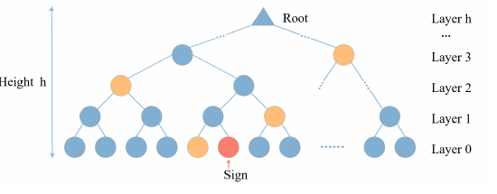

**Original caption:** Authentication Path of Merkle Tree.

**中文图注:** Merkle 树认证路径

**Reading note:** 图表用于核对相邻段落的结构或定量主张；批判性解读见独立分析报告。

### Fig. 2. LMS 总体结构

**Placed near:** p.5 S-LMS
**Source:** p.5 C-FIG-02

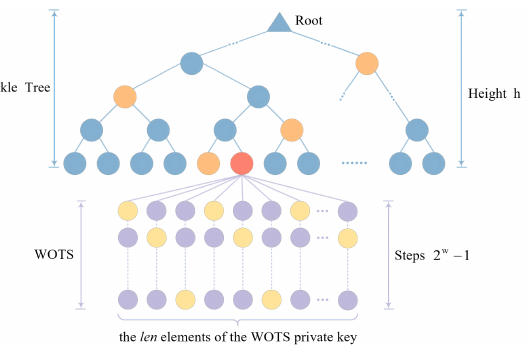

**Original caption:** LMS overall structure.

**中文图注:** LMS 总体结构

**Reading note:** 图表用于核对相邻段落的结构或定量主张；批判性解读见独立分析报告。

## Page 6

### 2.3.1 LMS Signature

**Source:** p.6 S021

**Original:** 2.3.1 LMS Signature

**中文:** 2.3.1 LMS签名

**Source:** p.6 S022

**Original:** The LMS signature, as shown in Equation (2), comprises five components: the type, a random string R, the OTS signature wots.sig, the leaf index q, and the Merkle tree authentication path path. The type is determined by the selected LMS parameters, while wots.sig and path are derived from and correspond to the specific leaf node indexed by q. LMS.sig = type ∥ R ∥ wots.sig ∥ q ∥ path 2.3.2

**中文:** 在方程 (2) 中所示的LMS签名包括五个组成部分:类型,随机字符串 R,OTS签名 wots.sig,叶子指数 q和Merkle树认证路径.类型由选定的LMS参数确定,而 wots.sig和路径是从q索引的特定叶节点中提取并相应的.LMS.sig = 类型  R  wots.sig  q 路径 2.3.2

**Source:** p.6 S023

**Original:** (2)

**中文:** (2) 其他

### Prefix

**Source:** p.6 S024

**Original:** Prefix

**中文:** 序列

**Source:** p.6 S025

**Original:** To ensure the security of hash computations, LMS incorporates a prefix into the hash input. The prefix typically consists of a key identifier I, a signature index q, and fixed constants used to distinguish different hash operations.

**中文:** 为了确保哈希计算的安全性,LMS在哈希输入中包含一个前置.预सर्ग通常由一个密钥标识符I,一个签名指数q和用于区分不同的哈希操作的固定常量组成.

### 2.4 XMSS

**Source:** p.6 S026

**Original:** 2.4 XMSS

**中文:** 2.4 XMSS

**Source:** p.6 S027

**Original:** The overall structure of XMSS, as illustrated in Figure 3, is a hierarchical construction comprising, from the bottom up, a variant of WOTS called WOTS+, L-trees, and a Merkle Tree. Notably, XMSS introduces an L-tree to replace the single hash operation used in LMS for compressing the WOTS+ public key. The L-tree has ⌈log2 len⌉ layers, with its leaf nodes being the len WOTS+ public key elements, and its root node serving as the corresponding leaf node in the Merkle Tree. Since len may be odd, the L-tree is an unbalanced binary tree. If the number of nodes at a level is odd, the last node is moved upward until it pairs with another node to perform hash computation for the next level.

**中文:** 如图3所示,XMSS的整体结构是一个层次结构,由底部上升组成,称为WOTS+,L树和Merkle树的WOTS变体.值得注意的是,XMSS引入了一个L-tree来取代LMS中用于压缩WOTS+公钥的单个哈希操作.L-树有log2 len层,其叶子节点是len WOTS+公共关键元素,其根节点是默克尔树中的相应叶子节点.由于len可能是奇怪的,所以L树是一个不平衡的二进制树.如果一个级别的节点数量是奇数的,最后一个节点将向上移动,直到它与另一个节点结合,以执行下一个级别的哈希计算.

**Source:** p.6 S028

**Original:** Figure 3: XMSS overall structure. Cyan nodes are assigned to the L-tree’s hash nodes, while the colors for all other node types are consistent with Figure 2.

**中文:** 图3:XMSS的整体结构Cyan 节点被分配给 L-trees 哈希节点,而其他所有节点类型的颜色与图2一致.

### 2.4.1 XMSS Signature

**Source:** p.6 S029

**Original:** 2.4.1 XMSS Signature

**中文:** 2.4.1 XMSS签名

**Source:** p.6 S030

**Original:** The XMSS signature, as shown in Equation (3), consists of four parts: signature index idx.sig, random string R, WOTS+ signature, and the Merkle tree authentication path.

**中文:** 在方程 (3) 中显示的XMSS签名由四部分组成:签名指数 idx.sig,随机字符串 R,WOTS+签名和Merkle树身份验证路径.

**Source:** p.6 E002 · Eq. (2)

$$
\mathrm{LMS.sig}=\mathrm{type}\parallel R\parallel\mathrm{wots.sig}\parallel q\parallel\mathrm{path}
$$

**中文说明：** LMS 签名格式；符号与连接顺序保持原式。

### Fig. 3. XMSS 总体结构

**Placed near:** p.6 S-XMSS
**Source:** p.6 C-FIG-03

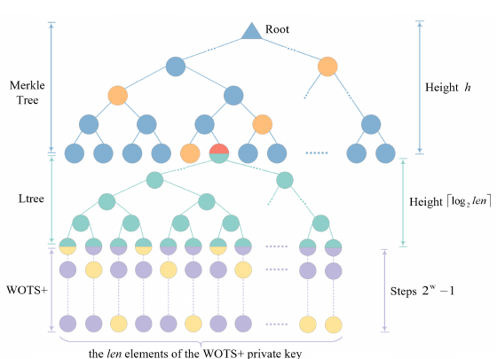

**Original caption:** XMSS overall structure.

**中文图注:** XMSS 总体结构

**Reading note:** 图表用于核对相邻段落的结构或定量主张；批判性解读见独立分析报告。

## Page 7

**Source:** p.7 S031

**Original:** Given that the WOTS+ signature shares the same structural format as the WOTS signature, the notation wots.sig is used generically throughout this paper to represent both. XMSS.sig = idx.sig ∥ R ∥ wots.sig ∥ path 2.4.2

**中文:** 由于WOTS+签名与WOTS签名具有相同的结构格式,因此在本文中使用 wots.sig标记来表示两者.XMSS.sig = idx.sig  R  wots.sig 路径 2.4.2

**Source:** p.7 S032

**Original:** (3)

**中文:** (3) 其他

### Prefix and Bitmask

**Source:** p.7 S033

**Original:** Prefix and Bitmask

**中文:** 预写和比特面具

**Source:** p.7 S034

**Original:** The architectural differences between LMS and XMSS primarily manifest in their input preparation for the hash function. For initial message compression, both schemes append a prefix to the input; however, the XMSS prefix is more complex, incorporating an n-bit random string R, the n-bit tree root, and a 4-byte signature index idxsig . For tree node computation, LMS simply concatenates the prefix with the node data. In contrast, XMSS implements a randomized hashing strategy: it generates a unique KEY and bitmask BM based on the current address ADRS and a public SEED. The node data must be XORed with BM before being concatenated with KEY for the final hash. If multiple data blocks are present, separate bitmasks are generated and XORed individually. The independent derivation of masks and prefixes in XMSS involves a more complex hashing sequence than in LMS. Consequently, XMSS offers superior resistance to certain collision attacks at the cost of reduced throughput.

**中文:** LMS和XMSS之间的建筑差异主要表现在它们为哈希函数的输入准备中.对于初始信息压缩,两种方案都将一个前置添加到输入中;然而,XMSS前更复杂,包括一个n-bit随机字符串R,n-bit树根和4byte签名指数idxsig.对于树节点计算,LMS简单地将前连接到节点数据.相比之下,XMSS实施了一种随机哈希策略:它基于当前地址ADRS和公共SEED生成了独特的KEY和bitmaskBM.结点数据必须与BMXOR before being concatenated with KEY for the final 哈希.如果存在多个数据区块,则生成单独的位面膜并单独XOR.在XMSS中,面具和前置的独立衍生涉及比LMS更复杂的哈希序列.因此,XMSS以降低吞吐量为代价,对某些碰撞攻击提供了优质的抵抗力.

### 2.5 SPHINCS+

**Source:** p.7 S035

**Original:** 2.5 SPHINCS+

**中文:** 2.5 SPHINCS+

**Source:** p.7 S036

**Original:** SPHINCS+ is structured as a hypertree composed of FORS (Forest Of Random Subset) and WOTS+ components, as illustrated in Figure 4. The signature process initiates at the bottom, where a message digest is signed by FORS. The resulting FORS root is then signed by the WOTS+ key pair of the bottom XMSS layer (Layer 0). This hierarchical signing continues upward, where the root of each XMSS tree at layer i is signed by a WOTS+ instance at layer i + 1, eventually reaching the global root. 2.5.1

**中文:** SPHINCS+ 结构为一个由FORS (Forest Of Random Subset) 和WOTS+组件组成的超树,如图4所示.签名过程始于底部,其中一个信息被FORS签名.结果的FORS根则由底层XMSS (层0) 的WOTS+键对签名.这种层次签名继续上升,每个XMSS树的根在层i被一个WOTS+实例在层i+1签名,最终达到全球根. 2.5.1

### FORS

**Source:** p.7 S037

**Original:** FORS

**中文:** 强力

**Source:** p.7 S038

**Original:** FORS can be viewed as K parallel Merkle trees of identical height. The roots of K trees are hashed together to generate the final n-bit FORS root (public key). The FORS signature consists of the signatures of all K subtrees, each sig.subtreei comprising the subtree’s private key sk.forsi and authentication path fors.pathi , as expressed in Equation (4). FORS.sig = sig.subtree0 ∥ · · · ∥ sig.subtreek−1 = sk.fors0 ∥ fors.path0 ∥ · · ·

**中文:** 强力可以被视为同等高度的K平行Merkle树.基树的根被拼接在一起生成最终的n-bit FORS根 (公钥).FORS签名由所有K子树的签名组成,每个子树的签名包括子树的私钥sk.forsi和认证路径for.pathi,如方程 (4) 中表达.标签: 标签: 标签: 标签: 标签: 标签:

**Source:** p.7 S039

**Original:** (4)

**中文:** (4) 其他

**Source:** p.7 S040

**Original:** ∥ sk.forsk−1 ∥ fors.pathk−1 2.5.2

**中文:** sk.forsk-1  fors.pathk-1 2.5.2

### SPHINCS+ Signature

**Source:** p.7 S041

**Original:** SPHINCS+ Signature

**中文:** SPHINCS+签名

**Source:** p.7 S042

**Original:** As formalized in Equation (5), the SPHINCS+ signature consists of three parts: a random string R, a FORS signature FORS.sig, and a hypertree signature HT.sig. SPHINCS + .sig = R ∥ FORS.sig ∥ HT.sig

**中文:** 在方程 (5) 中正式化,SPHINCS+签名由三个部分组成:一个随机字符串 R,一个 FORS签名 FORS.sig和一个 hypertree签名 HT.sig.SPHINCS + .sig = R  FORS.sig  HT.sig

**Source:** p.7 S043

**Original:** (5)

**中文:** (5)

**Source:** p.7 S044

**Original:** The hypertree signature HT.sig aggregates authentication data from all D layers, each contribution being an XMSS signature XMSS.sigi that includes a WOTS+ signature wots.sigi and a Merkle path pathi , shown in the following Equation (6): HT.sig = XMSS.sig0 ∥ · · · ∥ XMSS.sigD−1 where XMSS.sigi = wots.sigi ∥ pathi for layer i.

**中文:** 超树签名HT.sig集成所有D层的身份验证数据,每个贡献都是XMSS签名XMSS.sigi,其中包括一个WOTS+签名 wots.sigi和一个 Merkle路径 pathhi,如下方程 (6):HT.sig = XMSS.sig0  · · ·  XMSS.sigD−1,其中XMSS.sigi = wots.sigi  pathhi为层i.

**Source:** p.7 S045

**Original:** (6)

**中文:** (六)

**Source:** p.7 E003 · Eq. (3)

$$
\mathrm{XMSS.sig}=\mathrm{idx.sig}\parallel R\parallel\mathrm{wots.sig}\parallel\mathrm{path}
$$

**中文说明：** XMSS 签名格式；符号与连接顺序保持原式。

**Source:** p.7 E004 · Eq. (4)

$$
\begin{aligned}\mathrm{FORS.sig}&=\mathrm{sig.subtree}_0\parallel\cdots\parallel\mathrm{sig.subtree}_{k-1}\\&=\mathrm{sk.fors}_0\parallel\mathrm{fors.path}_0\parallel\cdots\parallel\mathrm{sk.fors}_{k-1}\parallel\mathrm{fors.path}_{k-1}\end{aligned}
$$

**中文说明：** FORS 签名格式；符号与连接顺序保持原式。

**Source:** p.7 E005 · Eq. (5)

$$
\mathrm{SPHINCS{+}.sig}=R\parallel\mathrm{FORS.sig}\parallel\mathrm{HT.sig}
$$

**中文说明：** SPHINCS+ 签名格式；符号与连接顺序保持原式。

**Source:** p.7 E006 · Eq. (6)

$$
\begin{aligned}\mathrm{HT.sig}&=\mathrm{XMSS.sig}_0\parallel\cdots\parallel\mathrm{XMSS.sig}_{D-1},\\\mathrm{XMSS.sig}_i&=\mathrm{wots.sig}_i\parallel\mathrm{path}_i\end{aligned}
$$

**中文说明：** 超树签名格式；符号与连接顺序保持原式。

## Page 8

### Merkle Tree

**Source:** p.8 S046

**Original:** Merkle Tree

**中文:** Merkle树

**Source:** p.8 S047

**Original:** ··· Layer D-1

**中文:** ··· D-1层

### WOTS+

**Source:** p.8 S048

**Original:** WOTS+

**中文:** 工业化技术

**Source:** p.8 S049

**Original:** ··· ··· ··· Layer 1~D-2

**中文:** ··········· 层1~D-2

### Merkle Tree

**Source:** p.8 S050

**Original:** Merkle Tree

**中文:** Merkle树

### WOTS+

**Source:** p.8 S051

**Original:** WOTS+

**中文:** 工业化技术

**Source:** p.8 S052

**Original:** ··· Layer 0

**中文:** ··· 层0

**Source:** p.8 S053

**Original:** ··· ··· ···

**中文:** ·········

**Source:** p.8 S054

**Original:** ··· ··· ···

**中文:** ·········

**Source:** p.8 S055

**Original:** FORS ···

**中文:** 强力

**Source:** p.8 S056

**Original:** ···

**中文:** ····

**Source:** p.8 S057

**Original:** ···

**中文:** ····

**Source:** p.8 S058

**Original:** Figure 4: SPHINCS+ overall structure. The green nodes denote the hash nodes within the FORS Tree, with all other node colors established in Figure 2.

**中文:** 图4:SPHINCS+的整体结构绿色节点表示FORS树内的哈希节点,所有其他节点颜色都建立在图2.

### 2.6 Parameter Sets

**Source:** p.8 S059

**Original:** 2.6 Parameter Sets

**中文:** 2.6 参数组

**Source:** p.8 S060

**Original:** LMS, XMSS, and SPHINCS+ support standardized hash functions, including SHA-2 and SHAKE256[NIS22, CAD+ 20]. The summary of parameters for these schemes is shown in Table 1 and Table 2, where all the security levels are included.

**中文:** LMS,XMSS和SPHINCS+支持标准化哈希函数,包括SHA-2和SHAKE256[NIS22,CAD+ 20].这些方案的参数总结在表1和表2中显示,其中包含了所有安全水平.

### 2.7 Commonality Analysis

**Source:** p.8 S061

**Original:** 2.7 Commonality Analysis

**中文:** 2.7 共同性分析

**Source:** p.8 S062

**Original:** Based on the above descriptions, the three signature schemes exhibit significant similarities. On one hand, all underlying operations rely solely on hash functions, which implies that in hardware implementations, the hash module can be shared across different schemes without conflict. On the other hand, from a structural perspective, all three schemes rely on OTS and Merkle trees as fundamental components, with their signatures comprising OTS signatures and Merkle tree authentication paths. This structural commonality suggests that these components can be reused across schemes, which not only reduces hardware overhead but also significantly enhances area-efficiency.

**中文:** 根据上述描述,三个签名方案具有显著的相似性.一方面,所有底层操作都完全依赖于哈希函数,这意味着在硬件实现中,哈希模块可以在不同方案中共享而无冲突.另一方面,从结构角度来看,这三个方案都依赖于OTS和Merkle树作为基本组成部分,其签名包括OTS签名和Merkle树认证路径.这种结构性共同性表明,这些组件可以在各种方案中重复使用,这不仅减少了硬件总费用,而且显著提高了面积效率.

### Fig. 4. SPHINCS+ 总体结构

**Placed near:** p.7 S-SPHINCS
**Source:** p.8 C-FIG-04

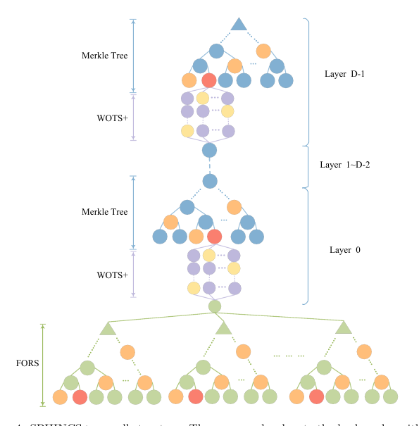

**Original caption:** SPHINCS+ overall structure.

**中文图注:** SPHINCS+ 总体结构

**Reading note:** 图表用于核对相邻段落的结构或定量主张；批判性解读见独立分析报告。

## Page 9

**Source:** p.9 S063

**Original:** Table 1: Parameters Set in XMSS/LMS Scheme

**中文:** 表格见本页对应图像卡。

**Source:** p.9 S064

**Original:** n

**中文:** 其他

**Source:** p.9 S065

**Original:** w

**中文:** 其他

### len

**Source:** p.9 S066

**Original:** len

**中文:** 雷恩

**Source:** p.9 S067

**Original:** h

**中文:** 

### XMSS

**Source:** p.9 S068

**Original:** XMSS

**中文:** 电子邮件

**Source:** p.9 S069

**Original:** 32 32

**中文:** 32 32

**Source:** p.9 S070

**Original:** 2 4

**中文:** 2 4

**Source:** p.9 S071

**Original:** 133 67

**中文:** 133 67

**Source:** p.9 S072

**Original:** {10, 16, 20} {10, 16, 20}

**中文:** 现在,我们要做什么呢?

### LMS

**Source:** p.9 S073

**Original:** LMS

**中文:** LMS

**Source:** p.9 S074

**Original:** 32 32 32 32

**中文:** 32 32 32 32

**Source:** p.9 S075

**Original:** 1 2 4 8

**中文:** 1 2 4 8

**Source:** p.9 S076

**Original:** 265 133 67 34

**中文:** 265 133 67 34

**Source:** p.9 S077

**Original:** {5, 10, 15, 20, 25} {5, 10, 15, 20, 25} {5, 10, 15, 20, 25} {5, 10, 15, 20, 25}

**中文:** {5, 10, 15, 20, 25} {5, 10, 15, 20, 25} {5, 10, 15, 20, 25} {5, 10, 15, 20, 25}

**Source:** p.9 S078

**Original:** Table 2: Parameters Set in SPHINCS+ Scheme

**中文:** 表格见本页对应图像卡。

**Source:** p.9 S079

**Original:** n

**中文:** 其他

### len

**Source:** p.9 S080

**Original:** len

**中文:** 雷恩

**Source:** p.9 S081

**Original:** ω

**中文:** ω

**Source:** p.9 S082

**Original:** k

**中文:** 其他

**Source:** p.9 S083

**Original:** a

**中文:** 一个

**Source:** p.9 S084

**Original:** h

**中文:** 

**Source:** p.9 S085

**Original:** d

**中文:** 其他

**Source:** p.9 S086

**Original:** SPHINCS+128-f SPHINCS+192-f SPHINCS+256-f SPHINCS+128-s SPHINCS+192-s SPHINCS+256-s

**中文:** 鱼+128-f鱼+192-f鱼+256-f鱼+128-s鱼+192-s鱼+256-s

**Source:** p.9 S087

**Original:** 128 192 256 128 192 256

**中文:** 128 192 256 128 192 256

**Source:** p.9 S088

**Original:** 35 51 67 35 51 67

**中文:** 35 51 67 35 51 67

**Source:** p.9 S089

**Original:** 4 4 4 4 4 4

**中文:** 4 4 4 4 4 4

**Source:** p.9 S090

**Original:** 33 33 35 14 17 22

**中文:** 33 33 35 14 17 22

**Source:** p.9 S091

**Original:** 6 8 12 14 14

**中文:** 6 8 12 14 14

**Source:** p.9 S092

**Original:** 3 3 4 8

**中文:** 3 3 4 8

**Source:** p.9 S093

**Original:** 22 22 17 7 7 8

**中文:** 22 22 17 7 7 8

### 3 Proposed Hardware Architecture

**Source:** p.9 S094

**Original:** 3 Proposed Hardware Architecture

**中文:** 3 拟议的硬件架构

### 3.1 Top-Level Architecture

**Source:** p.9 S095

**Original:** 3.1 Top-Level Architecture

**中文:** 3.1 顶级建筑

**Source:** p.9 S096

**Original:** To achieve efficient and flexible hash-based signature processing, we have constructed a task-based unified hardware architecture. The core idea of this architecture is to decompose the SPHINCS+, XMSS, and LMS signature algorithms into a series of coarse-grained hash tasks, which are scheduled by a unified controller while maximizing hardware resource reuse. message

**中文:** 为了实现高效和灵活的基于哈希的签名处理, 我们建立了一个基于任务的统一硬件架构.该架构的核心想法是将SPHINCS+,XMSS和LMS签名算法分解成一系列粗粒度的哈希任务,这些任务由统一控制器安排,同时最大限度地重复硬件资源使用.

### Message FIFO

**Source:** p.9 S097

**Original:** Message FIFO

**中文:** 信息 FIFO

**Source:** p.9 S098

**Original:** M

**中文:** 其他

### HASH LOOP0

**Source:** p.9 S099

**Original:** HASH LOOP0

**中文:** 哈什

### HASH LOOP1

**Source:** p.9 S100

**Original:** HASH LOOP1

**中文:** 哈什1

**Source:** p.9 S101

**Original:** seed task_type hash_mode ram_out

**中文:** 种子任务_类型哈希_模式ram_out

**Source:** p.9 S102

**Original:** Control ram_enb Unit ram_addrb

**中文:** 控制 ram_enb 控制组 ram_addrb

**Source:** p.9 S103

**Original:** HASH_OUT

**中文:** 除

### Memory

**Source:** p.9 S104

**Original:** Memory

**中文:** 记忆

**Source:** p.9 S105

**Original:** ram_ena ram_addra

**中文:** 拉姆_拉姆_阿德拉

**Source:** p.9 S106

**Original:** SIG_OUT

**中文:** 出

**Source:** p.9 S107

**Original:** PK_ROOT

**中文:** 标签:

### Post Process

**Source:** p.9 S108

**Original:** Post Process

**中文:** 后期过程

**Source:** p.9 S109

**Original:** task_type, iter_counter

**中文:** 任务类型,代码表

**Source:** p.9 S110

**Original:** task_done

**中文:** 完成任务

**Source:** p.9 S111

**Original:** Figure 5: Overall hardware architecture. The top-level architecture for our design is shown in Figure 5. The main blocks are: 1. HASH LOOP0/1: Two parallel hash engines that process M, seed, and other input components, then write back the results as hash_out to memory. 2. Control Unit: Manages the internal counters related to task control, issues control signals to subordinate modules, and drives the memory read port (ram_enb, ram_addrb).

**中文:** 图5:整体硬件架构.我们设计的顶级架构如图5所示.主要的区块是: 1.哈什LOOP0/1:两个平行哈希发动机处理M,种子和其他输入组件,然后将结果写回为哈希_out到内存.控制单元:管理与任务控制相关的内部计数器,向下属模块发出控制信号,并驱动内存读取端口 (ram_enb,ram_addrb).

### Fig. 5. 顶层统一硬件架构

**Placed near:** p.9 S-TOP
**Source:** p.9 C-FIG-05

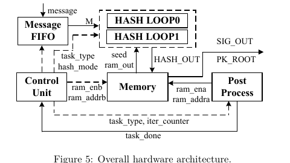

**Original caption:** Overall hardware architecture.

**中文图注:** 顶层统一硬件架构

**Reading note:** 图表用于核对相邻段落的结构或定量主张；批判性解读见独立分析报告。

### Table 1. XMSS/LMS 参数集

**Placed near:** p.8 S-PARAM
**Source:** p.9 C-TAB-01

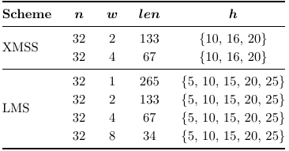

**核对补充：** [可复制表格、数据与说明](Extracted_Data_and_Analysis.md#audit-table1)。

**Original caption:** Parameters Set in XMSS/LMS

**中文图注:** XMSS/LMS 参数集

**Reading note:** 图表用于核对相邻段落的结构或定量主张；批判性解读见独立分析报告。

### Table 2. SPHINCS+ 参数集

**Placed near:** p.8 S-PARAM
**Source:** p.9 C-TAB-02

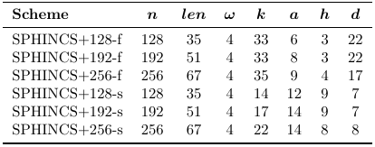

**核对补充：** [可复制表格、数据与说明](Extracted_Data_and_Analysis.md#audit-table2)。

**Original caption:** Parameters Set in SPHINCS+

**中文图注:** SPHINCS+ 参数集

**Reading note:** 图表用于核对相邻段落的结构或定量主张；批判性解读见独立分析报告。

## Page 10

**Source:** p.10 S112

**Original:** 10 A Unified Hardware Architecture for Stateful and Stateless Hash-Based Key/Signature Generations

**中文:** 10 一个统一的硬件架构,适用于全国和无国产的基于哈希的钥匙/签字代

**Source:** p.10 S113

**Original:** 3. Memory: Two dual-port memories are adopted to decouple the Control Unit’s read operations from the hash engines’ write-back cycles, effectively eliminating structural hazards. These two memories are dedicated to intermediate node storage and signature result buffering, respectively. Consequently, results from signing or key generation (SIG_OU T, P K_ROOT ) are also temporarily buffered here before being streamed out. 4. Message FIFO: Buffers incoming messages and streams the word sequence M to the hash datapath in 64-bit words. 5. Post Process: Receives iter_counter from the Control Unit to determine task completion and asserts task_done. Concurrently, it drives the memory write port (ram_ena, ram_addra) based on task type and counter signals. More details about them are shown below.

**中文:** 3. 如何?存储器:采用两个双端口存储器,将控制单元的读取操作与哈希发动机的回写周期分离开来,有效地消除结构危险.这些两个记忆分别用于中间节点存储和签名结果缓冲.因此,签名或密钥生成的结果 (SIG_OU T, P K_ROOT) 在流出之前也会暂时缓冲.信息FIFO:缓冲接入的消息,并将单词序列M传输到哈希数据路径,以64位单词.后进程:从控制单元接收iter_counter来确定任务完成,并确认task_done.同时,它根据任务类型和反信号驱动内存写端口 (ram_ena,ram_addra).更多详细信息如下.

### 3.2 HASH LOOP

**Source:** p.10 S114

**Original:** 3.2 HASH LOOP

**中文:** 3.2 哈什循环

**Source:** p.10 S115

**Original:** The HASH LOOP modules constitute the computational core of the accelerator, consisting of two engines operating in parallel, as depicted in Figure 6. HASH LOOP1 HASH Input Components: ram_out, seed,address

**中文:** 如图6所示,HASH LOOP模块构成加速器的计算核心,由两个并行运行的发动机组成.输入组件:ram_out,种子,地址

**Source:** p.10 S116

**Original:** HASH LOOP0 HASH Input Components: ram_out, seed, message,address hash_out’ots_sk

**中文:** 输入组件:ram_out,种子,消息,地址 哈希_outots_sk

### MUX

**Source:** p.10 S117

**Original:** MUX

**中文:** 酸盐

### ots task high-speed input logic

**Source:** p.10 S118

**Original:** ots task high-speed input logic

**中文:** 的任务高速度输入逻辑

### M bits

**Source:** p.10 S119

**Original:** M bits

**中文:** 密码

### chi

**Source:** p.10 S120

**Original:** chi

**中文:** 子

**Source:** p.10 S121

**Original:** π

**中文:** π

**Source:** p.10 S122

**Original:** ρ

**中文:** 

**Source:** p.10 S123

**Original:** θ

**中文:** 

### lota

**Source:** p.10 S124

**Original:** lota

**中文:** 子

### chi

**Source:** p.10 S125

**Original:** chi

**中文:** 子

**Source:** p.10 S126

**Original:** π

**中文:** π

**Source:** p.10 S127

**Original:** ρ

**中文:** 

**Source:** p.10 S128

**Original:** θ

**中文:** 

### Keccak1

**Source:** p.10 S129

**Original:** Keccak1

**中文:** 子1

**Source:** p.10 S130

**Original:** ρ

**中文:** 

**Source:** p.10 S131

**Original:** 1088bits

**中文:** 1088位

**Source:** p.10 S132

**Original:** π

**中文:** π

### chi

**Source:** p.10 S133

**Original:** chi

**中文:** 子

### M bits

**Source:** p.10 S134

**Original:** M bits

**中文:** 密码

**Source:** p.10 S135

**Original:** 512bits(0)

**中文:** 512比特)

### lota

**Source:** p.10 S136

**Original:** lota

**中文:** 子

**Source:** p.10 S137

**Original:** hash_out

**中文:** _出

**Source:** p.10 S138

**Original:** θ

**中文:** 

### Keccak0

**Source:** p.10 S139

**Original:** Keccak0

**中文:** 子

### MUX

**Source:** p.10 S140

**Original:** MUX

**中文:** 酸盐

**Source:** p.10 S141

**Original:** ρ

**中文:** 

**Source:** p.10 S142

**Original:** 1088bits

**中文:** 1088位

**Source:** p.10 S143

**Original:** task_type

**中文:** 任务_类型

### MUX pad shift input logic

**Source:** p.10 S144

**Original:** MUX pad shift input logic

**中文:** MUX pad 转换输入逻辑

**Source:** p.10 S145

**Original:** π

**中文:** π

**Source:** p.10 S146

**Original:** task_type

**中文:** 任务_类型

### chi

**Source:** p.10 S147

**Original:** chi

**中文:** 子

**Source:** p.10 S148

**Original:** 512bits(0)

**中文:** 512比特)

### MUX

**Source:** p.10 S149

**Original:** MUX

**中文:** 酸盐

### lota

**Source:** p.10 S150

**Original:** lota

**中文:** 子

**Source:** p.10 S151

**Original:** θ

**中文:** 

### pad shift input logic

**Source:** p.10 S152

**Original:** pad shift input logic

**中文:** 位转换输入逻辑

**Source:** p.10 S153

**Original:** 12cc

**中文:** 12cc

**Source:** p.10 S154

**Original:** hash_num

**中文:** 号

### MUX

**Source:** p.10 S155

**Original:** MUX

**中文:** 酸盐

### lota

**Source:** p.10 S156

**Original:** lota

**中文:** 子

**Source:** p.10 S157

**Original:** task_type

**中文:** 任务_类型

**Source:** p.10 S158

**Original:** 12cc

**中文:** 12cc

**Source:** p.10 S159

**Original:** hash_out

**中文:** _出

**Source:** p.10 S160

**Original:** Figure 6: Architecture of the HASH LOOP module.

**中文:** 图6:HASH LOOP模块的架构

### 3.2.1 Keccak Core

**Source:** p.10 S161

**Original:** 3.2.1 Keccak Core

**中文:** 3.2.1 基卡克核心

**Source:** p.10 S162

**Original:** Our architecture supports SHAKE256-based HBS schemes. Specifically, the hash engine in the HASH LOOP module is a highly optimized iterative unit that integrates a Keccakp[1600] core with an unrolling factor of 2 and a hash-input logic (HIL) that supports both 64-bit streaming and rate-wide (1088-bit) loading modes. Rationale for SHAKE-Only Support In our design, we exclusively support SHAKE256 as the underlying hash function for HBS. While SHA-2 remains a common alternative, we prioritize SHAKE256 for the following three reasons:

**中文:** 我们的架构支持基于SHAKE256的HBS计划.具体来说,HASH LOOP模块中的哈希引擎是一个高度优化的反复单元,它集成了Keccakp[1600]核心,其滚动因子为2和哈希输入逻辑 (HIL) 支持64位流媒体和速率宽 (1088位) 加载模式.在我们的设计中,我们完全支持SHAKE256作为HBS的底层哈希函数.虽然SHA-2仍然是一个常见的替代方案,但我们优先考虑SHAKE256为以下三个原因:

### Fig. 6. HASH LOOP 计算模块

**Placed near:** p.10 S-HASHLOOP
**Source:** p.10 C-FIG-06

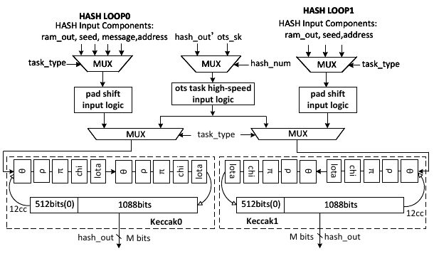

**Original caption:** Architecture of the HASH LOOP module.

**中文图注:** HASH LOOP 计算模块

**Reading note:** 图表用于核对相邻段落的结构或定量主张；批判性解读见独立分析报告。

## Page 11

**Source:** p.11 S163

**Original:** Table 3: Measured slice, time, and ATP values under different parallelism and unrolling factors for LMS ($\mathrm{len}=133,\ \omega=2,\ h=10$) U =1

**中文:** 表格见本页对应图像卡。

### P 1 2 3 4 6 8

**Source:** p.11 S164

**Original:** P 1 2 3 4 6 8

**中文:** P 1 2 3 4 6 8

**Source:** p.11 S165

**Original:** U =2

**中文:** U=2

### SLICE

**Source:** p.11 S166

**Original:** SLICE

**中文:** 切片

### TIME

**Source:** p.11 S167

**Original:** TIME

**中文:** 时间

### ATP

**Source:** p.11 S168

**Original:** ATP

**中文:** 排放量

### SLICE

**Source:** p.11 S169

**Original:** SLICE

**中文:** 切片

### TIME

**Source:** p.11 S170

**Original:** TIME

**中文:** 时间

### ATP

**Source:** p.11 S171

**Original:** ATP

**中文:** 排放量

**Source:** p.11 S172

**Original:** 7601.41 10807.48 13647.41 16487.35 22167.23 27847.10

**中文:** 7601.41 10807.48 13647.41 16487.35 22167.23 27847.10

**Source:** p.11 S173

**Original:** 80.36 50.40 40.20 35.43 30.44 27.71

**中文:** 80.36 50.40 40.20 35.43 30.44 27.71

**Source:** p.11 S174

**Original:** 61.09 54.47 54.86 58.41 67.48 77.16

**中文:** 61.09 54.47 54.86 58.41 67.48 77.16

**Source:** p.11 S175

**Original:** 8395.66 11601.73 14838.79 18075.85 24549.98 31024.10

**中文:** 8395.66 11601.73 14838.79 18075.85 24549.98 31024.10

**Source:** p.11 S176

**Original:** 49.85 35.03 29.88 27.63 25.16 23.81

**中文:** 49.85 35.03 29.88 27.63 25.16 23.81

**Source:** p.11 S177

**Original:** 41.85 40.64 44.34 49.94 61.78 73.86

**中文:** 41.85 40.64 44.34 49.94 61.78 73.86

**Source:** p.11 S178

**Original:** a The row (P ) represents the degree of parallelism, and the column

**中文:** a 行 (P) 表示平行程度,列

**Source:** p.11 S179

**Original:** grouping (U ) represents the expansion series.

**中文:** 集成 (U) 表示扩展系列.

**Source:** p.11 S180

**Original:** • Security Strength: SHAKE256 and SHA-2, when instantiated with 256-bit outputs, provide comparable security: about 128-bit collision resistance and 256-bit preimage resistance. • Performance Advantage: SHAKE256 provides superior throughput due to its larger block size (rate) and a more hardware-friendly sponge construction. Compared to the Merkle-Damgård (MD) construction of SHA-2, the sponge structure exhibits shorter critical paths in high-performance implementations. • Engineering Synergy: Our hardware stack—including the low-level keccak core, the parallelized HASH LOOP modules, and the specific parameter sets for SPHINCS+ , XMSS, and LMS—is deeply co-optimized for the SHAKE256 structure. This unified engineering approach maximizes resource reuse and minimizes control overhead across different HBS schemes. Analysis of the “dual-parallel, unroll-2” Architecture The three target HBS algorithms exhibit a fundamental computational dichotomy: Parallelizable Tasks (PTs), such as Merkle node generation across the same layer, and Data-Dependent Tasks (DDTs), such as message digesting and hash computation within a single OTS chain. These tasks impose conflicting optimization priorities: PTs demand high-throughput via parallelized hash cores to maximize concurrent processing, whereas DDTs necessitate minimized execution latency (fewer clock cycles) due to their inherent sequential dependencies (Hash(Hash(. . . ))), which render traditional pipelining ineffective for single-chain acceleration. Therefore, we propose the “Dual-Parallel, Unroll-2” architecture as a strategic tradeoff. Compared to a baseline single hash core, it can achieve about 4× and 2× faster speed for PTs and DDTs, respectively. We adopt the parallelism + unrolling strategy over interleaved pipelining for two reasons. First, pipelining prioritizes aggregate throughput at the cost of single-task latency. Since HBS protocols involve strict sequential dependencies (DDTs), our unroll-2 architecture is superior as it directly compresses the total cycle count, minimizing the latency required for DDTs. Second, interleaved pipelining incurs substantial area overhead due to the numerous registers needed for intermediate states, which contradicts our resource-efficient goal. Regarding the selection of the unrolling factor (U ) and parallelism level (P ), we justify our design by evaluating the ATP of LMS with len=133, ω=2, and h=10 under various configurations. Although only one LMS parameter set is reported, it is representative in that it follows the standard HBS workflow and exercises the dominant operations and memory-access patterns of the stateful HBS family, including frequent OTS-related

**中文:** • 安全性强度:SHAKE256和SHA-2,当使用256位输出时,提供可比较的安全性:约128位碰撞阻力和256位预像阻力. • 性能优势:SHAKE256由于其更大的块大小 (速度) 和更具硬件友好性的海绵结构,提供了更高的吞吐量.与SHA-2的Merkle-Damgård (MD) 构建相比,海绵结构在高性能实现中表现出更短的关键路径. •工程协同性:我们的硬件堆,包括低级基卡核心,并行 HASH LOOP模块和SPHINCS+ ,XMSS和LMS的特定参数组,对SHAKE256结构进行了深度合作优化.这种统一的工程方法最大限度地利用资源,减少了不同HBS方案的控制费用.双平行分析,解卷-2架构 三个目标HBS算法表现出了基本的计算两性:平行化任务 (PTs),如在同一层的默克尔节点生成,以及数据依赖任务 (DDT),如信息消化和在单个OTS链内哈希计算.这些任务对优化优先事项产生冲突:PTs需要通过并行化哈希核心进行高吞吐量,以最大限度地同时处理,而DDT由于其固有的连续依赖性 (Hash(Hash(. . . .) 需要最小化执行延迟,这使传统的管道对单链加速效果低下.因此,我们提出了"双平行,无滚动-2"架构作为战略交易.与基线单个哈希核心相比,它可以分别为PT和DDT实现4×和2×更快的速度.我们采用了平行性+不滚动的战略,首先,管道将总量吞吐量放在一个任务延迟成本上.由于HBS协议涉及严格的连续依赖性 (DDT),我们的解卷-2架构是优越的,因为它直接压缩了总周期数量,减少了DDT所需的延迟.其次,由于中间国家所需的大量注册, 互管道承担了大量的面积上海费用,对于起因子 (U) 和平行性水平 (P) 的选择,我们通过在各种配置中评估LMS的ATP为len=133, ω=2,和h=10来证明我们的设计.虽然只报告了一个LMS参数集合,但它是代表性的,因为它遵循标准HBS工作流程,并执行了状态性HBS家族的主导操作和内存访问模式,包括频繁的OTS相关

### Table 3. 并行度与展开因子的消融

**Placed near:** p.11 S-PU
**Source:** p.11 C-TAB-03

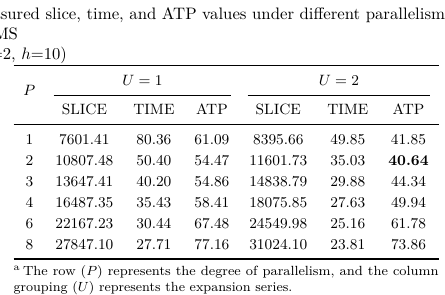

**Original caption:** Measured slice, time, and ATP under parallelism/unrolling choices

**中文图注:** 并行度与展开因子的消融

**Reading note:** 图表用于核对相邻段落的结构或定量主张；批判性解读见独立分析报告。

## Page 12

**Source:** p.12 S181

**Original:** 12 A Unified Hardware Architecture for Stateful and Stateless Hash-Based Key/Signature Generations

**中文:** 12 一个统一的硬件架构,适用于具有国家和无国家身份的按键/签名世代

**Source:** p.12 S182

**Original:** hashing and extensive intermediate-state handling. Specifically, we examine parallelism levels P ∈ {1, 2, 3, 4, 6, 8} and unrolling factors U ∈ {1, 2}. The rationale for limiting U to 2 is rooted in timing constraints: at U = 2, the critical path resides within the control logic; however, the U = 3 configuration shifts this path into the Keccak core logic. Consequently, any further unrolling would significantly extend the critical path, leading to a substantial degradation in operating frequency. Experimental results in Table 3 demonstrate that the proposed architecture achieves an optimal balance between performance and resource efficiency when U = 2 and P = 2. First, the U = 2 configuration effectively mitigates the sequential bottlenecks inherent in DDTs by executing two rounds of operations within a single clock cycle, resulting in a substantial reduction in the time metric compared to U = 1. Second, regarding the degree of parallelism, as shown in Figure 7, under U = 2, the ATP first decreases with increasing parallelism and reaches its minimum at P = 2, after which further increasing P leads to a monotonic ATP degradation due to rapidly growing resource overhead. Therefore, (P, U ) = (2, 2) is selected as the optimal design point, achieving the best trade-off between performance gain and hardware cost.

**中文:** 哈希和广泛的中间状态处理.具体来说,我们检查了平行性水平 P ∈ {1, 2, 3, 4, 6, 8} 和不滚动因子 U ∈ {1, 2}.限制U到2的理性源于时间限制:在U=2时,关键路径位于控制逻辑内;然而,U = 3配置将这个路径转移到凯卡克核心逻辑中.因此,任何进一步的推移将显著延长关键路径,导致运行频率大幅下降.在表3中的实验结果表明,当U=2和P=2时,拟议的架构实现性能和资源效率之间的最佳平衡.首先,U = 2配置通过在一个钟周期内执行两轮操作,有效缓解DDT固有的连续瓶,从而与U = 1相比大幅减少时间指标.其次,如图7所示,U=2下的平行程度,ATP首先随着增加的平行性而下降,达到P=2的最低值,之后进一步增加P导致由于资源上的快速增长,ATP的单调降解.因此, (P, U ) = (2, 2) 选为最佳设计点,实现性能增长和硬件成本之间的最佳权衡.

**Source:** p.12 S183

**Original:** Figure 7: ATP across parallelism under unrolling factor 1 and 2 for LMS ($\mathrm{len}=133,\ \omega=2,\ h=10$)

**中文:** 图7:为LMS ($\mathrm{len}=133,\ \omega=2,\ h=10$) 的脱滚因子1和2下的平行性ATP

### 3.2.2 Hash Input Logic

**Source:** p.12 S184

**Original:** 3.2.2 Hash Input Logic

**中文:** 3.2.2 哈希输入逻辑

**Source:** p.12 S185

**Original:** Implementing HBS hardware necessitates a trade-off between the high-throughput requirements of OTS chains—which account for over 80% of the total workload—and the flexibility demanded by diverse tasks such as message compression and tree computation. This challenge is further intensified when unifying SPHINCS+, XMSS, and LMS, as a universal flexible path would introduce excessive latency, while fully dedicated paths for every task would lead to prohibitive area overhead and reduced clock frequency. To resolve this, we propose an asymmetric dual-path Hash Input Logic (HIL) as shown in Figure 8. By decoupling the execution into a specialized high-speed channel for OTS operations and a resource-efficient, versatile lane for miscellaneous tasks, our design achieves an optimal balance between processing speed and hardware economy. Dedicated high-speed path for OTS For the OTS chain tasks, which dominate the computation, the hash input data format is fixed and constructed by concatenating multiple components. To achieve maximal data feeding efficiency, we implemented a dedicated 1088-bit wide OTS input register for OTS chain tasks, which matches the Keccak rate. This allows all components for a single hash absorption operation to achieve a single-cycle input supply. Furthermore, to maximize resource utilization, the two parallel Keccak

**中文:** 实现HBS硬件需要对OTS链的高吞吐量要求进行比较,这些链占总工作负载的80%以上,以及信息压缩和树计算等各种任务所需的灵活性.统一SPHINCS+,XMSS和LMS时,这一挑战将进一步加剧,因为一个普遍的灵活路径将引入过度延迟,而每个任务的完全专用路径将导致限制区域空费和减少时钟频率.为了解决这个问题,我们提出了一个不对称的双路线哈希输入逻辑 (HIL),如图8所示.通过将执行分离为OTS运营的专业高速通道和用于各种任务的资源高效,多功能车道,我们的设计实现了处理速度和硬件经济之间的最佳平衡.专用OTS高速路径 对于统治计算的OTS链任务,哈希输入数据格式通过连接多个组件来固定和构建.为了实现最大的数据传输效率,我们为OTS链任务实施了专门的1088位宽的OTS输入登记器,这允许所有用于单个哈希吸收操作的组件实现单周期输入供应.此外,为了最大限度地利用资源,

### Fig. 7. LMS 在 U=1/2 下随并行度变化的 ATP

**Placed near:** p.12 S-DESIGNPOINT
**Source:** p.12 C-FIG-07

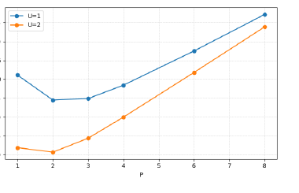

**Original caption:** ATP across parallelism under unrolling factor 1 and 2 for LMS ($\mathrm{len}=133,\ \omega=2,\ h=10$).

**中文图注:** LMS 在 U=1/2 下随并行度变化的 ATP

**Reading note:** 图表用于核对相邻段落的结构或定量主张；批判性解读见独立分析报告。

## Page 13

**Source:** p.13 S186

**Original:** pad_pice mpice

**中文:** 标签: 标签

### ifpad pad shifter 0

**Source:** p.13 S187

**Original:** ifpad pad shifter 0

**中文:** 如果padpadpad转换器 0

**Source:** p.13 S188

**Original:** 1 m_pad

**中文:** 1m_pad

**Source:** p.13 S189

**Original:** MUX mpad ……

**中文:** 麻醉剂...

**Source:** p.13 S190

**Original:** 2 idex pad_pice

**中文:** 2 个片

**Source:** p.13 S191

**Original:** contact： m_ots||idex||pad_pice mots_pad

**中文:** 联系人:m_ots 时时时时

**Source:** p.13 S192

**Original:** 14 15 16

**中文:** 14 15 16

**Source:** p.13 S193

**Original:** 1088-bit m_ots register

**中文:** 1088位的m_ots登记器

**Source:** p.13 S194

**Original:** keccak_in

**中文:** 一个子

**Source:** p.13 S195

**Original:** (mlen/64) cc

**中文:** (mlen/64) cc

**Source:** p.13 S196

**Original:** keccak_in

**中文:** 一个子

**Source:** p.13 S197

**Original:** (a)

**中文:** (一) 其他

**Source:** p.13 S198

**Original:** (b)

**中文:** (b) 其他

**Source:** p.13 S199

**Original:** Figure 8: Proposed logic architectures: (a) Dedicated high-speed path for OTS. (b) Flexible resource-efficient path for other tasks. cores share a common 1088-bit input register. To avoid resource contention and simplify control overhead, we adopted a deterministic, staggered start control strategy: in each OTS computation cycle, Keccak0 is always started first, followed by Keccak1 exactly one clock cycle later, as depicted in Figure 10. This approach enables efficient collaboration between the dual cores without the need for complex arbitration logic or extra register resources. Consequently, this design achieves significant area savings and streamlined control logic at the expense of a negligible performance penalty.

**中文:** 图8:拟议的逻辑架构: (a) 为OTS提供专用高速路径. (b) 其他任务提供灵活的资源效率路径.核心共享一个共同的1088位输入登记器.为了避免资源纠纷并简化控制总费用,我们采用了一种决定性,分阶段的启动控制策略:在每个OTS计算周期中,Keccak0始终是首先启动的,这种方法可以使双核之间的协作有效,而不需要复杂的仲裁逻辑或额外的注册资源.因此,这种设计可实现显著的区域节约和简化控制逻辑,而代价是轻微的性能罚款.

### Hash Input

**Source:** p.13 S200

**Original:** Hash Input

**中文:** 哈希输入

### Shared 1088bits Input Register for Ots Task

**Source:** p.13 S201

**Original:** Shared 1088bits Input Register for Ots Task

**中文:** 为 Ots 任务共享1088位输入登记器

### Keccak Core0

**Source:** p.13 S202

**Original:** Keccak Core0

**中文:** 子子

### Keccak Iteration

**Source:** p.13 S203

**Original:** Keccak Iteration

**中文:** 基卡克回复

### Keccak Iteration

**Source:** p.13 S204

**Original:** Keccak Iteration

**中文:** 基卡克回复

### Keccak Iteration 1cc 12cc

**Source:** p.13 S205

**Original:** Keccak Iteration 1cc 12cc

**中文:** 凯卡克回复 1cc 12cc

### Keccak Iteration 12cc clock cycles

**Source:** p.13 S206

**Original:** Keccak Iteration 12cc clock cycles

**中文:** 凯卡克反12cc钟周期

### Keccak Core1

**Source:** p.13 S207

**Original:** Keccak Core1

**中文:** 基卡克核心1

**Source:** p.13 S208

**Original:** …

**中文:** 现在,

**Source:** p.13 S209

**Original:** …

**中文:** 现在,

### Keccak Iteration Keccak Iteration 12cc

**Source:** p.13 S210

**Original:** Keccak Iteration Keccak Iteration 12cc

**中文:** 卡卡回复 卡卡回复 12cc

**Source:** p.13 S211

**Original:** Figure 9: Timing of OTS chain.

**中文:** 图9:OTS链的时间.

**Source:** p.13 S212

**Original:** Flexible resource-efficient path for other tasks For the remaining tasks and arbitrarylength inputs like message M ′ , which account for a minor fraction of the execution time but are diverse in input length, our goal is to achieve maximum flexibility with minimal area overhead. The motivation behind this approach is to avoid the excessive hardware overhead associated with a unified high-throughput architecture. If all diverse tasks were integrated into the primary high-speed data path, a high-fan-in multiplexer would be required at the input of the 1088-bit state register to handle various data alignment combinations. This would lead to prohibitive logic resource consumption and severe routing congestion. Therefore, we implement a versatile padding unit that bypasses the areaheavy static multiplexers typically required for variable-length data. The unit performs dynamic suffix padding controlled by the configuration signals pad_pos and is_last_blk. Furthermore, a 64 × 17-bit buffer is employed to manage serial-to-parallel absorption. Upon detecting the final block ($\mathrm{is\_last\_blk}=1$), padding is appended from the position

**中文:** 其他任务的灵活资源效率路径 对于剩余的任务和任意长度输入,如消息M ′,这些输入时间占执行时间的小部分,但输入长度是多样化的,我们的目标是实现最大的灵活性,带有最小的面积上空费用.这种方法背后的动机是避免与统一的高吞吐量架构相关的过度硬件费用.如果所有不同的任务都被集成到主要高速数据路径中,则需要在1088位状态登记器输入处使用高风扇式多变器来处理各种数据对齐组合.这将导致逻辑资源的消耗和严重的路由拥堵.因此,我们实施了一种多功能填充单元,它绕过了通常用于变长数据所需的面积重的静态多重器.该单元执行由配置信号pad_pos和is_last_blk控制的动态后尾填充.此外,用于管理连续到并行吸收的64 × 17位缓冲器.在检测到最后块时 ($\mathrm{is\_last\_blk}=1$),从位置添加填充

### Fig. 8. 非对称双路径哈希输入逻辑

**Placed near:** p.12 S-HIL
**Source:** p.13 C-FIG-08

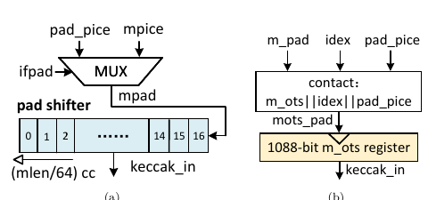

**Original caption:** Proposed logic architectures: dedicated OTS path and flexible path.

**中文图注:** 非对称双路径哈希输入逻辑

**Reading note:** 图表用于核对相邻段落的结构或定量主张；批判性解读见独立分析报告。

### Fig. 9. OTS 链时序

**Placed near:** p.13 S-OTS-TIMING
**Source:** p.13 C-FIG-09

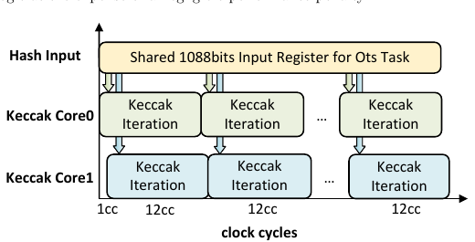

**Original caption:** Timing of OTS chain.

**中文图注:** OTS 链时序

**Reading note:** 图表用于核对相邻段落的结构或定量主张；批判性解读见独立分析报告。

## Page 14

**Source:** p.14 S213

**Original:** 14 A Unified Hardware Architecture for Stateful and Stateless Hash-Based Key/Signature Generations

**中文:** 14 一个统一的硬件架构,适用于具有国家和无国家身份的按键/签名世代

**Source:** p.14 S214

**Original:** pad_pos = input_length%8 (in bytes) within the 64-bit input block, and continues until the valid data length reaches the rate r = 1088. Since the Keccak iteration time (12 cycles) is comparable to the buffer shift time (17 cycles), the resulting latency mismatch introduces intermittent pipeline bubbles. Although this design choice incurs a marginal performance penalty, the architectural advantages are substantial: it facilitates timing closure, reduces logic resource utilization, and alleviates routing congestion. This trade-off is well-justified given that these ancillary operations constitute less than 20% of the total execution time.

**中文:** 在64位输入区内,pad_pos = input_length%8 (在字节中),并继续直到有效的数据长度达到速度r = 1088.由于凯卡克的代时间 (12周期) 与缓冲转换时间 (17周期) 相比,因此导致的延迟不匹配引入间歇性管道泡.尽管这种设计选择带来了边际性能处罚,但建筑优势很大:它促进了时间关闭,减少了逻辑资源的利用,减轻了路由拥堵.由于这些辅助操作占执行总时间的20%不到,因此这种妥协是合理的.

### 3.3 Control Unit

**Source:** p.14 S215

**Original:** 3.3 Control Unit

**中文:** 3.3 控制单位

**Source:** p.14 S216

**Original:** To support the SPHINCS+, XMSS, and LMS algorithms within a unified hardware framework, the controller design faces two major challenges: an extensive state space and a low degree of logic reuse. Adopting a direct implementation by developing separate control logic for each algorithm would lead to severe resource redundancy and prohibitive design complexity. To address this, we propose a parameterized control reuse architecture based on “task abstraction”, which achieves flexible support for multiple algorithms with minimal hardware overhead. Table 4: Task-based abstraction for Hash-Based Signatures. TASK

**中文:** 为了在统一的硬件框架内支持SPHINCS+,XMSS和LMS算法,控制器设计面临两个主要挑战:广泛的状态空间和低的逻辑重复使用.通过为每个算法制定单独的控制逻辑来直接实施,将导致严重的资源冗余和禁止的设计复杂性.为了解决这个问题,我们提出了一个基于任务抽象的参数化控制重复使用架构,该架构实现了多个算法的灵活支持,表4:基于哈希签名的任务抽象.任务

**Source:** p.14 S217

**Original:** H

**中文:** 其他

### Algorithm

**Source:** p.14 S218

**Original:** Algorithm

**中文:** 算法

### Usage

**Source:** p.14 S219

**Original:** Usage

**中文:** 使用

### Input Length

**Source:** p.14 S220

**Original:** Input Length

**中文:** 输入长度

### task0

**Source:** p.14 S221

**Original:** task0

**中文:** 任务

**Source:** p.14 S222

**Original:** 1 0

**中文:** 十个

**Source:** p.14 S223

**Original:** SPHINCS+ LMS/XMSS

**中文:** SPHINCS+ LMS/XMSS

### Pseudorandom Number

**Source:** p.14 S224

**Original:** Pseudorandom Number

**中文:** 伪随机号码

**Source:** p.14 S225

**Original:** 2N+Mesg Size N+32

**中文:** 2N+Mesg 尺寸N+32

### task1

**Source:** p.14 S226

**Original:** task1

**中文:** 任务1

**Source:** p.14 S227

**Original:** 2 SPHINCS+/ LMS/XMSS

**中文:** 2 SPHINCS+/LMS/XMSS

### Message Digest

**Source:** p.14 S228

**Original:** Message Digest

**中文:** 信息摘要

**Source:** p.14 S229

**Original:** 3N+Mesg Size

**中文:** 3N+Mesg 尺寸

### task2

**Source:** p.14 S230

**Original:** task2

**中文:** 任务2

### 5 SPHINCS+

**Source:** p.14 S231

**Original:** 5 SPHINCS+

**中文:** 5 SPHINCS+

**Source:** p.14 S232

**Original:** FORS Private Key/Leaf

**中文:** FORS私钥/叶片

**Source:** p.14 S233

**Original:** 2N+32

**中文:** 2N+32

### task3

**Source:** p.14 S234

**Original:** task3

**中文:** 任务3

**Source:** p.14 S235

**Original:** 0 LMS/XMSS

**中文:** 0 LMS/XMSS

### OTS Private Key Seed

**Source:** p.14 S236

**Original:** OTS Private Key Seed

**中文:** OTS私钥种子

### N+32

**Source:** p.14 S237

**Original:** N+32

**中文:** N+32

### task4

**Source:** p.14 S238

**Original:** task4

**中文:** 任务4

### 7 SPHINCS+

**Source:** p.14 S239

**Original:** 7 SPHINCS+

**中文:** 7 SPHINCS+

### FORS Merkle Tree Node

**Source:** p.14 S240

**Original:** FORS Merkle Tree Node

**中文:** 强力 Merkle树节点

**Source:** p.14 S241

**Original:** 3N+32

**中文:** 3N+32

### task5

**Source:** p.14 S242

**Original:** task5

**中文:** 任务5

### 8 SPHINCS+

**Source:** p.14 S243

**Original:** 8 SPHINCS+

**中文:** 8 SPHINCS+

**Source:** p.14 S244

**Original:** FORS Tree Public Key(Hl )

**中文:** FORS树公钥 (Hl)

**Source:** p.14 S245

**Original:** (1+k)*N+32

**中文:** (1+k) *N+32

### task6

**Source:** p.14 S246

**Original:** task6

**中文:** 任务6

**Source:** p.14 S247

**Original:** 5 0

**中文:** 5 0

**Source:** p.14 S248

**Original:** SPHINCS+ LMS/XMSS

**中文:** SPHINCS+ LMS/XMSS

### WOTS Private Key

**Source:** p.14 S249

**Original:** WOTS Private Key

**中文:** 沃茨私钥

**Source:** p.14 S250

**Original:** 2N+32 N+32

**中文:** 2N+32N+32

### task7

**Source:** p.14 S251

**Original:** task7

**中文:** 任务7

**Source:** p.14 S252

**Original:** 3 4

**中文:** 3 4

**Source:** p.14 S253

**Original:** SPHINCS+/LMS XMSS

**中文:** SPHINCS+/LMS XMSS

**Source:** p.14 S254

**Original:** WOTS Chain WOTS+ Chain(mask)

**中文:** 链+链面具)

**Source:** p.14 S255

**Original:** 2N+32 N+32

**中文:** 2N+32N+32

### task8

**Source:** p.14 S256

**Original:** task8

**中文:** 任务8

**Source:** p.14 S257

**Original:** 8 SPHINCS+/LMS

**中文:** 8 SPHINCS+/LMS

**Source:** p.14 S258

**Original:** WOTS Public Key(Hl )

**中文:** 公共钥匙 (Hl)

**Source:** p.14 S259

**Original:** (1+L)N+32

**中文:** (1+L)N+32

### task9

**Source:** p.14 S260

**Original:** task9

**中文:** 任务9

### 6 XMSS

**Source:** p.14 S261

**Original:** 6 XMSS

**中文:** 6 XMSS

**Source:** p.14 S262

**Original:** WOTS+ Public Key(L-tree)

**中文:** 公共钥匙 (L-树)

**Source:** p.14 S263

**Original:** 3*(N||32),3N

**中文:** 3*(N 其他32),3N

### task10

**Source:** p.14 S264

**Original:** task10

**中文:** 任务10

**Source:** p.14 S265

**Original:** 7 6

**中文:** 7 6

**Source:** p.14 S266

**Original:** SPHINCS+/LMS XMSS

**中文:** SPHINCS+/LMS XMSS

**Source:** p.14 S267

**Original:** Merkle Tree Node Merkle Tree Node(mask)

**中文:** 马克尔树结 马克尔树结

**Source:** p.14 S268

**Original:** 3N+32 3*(N||32),3N

**中文:** 其他类型

### 3.3.1 Cross-Algorithm Hardware Reuse Based on Task Abstraction

**Source:** p.14 S269

**Original:** 3.3.1 Cross-Algorithm Hardware Reuse Based on Task Abstraction

**中文:** 3.3.1基于任务抽象的跨算法硬件重复使用

**Source:** p.14 S270

**Original:** Although the three algorithms differ in their top-level flows, their underlying computational patterns share significant commonalities. For instance, they all employ OTS schemes (WOTS and WOTS+) and all utilize the Merkle tree to aggregate vast quantities of OTS public keys. Based on this insight, we employed a reused, coarse-grained task abstraction control strategy. We abstract and encapsulate the various computation stages from different algorithms—such as OTS chain computation, Merkle tree node updates, FORS tree generation, and message digest generation—into a series of parameterized tasks.

**中文:** 尽管这三个算法在顶级流程中不同,但它们的基本计算模式共享着显著的共同点.例如,它们都使用OTS方案 (WOTS和WOTS+) 并使用Merkle树来汇集大量的OTS公钥.基于这一见解,我们采用了一种重复使用的,粗的任务抽象控制策略.我们将各种计算阶段从不同的算法中抽象和包装起来,例如OTS链计算,Merkle树节点更新,FORS树生成和信息消化生成,

### Table 4. 11 个共享参数化任务

**Placed near:** p.14 S-TASKS
**Source:** p.14 C-TAB-04

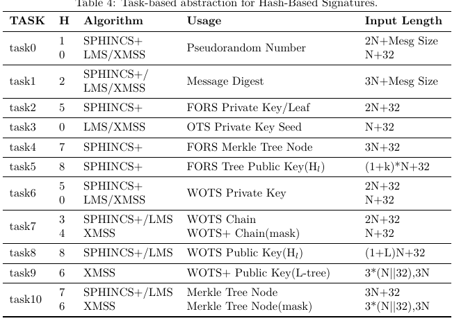

**Original caption:** Task-based abstraction for Hash-Based Signatures

**中文图注:** 11 个共享参数化任务

**Reading note:** 图表用于核对相邻段落的结构或定量主张；批判性解读见独立分析报告。

## Page 15

**Source:** p.15 S271

**Original:** Each abstracted task is parameterized by the top-level controller, translating into a deterministic configuration of internal datapaths and Hash Input Logic (HIL) modes. This dynamic reconfiguration enables a single physical hardware module to be time-multiplexed across SPHINCS+, XMSS, and LMS, thereby supporting diverse computational primitives without the need for structural hardware alterations. This high degree of reuse not only maximizes the utilization of hardware resources but also enhances the scalability of the control architecture. To accommodate new variants of hash-based signatures in the future, only new task sequences and parameter configurations will need to be added to the controller, obviating the need for large-scale hardware modifications to the underlying datapath. Table 4 delineates the core tasks and their attributes, clearly illustrating this task-based abstraction method. k-rounds Hash Loop0 task0 task1 #Hash

**中文:** 每个抽象任务都由顶级控制器进行参数化,转化为内部数据路径和哈希输入逻辑 (HIL) 模式的确定性配置.这种动态重组使单个物理硬件模块能够在SPHINCS+,XMSS和LMS之间进行时间多元化,从而支持各种计算原始 without the need for structural hardware alterations.这种高度的重复使用不仅最大化了硬件资源的利用,而且提高了控制架构的可扩展性.为了在未来适应基于哈希的签名的新变种,只需要添加新的任务序列和参数配置到控制器中,从而避免对底层数据路进行大规模硬件修改.表4概述了核心任务及其属性,清楚地说明了基于任务的抽象方法. k-rounds Hash Loop0 task0 task1 #Hash

**Source:** p.15 S272

**Original:** 1 1

**中文:** 一个月

**Source:** p.15 S273

**Original:** Hash Loop1 #Hash Initial

**中文:** 哈什循环1 #哈什初始

### d-rounds

**Source:** p.15 S274

**Original:** d-rounds

**中文:** 轮子

### task2

**Source:** p.15 S275

**Original:** task2

**中文:** 任务2

### task4

**Source:** p.15 S276

**Original:** task4

**中文:** 任务4

### task5

**Source:** p.15 S277

**Original:** task5

**中文:** 任务5

### task6

**Source:** p.15 S278

**Original:** task6

**中文:** 任务6

### task7

**Source:** p.15 S279

**Original:** task7

**中文:** 任务7

### task8

**Source:** p.15 S280

**Original:** task8

**中文:** 任务8

### task10

**Source:** p.15 S281

**Original:** task10

**中文:** 任务10

**Source:** p.15 S282

**Original:** 2a-1

**中文:** 2a-1

**Source:** p.15 S283

**Original:** 2a-1

**中文:** 2a-1

**Source:** p.15 S284

**Original:** 1 len*2h-1

**中文:** 1 2h-1

**Source:** p.15 S285

**Original:** len*2h-1*2w

**中文:** 子子

**Source:** p.15 S286

**Original:** 2h-1

**中文:** 2h-1

**Source:** p.15 S287

**Original:** 2h-1

**中文:** 2h-1

### task2

**Source:** p.15 S288

**Original:** task2

**中文:** 任务2

### task4

**Source:** p.15 S289

**Original:** task4

**中文:** 任务4

### task6

**Source:** p.15 S290

**Original:** task6

**中文:** 任务6

### task7

**Source:** p.15 S291

**Original:** task7

**中文:** 任务7

### task8

**Source:** p.15 S292

**Original:** task8

**中文:** 任务8

### task10

**Source:** p.15 S293

**Original:** task10

**中文:** 任务10

**Source:** p.15 S294

**Original:** 2a-1

**中文:** 2a-1

**Source:** p.15 S295

**Original:** 2a-1-1

**中文:** 2a-1-1

**Source:** p.15 S296

**Original:** len*2h-1

**中文:** 子子

**Source:** p.15 S297

**Original:** len*2h-1*2w

**中文:** 子子

**Source:** p.15 S298

**Original:** 2h-1

**中文:** 2h-1

**Source:** p.15 S299

**Original:** 2h-1-1 Merkle

**中文:** 2h-1-1 Merkle

### FORS

**Source:** p.15 S300

**Original:** FORS

**中文:** 强力

### WOTS

**Source:** p.15 S301

**Original:** WOTS

**中文:** 产品

### Time

**Source:** p.15 S302

**Original:** Time

**中文:** 时间

**Source:** p.15 S303

**Original:** Figure 10: Execution flow and task scheduling of SPHINCS+ signature generation. To clearly demonstrate the control logic, Figure 8 illustrates the execution flow and computational workload scheduling for SPHINCS+ signature generation as an example. The process begins with sequential hash operations to derive a pseudo-random value (task0) and its corresponding message digest (task1). Subsequently, the k subtrees of the FORS structure are processed. Specifically, task2 parallelizes the generation of 2a leaf nodes, while task4 computes the remaining internal nodes. Given that each FORS subtree requires 2a − 1 hash operations in task4, while Hash Loop0 executes 2a−1 iterations, Hash Loop1 only performs 2a−1 − 1 iterations, idling during the final cycle to ensure timing synchronization. Once the k FORS subtree roots are generated, they are aggregated to form the definitive FORS root via the Hl function (task5). The workflow then enters the Hypertree stage, where d layers of XMSS signatures are computed iteratively, involving WOTS+ computation (task6–8) and Merkle tree updates (task10). Specifically, task8 employs the Hl hash function to compress WOTS+ public keys into XMSS leaf nodes. Mirroring the scheduling in task4, task10 manages the Merkle tree node calculations with a similar idling mechanism to accommodate the odd iteration count. The controller repeats the stage for all d layers to finalize the SPHINCS+ computation. 3.3.2

**中文:** 图10:SPHINCS+签名生成执行流程和任务规划.为了清楚地展示控制逻辑,图8为SPHINCS+签名生成的执行流程和计算工作负载规划.这个过程从连续的哈希操作开始,以获得一个伪随机值 (task0) 和相应的消息消化 (task1).随后,FORS结构的 k 基基被加工.具体来说,task2将2a叶节点的生成并行,而task4则计算剩余的内部节点.鉴于每个FORS子树在任务4中需要2a − 1 哈希操作,而Hash Loop0执行2a − 1 代,Hash Loop1只执行2a − 1 代,在最后周期中停滞不前,以确保时间同步.一旦生成k FORS子树根,它们将通过Hl函数 (任务5) 聚合成最终的 FORS根.然后工作流进入Hypertree阶段, XMSS签名的d层进行反复计算,涉及WOTS+计算 (task68) 和 Merkle树更新 (task10).具体来说,任务8使用Hl哈希函数将WOTS+公钥压缩成XMSS叶节点.通过反映任务4中的规划,任务10使用类似的置机制来管理 Merkle 树节点计算,以适应奇数代数.控制器重复所有d层的阶段,以完成SPHINCS+计算. 3.3.2

### Hierarchical Counter–Based Control Logic

**Source:** p.15 S304

**Original:** Hierarchical Counter–Based Control Logic

**中文:** 基于反的等级控制逻辑

**Source:** p.15 S305

**Original:** When integrating multiple complex cryptographic algorithms, conventional monolithic Finite State Machines (FSMs) often encounter the state-space explosion problem. This results in excessively intricate state transition logic that is difficult to design, verify, and scale. To mitigate this complexity, we employ a hierarchical counter-based architecture to achieve systematic orchestration and control of the algorithmic processes. This approach decomposes complex execution flows into nested looping structures. The hierarchical counter configuration within a single functional task is illustrated in Figure 11. The specific functionalities are defined as follows: • Bottom-level Counter (cnt): Manages hash iterations within a single node. For task7 and task10 in XMSS requiring mask calculations, the maximum iterations are 3 and 4 (i.e., A is set to 2 and 3, respectively). For tasks independent of mask operations, only a single hash is performed ($A=0$).

**中文:** 在整合多个复杂的加密算法时,传统的单一式有限状态机 (FSM) 通常会遇到状态空间爆炸问题.这导致过度复杂的状态过渡逻辑,难以设计,验证和扩展.为了减轻这种复杂性,我们采用了层次性的反向架构来实现系统的编排和控制算法过程.这种方法将复杂的执行流解成嵌套的循环结构.在单个功能任务中的等级计数配置如图11所示.具体功能如下定义: • 底层计数 (cnt): 在单个节点内管理哈希回复.对于XMSS中需要面具计算的任务7和任务10,最大的代是3和4 (即A分别设置为2和3).对于独立于面具操作的任务,只执行一个哈希 ($A=0$).

### Fig. 10. SPHINCS+ 签名任务调度

**Placed near:** p.15 S-SCHED
**Source:** p.15 C-FIG-10

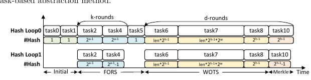

**Original caption:** Execution flow and task scheduling of SPHINCS+ signature generation.

**中文图注:** SPHINCS+ 签名任务调度

**Reading note:** 图表用于核对相邻段落的结构或定量主张；批判性解读见独立分析报告。

## Page 16

**Source:** p.16 S306

**Original:** 16 A Unified Hardware Architecture for Stateful and Stateless Hash-Based Key/Signature Generations

**中文:** 16 一个统一的硬件架构,适用于具有国家和无国家身份的按键/签名世代

**Source:** p.16 S307

**Original:** • Mid-level counter (num): Tracks and controls the node index within a specific hierarchical level, such as the node index of a single OTS chain in task7 or the Merkle tree node index of the current layer in task10. • Top-level counter (index): Controls the high-level execution stage, such as the OTS chain index in task7 or the layer index of the Merkle tree in task10. In terms of functionality, this multi-level counter hierarchy is fully equivalent to a deterministic finite-state machine (FSM). Its key advantage lies in decomposing a monolithic global state into a set of independent, logically decoupled local states.

**中文:** • 中级计数器 (数):追踪和控制特定层次级别内的节点指数,例如任务7中的单个OTS链的节点指数或任务10中的当前层的Merkle树节点指数.在功能方面,这个多层次的计数等级完全相当于确定性有限状态机器 (FSM).它的主要优势在于将单一的全球国家分解为一组独立的,逻辑上离散的本地国家.

**Source:** p.16 S308

**Original:** + 0 0

**中文:** 0 0

**Source:** p.16 S309

**Original:** 1 C

**中文:** 1 C

**Source:** p.16 S310

**Original:** 0 cnt =

**中文:** 0 cnt =

**Source:** p.16 S311

**Original:** A

**中文:** 一个

**Source:** p.16 S312

**Original:** +

**中文:** 其他地方

### num

**Source:** p.16 S313

**Original:** num

**中文:** 号码

**Source:** p.16 S314

**Original:** B

**中文:** 其他

**Source:** p.16 S315

**Original:** =

**中文:** 没有什么.

**Source:** p.16 S316

**Original:** +

**中文:** 其他地方

### index

**Source:** p.16 S317

**Original:** index

**中文:** 指数

**Source:** p.16 S318

**Original:** =

**中文:** 没有什么.

**Source:** p.16 S319

**Original:** task_done

**中文:** 完成任务

**Source:** p.16 S320

**Original:** Figure 11: Architecture of hierarchical counter.

**中文:** 图11:等级计数架构

### 3.4 Memory

**Source:** p.16 S321

**Original:** 3.4 Memory

**中文:** 3.4 记忆

**Source:** p.16 S322

**Original:** The total memory footprint of this design is approximately 72 KB, utilizing 16.5 dualport BRAMs in total. Of these, two BRAMs buffer signatures (SigRAM), and the remaining 14.5 BRAMs store intermediate data (DataRAM). To support LMS/XMSS key generation—which requires storing the entire Merkle tree with maximum height h = 10—the 256-bit-port DataRAM is configured with a maximum depth of 2(10+1) = 211 . Accordingly, the DataRAM is configured as 256 × 211 , which synthesizes to 14.5 BRAMs. For signature buffering, we adopt a segmented streaming strategy. The maximum signature length per tree is 143×256 bits, requiring a depth of 143; therefore, a SigRAM configured as 256 × 28 suffices and synthesizes to 2 BRAMs. What’s more, BRAM read/write operations and the hash computations in the HASH LOOP are scheduled in different pipeline stages, enabling parallel execution. By overlapping memory access with computation, the memory controller prefetches data for the subsequent cycle while the hash core processes the current block, effectively hiding memory access latency. To cope with limited on-chip storage and the intrinsically large signature-size overhead of SPHINCS+, we employ a segmented signature streaming strategy. The core principle of this strategy is to produce and output immediately. During the signing phase, upon the completion of each computational segment, such as a single FORS tree or a single Merkle tree, its result is immediately dispatched via the I/O interface, rather than awaiting the full signature generation. This streaming approach effectively reduces the peak storage requirement from full-signature buffering to only buffering the current computational segment, significantly conserving BRAM resources while also shortening the system’s response latency.

**中文:** 该设计的总内存足迹约为72KB,使用总共16.5个双端口BRAM.其中,两个BRAM存储缓冲签名 (SigRAM),其余14.5个BRAM存储中间数据 (DataRAM).为了支持LMS/XMSS密钥生成,需要存储整个Merkle树的最高高度 h = 10256位端口数据RAM配置的最大深度是2(10+1) = 211 .因此,数据RAM配置为256 × 211 ,并合成为14.5个BRAM.对于签名缓冲,我们采用了细分流媒体策略.每棵树的最大签名长度为143×256位,需要深度为143;因此,设置为256 × 28的SigRAM足够,并合成为2个BRAM.更重要的是,BRAM读写操作和HASH LOOP中的哈希计算在不同的管道阶段进行调度,从而实现并行执行.通过重叠存储访问与计算,存储控制器预先为下一个周期收集数据,而哈希核心处理当前的区块,有效地隐藏存储访问延迟.为了应对CPHINCS+的有限的芯片存储量和本质上很大的签名尺寸,我们采用了细分签名流媒体策略.这项战略的核心原则是立即生产和生产.在签名阶段,在完成每个计算细分,如单个FORS树或单个Merkle树,其结果立即通过I/O接口发送,而不是等待完整的签名生成.这种流媒体方法有效降低了从全签名缓冲到仅缓冲当前计算部分的峰值存储需求,显著节省了BRAM资源,同时缩短了系统的响应延迟.

### 4 Results And Comparisons

**Source:** p.16 S323

**Original:** 4 Results And Comparisons

**中文:** 4 结果与比较

### 4.1 Results

**Source:** p.16 S324

**Original:** 4.1 Results

**中文:** 4.1 结果

**Source:** p.16 S325

**Original:** The hardware architecture proposed in this paper is implemented using Xilinx Vivado 2018.3. For fair comparison, the target device selected is an Artix-7 series xc7a200t FPGA.

**中文:** 在本文中提出的硬件架构是使用Xilinx Vivado 2018实现的.为公平的比较,选择的目标设备是Artix-7系列xc7a200t FPGA.

### Fig. 11. 分层计数器控制结构

**Placed near:** p.16 S-COUNTER
**Source:** p.16 C-FIG-11

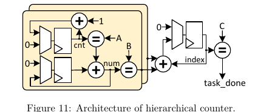

**Original caption:** Architecture of hierarchical counter.

**中文图注:** 分层计数器控制结构

**Reading note:** 图表用于核对相邻段落的结构或定量主张；批判性解读见独立分析报告。

## Page 17

**Source:** p.17 S326

**Original:** The proposed architecture achieves a maximum clock frequency of 108 MHz. Detailed performance metrics—including clock cycle counts and total execution latency for key generation (Keygen) and signing (Sign)—are summarized in Table 5. Table 5: Latency of processor. Algorithm

**中文:** 拟议的架构达到108MHz的最高时钟频率.密钥生成 (Keygen) 和签名 (Sign) 密钥生成 (Keygen) 及签名 (Sign) 执行总延迟等详细性能指标在表5中概括.处理器的延迟.算法

### Param

**Source:** p.17 S327

**Original:** Param

**中文:** 帕拉姆

**Source:** p.17 S328

**Original:** Keygen(CCs/ms)

**中文:** 关键字 (CCs/ms)

**Source:** p.17 S329

**Original:** Sign(CCs/ms)

**中文:** 标签:CCs/ms

### SPHINCS+

**Source:** p.17 S330

**Original:** SPHINCS+

**中文:** 标准标准+

**Source:** p.17 S331

**Original:** n = 128 n = 192 n = 256

**中文:** n = 128 n = 192 n = 256

**Source:** p.17 S332

**Original:** 23,688/0.22 34,687/0.32 91,510/0.84

**中文:** 23,688/0.22 34,687/0.32 91,510/0.84

**Source:** p.17 S333

**Original:** 537,636/4.95 926,398/8.52 1,929,154/17.75

**中文:** 537,636/4.95 926,398/8.52 1,929,154/17.75

### LMS

**Source:** p.17 S334

**Original:** LMS

**中文:** LMS

**Source:** p.17 S335

**Original:** ω=2 ω=4

**中文:** 它们的数量:

**Source:** p.17 S336

**Original:** 3,808,440/35.04 5,843,438/53.76

**中文:** 3,808,440/35.04 5,843,438/53.76

**Source:** p.17 S337

**Original:** 3,572/0.03 5,429/0.05

**中文:** 3,572/0.03 5,429/0.05

### XMSS

**Source:** p.17 S338

**Original:** XMSS

**中文:** 电子邮件

**Source:** p.17 S339

**Original:** ω=2 ω=4

**中文:** 它们的数量:

**Source:** p.17 S340

**Original:** 7,829,494/72.03 15,682,342/144.28

**中文:** 7,829,494/72.03 15,682,342/144.28

**Source:** p.17 S341

**Original:** 7,334/0.07 14,549/0.13

**中文:** 7,334/0.07 14,549/0.13

**Source:** p.17 S342

**Original:** For SPHINCS+, with security parameters in n ∈ {128, 192, 256}, the Keygen/Sign execution times are 0.22/4.95 ms, 0.32/8.52 ms, and 0.84/17.75 ms, respectively. Because the number of hash invocations is fixed for a given parameter set, the Keygen/Sign latency is constant and does not vary with the public or private key values. For LMS/XMSS with n = 256 and h = 10, the Keygen/Sign times for LMS with w ∈ 2, 4 are 35.04/0.03 ms and 53.76/0.05 ms, respectively. For XMSS with w ∈ {2, 4}, the times are 72.03/0.07 ms and 144.28/0.13 ms. The signing procedures for LMS and XMSS rely on an OTS scheme where the number of hash computations in the Winternitz chains depends on the message digest being signed, so the signing latency varies within a bounded range. The signing times reported in Table II are the average values obtained over 1000 random signing operations to reflect expected real-world performance. Table 6: Resource utilization by module. Modules Control unit Post Process Hash LOOP ⌞ HASH LOOP0 ⌞ HASH LOOP0.HIL ⌞ HASH LOOP0.Keccak ⌞ HASH LOOP1 ⌞ HASH LOOP1.HIL ⌞ HASH LOOP1.Keccak Sig RAM Data RAM Total

**中文:** 对于SPHINCS+,安全参数为 n ∈ {128, 192, 256},Keygen/Sign执行时间分别为0.22/4.95 ms,0.32/8.52 ms和0.84/17.75 ms.由于对给定的参数集合的哈希调用数量是固定的,因此Keygen/Sign延迟是恒定的,并不会随公共或私钥值而变化.对于 n = 256 和 h = 10 的 LMS/XMSS,为 w ∈ 2, 4 的 Keygen/Sign时间分别为 35.04/0.03 ms 和 53.76/0.05 ms.对于w ∈ {2, 4}的XMSS,时间为72.03/0.07 ms和144.28/0.13 ms.LMS和XMSS的签名程序依赖于OTS方案,其中Winternitz链中的哈希计算数量取决于正在签名的消息消化,因此签名延迟在有限范围内变化.在表II中报告的签名时间是以1000个随机签名操作中获得的平均值,以反映预期的现实业绩.表6:按模块使用资源.模块控制单元 后流程哈什LOOP 哈什LOOP0 哈什LOOP0.HIL 哈什LOOP0.Keccak 哈什LOOP1 哈什LOOP1.HIL 哈什LOOP1.Keccak Sig RAM 数据 RAM 总数

### LUT

**Source:** p.17 S343

**Original:** LUT

**中文:** 子

### FF

**Source:** p.17 S344

**Original:** FF

**中文:** FF

### BRAM

**Source:** p.17 S345

**Original:** BRAM

**中文:** 子

**Source:** p.17 S346

**Original:** 4,222/17.4% 895/3.7% 19,067/78.4% 9,657 3,303 6,354 9,410 3,056 6,354 0 0

**中文:** 4,222/17.4% 895/3.7% 19,067/78.4% 9,657 3,303 6,354 9,410 3,056 6,354 0 0

**Source:** p.17 S347

**Original:** 5,137/37.8% 1,090/8.0% 7,432/54.8% 3,717 2,078 1,639 3,715 2,076 1,639 0 0

**中文:** 5,137/37.8% 1,090/8.0% 7,432/54.8% 3,717 2,078 1,639 3,715 2,076 1,639 0 0

**Source:** p.17 S348

**Original:** 16.5 0 0 0 0 0 0 0 0 2 14.5

**中文:** 16.5 0 0 0 0 0 0 0 0

**Source:** p.17 S349

**Original:** 24,184

**中文:** 两千四百八十四

**Source:** p.17 S350

**Original:** 13,659

**中文:** 13,659 年

**Source:** p.17 S351

**Original:** 16.5

**中文:** 16.5

**Source:** p.17 S352

**Original:** Note: LUT/FF percentages are normalized to the total resource usage of this design (the “Total” row).

**中文:** 注:LUT/FF百分比是正常化为本设计的总资源使用量 (排列 Total).

**Source:** p.17 S353

**Original:** Table 6 presents the resource consumption of each module on the Artix-7 FPGA. The overall design utilizes 24,184 LUTs, 13,659 FFs, 16.5 BRAMs, and 0 DSPs. The Control Unit consumes 4,222 LUTs (17.4%) and 5,137 FFs (37.8%); its FF share exceeds 30% of the design because it integrates complex logic with numerous counters and state machines (e.g., the ADRS generator and task-control unit), buffers diverse inputs for the two HASH LOOP modules, and maintains a 1088-bit mots register. The Post-Process unit—responsible for handshaking, task-status management, and precise BRAM writes—uses 895 LUTs (3.68%)

**中文:** 表格见本页对应图像卡。

### Table 5. 处理器周期与延迟

**Placed near:** p.17 S-LATENCY
**Source:** p.17 C-TAB-05

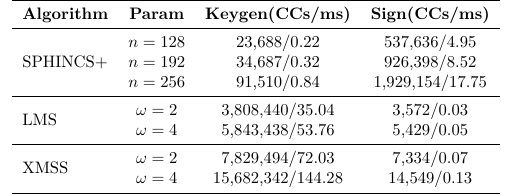

**核对补充：** [可复制表格、数据与说明](Extracted_Data_and_Analysis.md#audit-table5)。

**Original caption:** Latency of processor

**中文图注:** 处理器周期与延迟

**Reading note:** 图表用于核对相邻段落的结构或定量主张；批判性解读见独立分析报告。

### Table 6. 分模块资源占用

**Placed near:** p.17 S-RESOURCE
**Source:** p.17 C-TAB-06

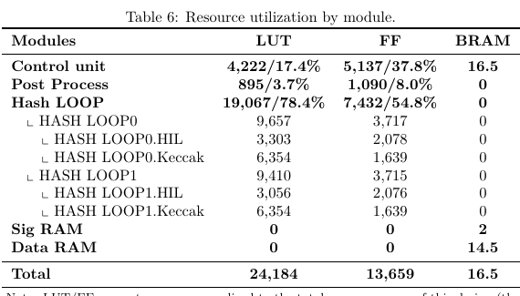

**核对补充：** [可复制表格、数据与说明](Extracted_Data_and_Analysis.md#audit-table6)。

**Original caption:** Resource utilization by module

**中文图注:** 分模块资源占用

**Reading note:** 图表用于核对相邻段落的结构或定量主张；批判性解读见独立分析报告。

## Page 18

**Source:** p.18 S354

**Original:** 18 A Unified Hardware Architecture for Stateful and Stateless Hash-Based Key/Signature Generations

**中文:** 18 一个统一的硬件架构,适用于具有国家和无国家身份的按键/签名世代

**Source:** p.18 S355

**Original:** and 1,090 FFs (8.03%). The HASH LOOP module is the core computational engine and the primary resource consumer, requiring 19,067 LUTs (78.4%) and 7,432 FFs (54.8%); this concentration highlights the computation-centric simplicity of our architecture. To further optimize resources, we employ an asymmetric design: HASH LOOP0 executes both parallel and serial tasks, whereas HASH LOOP1 handles only parallel tasks; their utilizations are 9,657/9,410 LUTs and 3,717/3,715 FFs, respectively. As summarized previously, this design utilizes a total of 16.5 BRAMs. Among them, 14.5 BRAMs are dedicated to storing the extensive amount of intermediate data generated during the execution of the SPHINCS+, XMSS, and LMS algorithms, including but not limited to the nodes of each layer of the Merkle tree and OTS public keys. The remaining 2 BRAMs are used exclusively as a signature buffer.

**中文:** 1,090 FF (8.03%).哈什LOOP模块是核心计算引擎和主要资源消费者,需要19067LUT (78.4%) 和7,432FF (54.8%);这种度突出了我们建筑的计算式简单性.为了进一步优化资源,我们采用了不对称的设计:HASH LOOP0执行并行和串行任务,而HASH LOOP1只处理并行任务;它们的使用量分别为9,657/9,410LUT和3,717/3,715FF.如前所述,该设计使用了总共16.5个BRAM.其中,14.5个BRAM用于存储在执行SPHINCS+,XMSS和LMS算法过程中生成的大量中间数据,包括但不限于Merkle树的每个层和OTS公钥的节点.剩下的2个BRAM仅作为签名缓冲器.

### 4.2 Comparisons With Related Works

**Source:** p.18 S356

**Original:** 4.2 Comparisons With Related Works

**中文:** 4.2 与相关作品的比较

**Source:** p.18 S357

**Original:** To objectively position our design relative to the state of the art, we conduct quantitative comparisons against several advanced hardware implementations; results are summarized in Table 7. All results of the table were obtained on Artix-7 FPGA, except for [CWW+ 22], which was implemented on Virtex UltraScale+ FPGA. As the first hardware implementation to support both LMS and XMSS, and as the newest and most effective full implementation of XMSS, [THG24] uses SHA256 as the core hash function. It introduces a BDS algorithm with configurable parameter k. Compared to their most high-performance configuration with 8 hash cores and 7 WOTS+ chaining modules, our design exhibits speedup of 4.34× (LMS) and 8.97× (XMSS) for Sign with {h, ω} = {10, 4}. The speedup in Keygen is 2.60×(LMS)/5.43×(XMSS). In terms of ATP, the design in [THG24] is 4.13× (LMS)/10.92× (XMSS) higher than this work for Sign and 2.47× (LMS)/6.61× (XMSS) higher for Keygen. Our design’s superior performance stems from two synergistic optimizations. First, the adoption of SHAKE256 provides a higher throughput baseline, as its larger rate (1088 bits) and sponge-based structure are more hardware-friendly than SHA-256. Second, our novel dual-path architecture provides single-cycle input latency for the OTS chain computations, a key performance bottleneck. Notably, we compare our SHAKE256-based design with prior SHA-256 implementations because, to the best of our knowledge, no other high-performance unified hardware architectures for XMSS and LMS currently leverage the SHA-3 family. Apart from [THG24], the remaining works implement a single signature scheme and are analyzed separately. For SPHINCS+, the fastest existing hardware implementation is [ALCZ20]. They implemented a 12-stage Keccak permutation along with substantial register insertion to minimize the critical path. As a result, their Keccak core can operate at a maximum frequency of 500 MHz. Additionally, a multi-clock-domain scheme was designed, allowing the peripheral control circuit to function at 250 MHz. Compared to [ALCZ20], our design exhibits a higher latency for individual SHAKE256 operations due to our emphasis on resource efficiency. However, our solution demonstrates a substantial resource advantage, reducing LUT/FF/DSP consumption by 49.61%/81.16%/100%, respectively. The most area-efficient implementation, [DLK+ 25], uses about half our hardware resources but is more than 3× slower in signing and omits the key-generation functionality. Compared to [HLL+ 25], which exhibits the best area–time performance, our design uses 17.77% fewer LUTs and 3.06% fewer FFs. In BRAM usage, [HLL+ 25] employs a Group Subtree strategy for Merkle-tree computation that avoids storing an entire layer of a full tree, reducing BRAM to 48.48% of ours. However, our design requires an entire layer of tree nodes to be stored to be compatible with LMS/XMSS fast signatures. This is a necessary overhead due to architectural uniformity. In terms of Sign speed, the 8-unroll, 4-stage pipelined hash core and 180 MHz frequency in [HLL+ 25] make it 2 ∼ 3× faster than our 2-parallel, 2-unroll architecture. While there is a gap for standalone SPHINCS+, our core advantage is lower LUT/FF usage while flexibly supporting all security parameters of the three HBS

**中文:** 为了客观地将我们的设计定位在技术的最新状态下,我们对几个先进的硬件实现进行量化比较;在表7中概述了结果.所有表的结果均是在Artix-7 FPGA上获得的,除了[CWW+ 22],该结果是在Virtex UltraScale+ FPGA上实现的.作为支持LMS和XMSS的第一个硬件实现,以及作为XMSS的最新和最有效的全面实现, [THG24]使用SHA256作为核心哈希函数.它引入了一个可配置参数 k 的BDS算法.与8个哈希核心和7个WOTS+链接模块的最高性能配置相比,我们的设计显示了4.34× (LMS) 和8.97× (XMSS) 的加速度.在Keygen的速度是2.60×LMS/5.43×XMSS.在ATP方面, [THG24]的设计比Sign的4.13× (LMS)/10.92× (XMSS) 高,Keygen的2.47× (LMS)/6.61× (XMSS) 高.我们的设计优异性能源于两个协同优化.首先,采用SHAKE256提供了更高的吞吐量基线,因为其更大的速度 (1088位) 和基于海绵的结构比SHA-256更适合硬件.其次,我们的新型双路架构为OTS链计算提供单周期输入延迟,值得注意的是,我们将基于SHA256的设计与之前的SHA-256实现进行比较,因为我们所知,目前没有其他高性能统一硬件架构用于XMSS和LMS的SHA-3家族.除了 [THG24]之外,其余的工程实施了单一的签名方案,并被单独分析.对于SPHINCS+来说,现有的最快的硬件实现是 [ALCZ20].他们实施了12个阶段的Keccak变量,并进行了大量的注册插入,以最大限度地减少关键路径.因此,它们的Keccak核心可以在500MHz的最高频率上运行.此外,设计了一种多个时钟域的方案,允许边缘控制电路在250MHz上运行.与[ALCZ20]相比,我们的设计显示了对单个SHAKE256操作的延迟较高,因为我们强调资源效率.然而,我们的解决方案显示出了相当大的资源优势,分别减少了49.61%/81.16%/100%的LUT/FF/DSP消耗.最有效地实现的DLK+25使用了大约一半的硬件资源,与[HLL+ 25]相比,我们的设计使用了17.77%少的LUT和3.06%少的FF.在BRAM使用中, [HLL+ 25]用于 Merkle-tree计算的集团子树策略,以避免存储一个完整的树层,使BRAM减少到48.48%.然而,我们的设计需要存储整个树节点层,以兼容LMS/XMSS快速签名.由于建筑均性,这是一个必要的总费用.在信号速度方面, 8 个取消, 4 个阶段的管道哈希核心和 [HLL+ 25] 的 180 MHz 频率使其比我们的 2 ∼ 3 倍快, 2 个并行, 2 个取消架构.虽然独立的SPHINCS+存在差距,但我们的核心优势是较低的LUT/FF使用,同时灵活地支持三个HBS的所有安全参数

## Page 19

**Source:** p.19 S358

**Original:** Table 7: Comparison of resource usage and performance across schemes. Scheme

**中文:** 表格见本页对应图像卡。

**Source:** p.19 S359

**Original:** Paramb LUT/FF/BRAM/DSP

**中文:** 控制仪表 (LUT/FF/BRAM/DSP)

**Source:** p.19 S360

**Original:** Freq Sign Keygen (MHz) (ms) (ms)

**中文:** 频率信号键盘 (MHz) (ms) (ms)

### ATPc sign

**Source:** p.19 S361

**Original:** ATPc sign

**中文:** ATPc标志

### keygen

**Source:** p.19 S362

**Original:** keygen

**中文:** 基因

**Source:** p.19 S363

**Original:** SPHINCS+ [ALCZ20]

**中文:** 标准标准 (SPHINCS+ [ALCZ20]

**Source:** p.19 S364

**Original:** n = 128 n = 192 n = 256

**中文:** n = 128 n = 192 n = 256

**Source:** p.19 S365

**Original:** 47,991/72,505/11.5/1 48,398/73,476/17.0/1 51,009/74,539/22.5/1

**中文:** 4,991/72,505/11.5/1 48,398/73,476/17.0/1 51,009/74,539/22.5/1

**Source:** p.19 S366

**Original:** 250 1.01 1.17 2.52

**中文:** 250 1.01 1.17 2.52

**Source:** p.19 S367

**Original:** 1.01 1.17 2.52

**中文:** 1.01 1.17 2.52

**Source:** p.19 S368

**Original:** 2.41 2.96 6.91

**中文:** 2.41 2.96 6.91

**Source:** p.19 S369

**Original:** 2.41 2.96 6.91

**中文:** 2.41 2.96 6.91

**Source:** p.19 S370

**Original:** SPHINCS+ [HLL+ 25]

**中文:** [HLL+ 25]

**Source:** p.19 S371

**Original:** n = 128 n = 192 n = 256

**中文:** n = 128 n = 192 n = 256

**Source:** p.19 S372

**Original:** 29,410/14,090/4/0

**中文:** 4,090/4/0410/14,090

**Source:** p.19 S373

**Original:** 179.8 1.96 3.19 6.61

**中文:** 179.8 1.96 3.19 6.61

**Source:** p.19 S374

**Original:** 0.082 0.12 0.316

**中文:** 0.082 0.12 0.316

**Source:** p.19 S375

**Original:** 1.97 3.21 6.64

**中文:** 1.97 3.21 6.64

**Source:** p.19 S376

**Original:** 0.08 0.12 0.32

**中文:** 0.08 0.12 0.32

**Source:** p.19 S377

**Original:** SPHINCS+ [DLK+ 25]

**中文:** 标准标准 (SPHINCS+) [DLK+ 25]

**Source:** p.19 S378

**Original:** n = 128 n = 192 n = 256

**中文:** n = 128 n = 192 n = 256

**Source:** p.19 S379

**Original:** 10,197/7,357/8/0 10,333/7,590/8/0 10,416/7,072/8/0

**中文:** 10,197/7,357/8/0 10,333/7,590/8/0 10,416/7,072/8/0

**Source:** p.19 S380

**Original:** 150 19.3 31.11 61.77

**中文:** 150 19.3 31.11 61.77

**Source:** p.19 S381

**Original:** – – –

**中文:** 

**Source:** p.19 S382

**Original:** 10.28 16.77 33.03

**中文:** 10.28 16.77 33.03

**Source:** p.19 S383

**Original:** – – –

**中文:** 

**Source:** p.19 S384

**Original:** SPHINCS+ [This work]

**中文:** [本工作]

**Source:** p.19 S385

**Original:** n = 128 n = 192 n = 256

**中文:** n = 128 n = 192 n = 256

**Source:** p.19 S386

**Original:** 24,184/13,659/16.5/0

**中文:** 其他国家/地区

**Source:** p.19 S387

**Original:** 108 4.95 8.52 17.75

**中文:** 108 4.95 8.52 17.75

**Source:** p.19 S388

**Original:** 0.22 0.32 0.84

**中文:** 0.22 0.32 0.84

**Source:** p.19 S389

**Original:** 5.73 9.88 20.57

**中文:** 5.73 9.88 20.57

**Source:** p.19 S390

**Original:** 0.25 0.37 0.98

**中文:** 0.25 0.37 0.98

**Source:** p.19 S391

**Original:** LMS [SHTW23]

**中文:** LMS [SHTW23]

**Source:** p.19 S392

**Original:** h, w = 5, 1 w=1 w=2 w=4 w=8

**中文:** ,w=5,1w=1w=2w=4w=8

**Source:** p.19 S393

**Original:** 139,886/103,914/58/3 – – – –

**中文:** 139,886/103,914/58/3

**Source:** p.19 S394

**Original:** 267 0.0022 0.0022 0.0021 0.0037 0.0264

**中文:** 267 0.0022 0.0022 0.0021 0.0037 0.0264

**Source:** p.19 S395

**Original:** 0.21 1.81 0.92 0.89 7.09

**中文:** 0.21 1.81 0.92 0.89 7.09

**Source:** p.19 S396

**Original:** 0.01 – – – –

**中文:** 0.01

**Source:** p.19 S397

**Original:** 1.17 – – – –

**中文:** 1.17

**Source:** p.19 S398

**Original:** LMS [THG24]

**中文:** LMS [THG24]

**Source:** p.19 S399

**Original:** w = 4 Min w = 4 Med w = 4 Lar

**中文:** w = 4 分钟 w = 4 Med w = 4 Lar

**Source:** p.19 S400

**Original:** 15,860/13,914/15/0 26,828/19,515/15/0 36,534/24,197/15/0

**中文:** 其他国家:西班牙

**Source:** p.19 S401

**Original:** 100 1.18 0.34 0.22

**中文:** 100 1.18 0.34 0.22

**Source:** p.19 S402

**Original:** 785 223 140

**中文:** 785 223 140

**Source:** p.19 S403

**Original:** 0.97 0.37 0.24

**中文:** 0.97 0.37 0.24

**Source:** p.19 S404

**Original:** 647.55 245.57 154.17

**中文:** 647.55 245.57 154.17

**Source:** p.19 S405

**Original:** LMS [This work]

**中文:** [本工作]

**Source:** p.19 S406

**Original:** w=2 w=4

**中文:** 它们的位置:

**Source:** p.19 S407

**Original:** 24,184/13,659/16.5/0

**中文:** 其他国家/地区

**Source:** p.19 S408

**Original:** 108 0.03 0.05

**中文:** 108 0.03 0.05

**Source:** p.19 S409

**Original:** 35.04 53.76

**中文:** 其他类型

**Source:** p.19 S410

**Original:** 0.04 0.06

**中文:** 0.04 0.06

**Source:** p.19 S411

**Original:** 40.60 62.30

**中文:** 4060 62.30

**Source:** p.19 S412

**Original:** XMSS [THG24]

**中文:** 其他类型:

**Source:** p.19 S413

**Original:** w = 4 Min w = 4 Med w = 4 Lar

**中文:** w = 4 分钟 w = 4 Med w = 4 Lar

**Source:** p.19 S414

**Original:** 15,860/13,914/15/0 26,828/19,515/15/0 36,534/24,197/15/0

**中文:** 其他国家:西班牙

**Source:** p.19 S415

**Original:** 100 6.9 1.6 1.2

**中文:** 100 6.9 1.6 1.2

**Source:** p.19 S416

**Original:** 4,680 1,100 783

**中文:** 4,680 1,100 783

**Source:** p.19 S417

**Original:** 5.88 1.84 1.69

**中文:** 5,88 1,84 1,69

**Source:** p.19 S418

**Original:** 3,985.55 1,267.27 1,104.98

**中文:** 3,985.55 1,267.27 1,104.98

**Source:** p.19 S419

**Original:** XMSS [CWW+ 22]

**中文:** 其他信息:

**Source:** p.19 S420

**Original:** w=2 w=4

**中文:** 它们的位置:

**Source:** p.19 S421

**Original:** 22,300/31,215/0/0

**中文:** 22,300/31,215/0/0

**Source:** p.19 S422

**Original:** 110 5.54 11.09

**中文:** 110 5.54 11.09

**Source:** p.19 S423

**Original:** 1,799.82 5.25 1,706.16 2,881.53 10.51 2,731.58

**中文:** 1,799.82 5.25 1,706.16 2,881.53 10.51 2,731.58

**Source:** p.19 S424

**Original:** XMSS [This work]

**中文:** 这项工作

**Source:** p.19 S425

**Original:** w=2 w=4

**中文:** 它们的位置:

**Source:** p.19 S426

**Original:** 24,184/13,659/16.5/0

**中文:** 其他国家/地区

**Source:** p.19 S427

**Original:** 108 0.07 0.13

**中文:** 108 0.07 0.13

**Source:** p.19 S428

**Original:** 72.03 144.28

**中文:** 72.03 144.28

**Source:** p.19 S429

**Original:** 0.08 0.16

**中文:** 0.08 0.16

**Source:** p.19 S430

**Original:** 83.47 167.19

**中文:** 83.47 167.19

**Source:** p.19 S431

**Original:** Dashes (-) indicate completely unavailable data. Unless otherwise specified, the data for LMS and XMSS are selected with h = 10 for fair comparison. Remaining parameters for each configuration (parameter n for SPHINCS+ and h, w for LMS/XMSS) can be found in Table 1 and Table 2, respectively. c ATP is calculated as equivalent Slices × time. Equivalent Slice is calculated as LU T /4 + F F/8 + BRAM × 232.4 + DSP × 102.4 for 7 series and LU T /4 + F F/8 + BRAM × 116.2 + DSP × 51.2 for Ultrascale+. a

**中文:** 标记 (-) 表示完全不可用的数据.除非另有指定的外,以h=10为公平的比较,选择LMS和XMSS数据.每个配置的剩余参数 (SPHINCS+ 的参数 n 和 LMS/XMSS 的参数 h, w) 可以分别在表 1 和表 2 中找到.同等切片计算为7系列的LU T /4 + F F/8 + BRAM × 232.4 + DSP × 102.4 和超尺度+的LU T /4 + F F/8 + BRAM × 116.2 + DSP × 51.2

**Source:** p.19 S432

**Original:** b

**中文:** 其他

### Table 7. 跨方案资源与性能比较

**Placed near:** p.18 S-COMPARE
**Source:** p.19 C-TAB-07

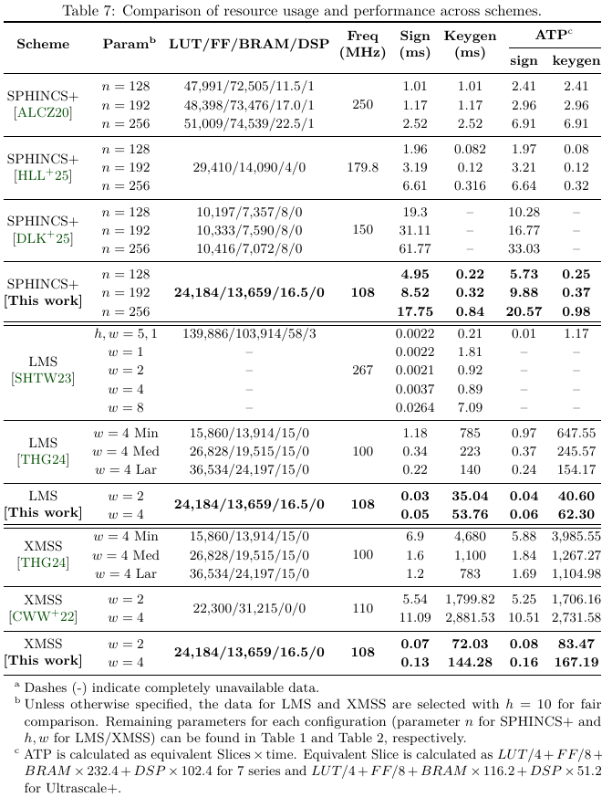

**核对补充：** [可复制表格、数据与说明](Extracted_Data_and_Analysis.md#audit-table7)。

**Original caption:** Comparison of resource usage and performance across schemes

**中文图注:** 跨方案资源与性能比较

**Reading note:** 图表用于核对相邻段落的结构或定量主张；批判性解读见独立分析报告。

## Page 20

**Source:** p.20 S433

**Original:** 20 A Unified Hardware Architecture for Stateful and Stateless Hash-Based Key/Signature Generations

**中文:** 20 一个统一的硬件架构,适用于具有国家和无国家身份的按键/签名世代

**Source:** p.20 S434

**Original:** algorithms, yielding greater flexibility and scalability. For LMS, [SHTW23] proposes an ultra-high-throughput implementation scheme with 34 parallel hash modules for OTS chain computation on Virtex UltraScale+ FPGA. To allow many hash modules to flexibly process diverse inputs at different stages, the design requires complex control logic and large on-chip storage. This results in very high resource usage of approximately 140k LUTs, 104k FFs, and 58 BRAMs. This remains the case for the minimum parameter setting of {h, ω} = 5, 1, and the required resources increase as the parameter increases. In comparison, our design reduces LUT/FF/DSP usage by 82.71%/86.86%/100%, respectively. For XMSS, the hardware implementation presented in [CWW+ 22] is partitioned into separate modules for key generation, signature, and verification (the hardware resource consumption of that work in the table corresponds to the signature module alone, with key generation requiring 8464 LUTs and 14464 FFs), whereas our design integrates the first two operations and delivers 82.11 × /24.99× and 82.85 × /19.97× speedups for Sign/Keygen when h, ω = 10, 2 and 10, 4, respectively. In terms of ATP, the design in [CWW+ 22] incurs 67.15 × /20.44× and 67.77 × /16.34× higher ATP than this work for Sign/Keygen under h, ω = 10, 2 and 10, 4, respectively.

**中文:** 这种方法可以提高灵活性和可扩展性.对于LMS, [SHTW23]提出了一个超高吞吐量实现方案,该方案包括34个对等式哈希模块,用于在Virtex UltraScale+ FPGA上计算OTS链.为了让许多哈希模块在不同阶段灵活处理各种输入,设计需要复杂的控制逻辑和大型的芯片存储.这导致大约140万LUT,104万FF和58个BRAM的资源使用非常高.对于 {h, ω} = 5, 1 的最小参数设定,这种情况仍然是如此,随着参数的增加,所需的资源会增加.相比之下,我们的设计可将LUT/FF/DSP使用量分别减少82.71%/86.86%/100%.对于XMSS来说,在 [CWW+ 22]中介绍的硬件实现分为密钥生成,签名和验证的单独模块 (该表中的该工作的硬件资源消耗仅与签名模块相符,密钥生成需要8464 LUT和14464 FFs),而我们的设计整合了前两个操作,并为Sign/Keygen提供了分别82.11 × /24.99×和82.85 × /19.97×速度升级, h, ω = 10, 2 和 10, 4.在ATP方面,[CWW+22]的设计分别为67.15 × /20.44×和67.77 × /16.34×的ATP高于此工作的Sign/Keygen在h, ω = 10,2和10,4下.

### 5 Conclusion

**Source:** p.20 S435

**Original:** 5 Conclusion

**中文:** 5 结论

**Source:** p.20 S436

**Original:** To the best of our knowledge, this work introduces the first efficient and configurable accelerator that supports both stateful (LMS/XMSS) and stateless (SPHINCS+) hashbased signature schemes within a unified architecture. High throughput is achieved through a dual-parallel unroll-2 engine and a customized high-speed input path for the high-frequency OTS task. Meanwhile, area efficiency is maximized by reusing control logic via task abstraction and a hierarchical counter system, and is further optimized by a flexible padding shifter that accommodates diverse task inputs, thereby eliminating the need for large-scale multiplexers. Furthermore, memory efficiency is optimized by overlapping BRAM access with hash execution to conceal latency, and by employing segmented signature streaming to minimize peak memory footprint through real-time data output. Overall, the proposed design achieves a favorable performance-area trade-off and delivers significant acceleration for LMS/XMSS. In future work, we will conduct an in-depth side-channel analysis of the current design. This investigation will extend beyond theoretical modeling to include practical attack simulations, allowing us to identify and characterize potential vulnerabilities related to power consumption and electromagnetic emissions. Based on these findings, we plan to develop and integrate a multi-layered suite of countermeasures, from hardware-level masking to algorithmic randomization. The objective is to effectively mitigate information leakage, thereby enhancing the system’s overall end-to-end security. What’s more, the scalable task abstraction architecture allows our design to extend support to other HBS algorithms with minimal overhead, providing a single, efficient accelerator for all NIST-standardized hash-based signatures, which in turn simplifies deployment.

**中文:** 根据我们所知道的情况,这项工作引入了第一个高效和可配置的加速器,该加速器在统一架构中支持状态式 (LMS/XMSS) 和状态式 (SPHINCS+) 基于哈希的签名方案.通过双平行解滚-2引擎和用于高频OTS任务的定制高速输入路径实现高吞吐量.与此同时,通过任务抽象和等级计数系统重复使用控制逻辑来最大化面积效率,并通过适应各种任务输入的灵活填充转换器进一步优化,从而消除了大规模多重器的需求.此外,通过重叠BRAM访问与哈希执行来隐藏延迟,并通过使用细分签名流以通过实时数据输出来最大限度地减少内存足迹来优化内存效率.总体而言,拟议的设计实现了有利的性能领域交易,并为LMS/XMSS提供了显著的加速.在未来的工作中,我们将对目前的设计进行深入的侧分析.这项调查将超越理论建模,包括实际攻击模拟,使我们能够识别和描述与电力消耗和电磁排放有关的潜在漏洞.基于这些发现,我们计划开发和集成一套多层次的反措施, 从硬件层面的掩饰到算法随机化.目标是有效缓解信息泄露,从而提高系统的整体端到端安全性.更重要的是,可扩展的任务抽象架构允许我们的设计将支持扩展到其他HBS算法, 带来最小的通用费用, 为所有NIST标准化基于哈希的签名提供单个高效的加速器, 这反过来简化了部署.

**Source:** p.20 S437

**Original:** References [ALCZ20]

**中文:** 参考文献 [ALCZ20]

**Source:** p.20 S438

**Original:** Dorian Amiet, Lukas Leuenberger, Andreas Curiger, and Paul Zbinden. FPGAbased SPHINCS+ Implementations: Mind the Glitch. In 23rd Euromicro Conference on Digital System Design, DSD 2020, Kranj, Slovenia, August 26-28, 2020, pages 229–237. IEEE, 2020.

**中文:** 杜里安·阿米特,卢卡斯·莱恩伯格,安德烈亚斯·库里格和保罗·兹宾登.基于FPGA的SPHINCS+实现:注意故障.2020年8月26日至28日在斯洛文尼亚克兰吉举行的第23届欧洲微信数字系统设计会议,第229237页.电气电气系统,2020年

**Source:** p.20 S439

**Original:** [BDH11]

**中文:** 参考文献书目信息保持原文。

**Source:** p.20 S440

**Original:** Johannes Buchmann, Erik Dahmen, and Andreas Hülsing. XMSS-a practical forward secure signature scheme based on minimal security assumptions.

**中文:** 约翰内斯·布赫曼,埃里克·达姆和安德烈亚斯·赫尔辛基于最小安全假设的实用前期安全签名方案.

## Page 21

**Source:** p.21 S441

**Original:** In International Workshop on Post-Quantum Cryptography, pages 117–129. Springer, 2011. [BHK+ 19]

**中文:** 在"后量子密码学国际研讨会"中,第117129页.2011年的斯普林格.[BHK+19]

**Source:** p.21 S442

**Original:** Daniel J Bernstein, Andreas Hülsing, Stefan Kölbl, Ruben Niederhagen, Joost Rijneveld, and Peter Schwabe. The SPHINCS+ signature framework. In Proceedings of the 2019 ACM SIGSAC conference on computer and communications security, pages 2129–2146, 2019.

**中文:** 丹尼尔·J·伯恩斯坦,安德烈亚斯·赫尔辛,斯蒂芬·科尔布尔,鲁本·尼德哈根,乔斯特·里涅维尔德和彼得·施瓦贝.SPHINCS+签名框架.在2019年ACMSIGSAC电脑和通信安全会议的程序中,2019年21292146页.

**Source:** p.21 S443

**Original:** [BHRvV21] Joppe W Bos, Andreas Hülsing, Joost Renes, and Christine van Vredendaal. Rapidly verifiable XMSS signatures. IACR Transactions on Cryptographic Hardware and Embedded Systems, pages 137–168, 2021. [CAD+ 20]

**中文:** 参考文献书目信息保持原文。

**Source:** p.21 S444

**Original:** David A. Cooper, Daniel C. Apon, Quynh H. Dang, et al. Recommendation for Stateful Hash-Based Signature Schemes. NIST Special Publication 208, National Institute of Standards and Technology, 2020.

**中文:** 戴维·A.库珀,丹尼尔C.,奎恩H.,等等.对国家基于哈希的签名方案的建议.美国国家标准技术协会 (NIST) 特别出版物208,2020年.

**Source:** p.21 S445

**Original:** [CCJ+ 16]

**中文:** 参考文献书目信息保持原文。

**Source:** p.21 S446

**Original:** Lily Chen, Lily Chen, Stephen Jordan, Yi-Kai Liu, Dustin Moody, Rene Peralta, Ray A Perlner, and Daniel Smith-Tone. Report on post-quantum cryptography, volume 12. US Department of Commerce, National Institute of Standards and Technology . . . , 2016.

**中文:** 莉莉陈,莉莉陈,斯蒂芬·乔丹,易凯·,达斯丁·穆迪,雷内·佩拉尔塔,雷·艾·珀尔纳和丹尼尔·史密斯-.关于后量子加密的报告,第12卷.美国商务部,国家标准和技术研究所 . . . , 2016.

**Source:** p.21 S447

**Original:** [CKRS20]

**中文:** 参考文献书目信息保持原文。

**Source:** p.21 S448

**Original:** Fabio Campos, Tim Kohlstadt, Steffen Reith, and Marc Stöttinger. Lms vs xmss: comparison of stateful hash-based signature schemes on arm cortex-m4. In International Conference on Cryptology in Africa, pages 258–277. Springer, 2020.

**中文:** 菲比奥·坎波斯,蒂姆·科尔施塔德,史蒂芬·里斯和马克·斯托廷格Lms vs xmss:在手臂皮质m4上的状态式基于哈希的签名方案的比较.在"非洲加密学国际会议",第258277页.斯普林格,2020年

**Source:** p.21 S449

**Original:** [CWW+ 22] Yuan Cao, Yanze Wu, Wen Wang, Xu Lu, Shuai Chen, Jing Ye, and ChipHong Chang. An Efficient Full Hardware Implementation of Extended Merkle Signature Scheme. IEEE Trans. Circuits Syst. I Regul. Pap., 69(2):682–693, 2022. [DF17]

**中文:** 参考文献书目信息保持原文。

**Source:** p.21 S450

**Original:** Luca De Feo. Mathematics of Isogeny-Based Cryptography. arXiv preprint arXiv:1711.04062, 2017.

**中文:** 卢卡·德·费奥.基于异质的加密学的数学. arXiv预印 arXiv:1711.04062, 2017.

**Source:** p.21 S451

**Original:** [DLK+ 25]

**中文:** 参考文献书目信息保持原文。

**Source:** p.21 S452

**Original:** Sanjay Deshpande, Yongseok Lee, Cansu Karakuzu, Jakub Szefer, and Yunheung Paek. SPHINCSLET: An Area-Efficient Accelerator for the Full SPHINCS+ Digital Signature Algorithm. ACM Trans. Embed. Comput. Syst., 24(5):69:1–69:19, 2025.

**中文:** 据报道,这两位领导人都在接受了采访.SPHINCSLET:为完整的SPHINCS+数字签名算法提供一个面积效率加速器.转移器.嵌入.计算机.系统,24(5):69:169:19, 2025.

**Source:** p.21 S453

**Original:** [DS05]

**中文:** 参考文献书目信息保持原文。

**Source:** p.21 S454

**Original:** Jintai Ding and Dieter Schmidt. Rainbow, a New Multivariable Polynomial Signature Scheme. In International Conference on Applied Cryptography and Network Security, pages 164–175, Berlin, Heidelberg, 2005. Springer.

**中文:** 泰丁和迪特·施密特.彩虹,一个新的多变量多项签名方案.在"应用加密和网络安全国际会议"中,第164175页,柏林,海德堡,2005年.斯普林格.

**Source:** p.21 S455

**Original:** [HBG+ 18]

**中文:** 参考文献书目信息保持原文。

**Source:** p.21 S456

**Original:** Andreas Hülsing, Denis Butin, Stefan Gazdag, et al. RFC 8391: XMSS: eXtended Merkle Signature Scheme. RFC Editor, 2018.

**中文:** 亚德里亚斯·赫尔辛,丹尼斯·布丁,斯蒂芬·加斯达格等.RFC 8391:XMSS:扩展的默克尔签名方案.编辑器, 2018.

**Source:** p.21 S457

**Original:** [HLL+ 25]

**中文:** 参考文献书目信息保持原文。

**Source:** p.21 S458

**Original:** Tianze Huang, Jiahao Lu, Dongsheng Liu, Zhixiang Luo, Chi Cheng, Aobo Li, Lei Chen, Shuo Yang, Jiaming Zhang, and Xiang Li. An Efficient and Reconfigurable Post-Qantum Crypto-Processor for SPHINCS+. IEEE Trans. Circuits Syst. I Regul. Pap., 72(5):2252–2262, 2025.

**中文:** 江黄,贾豪卢,东申,志强卢,奇成,阿波李,莱陈,舒阳,贾明张,丽.对于SPHINCS+来说,一个高效且可重组的后量子加密处理器.电气电气设备.电路系统.我调整了., 72(5):22522262, 2025.

**Source:** p.21 S459

**Original:** [KGC+ 20]

**中文:** 参考文献书目信息保持原文。

**Source:** p.21 S460

**Original:** Vinay B. Y. Kumar, Naina Gupta, Anupam Chattopadhyay, Michael Kasper, Christoph Krauß, and Ruben Niederhagen. Post-Quantum Secure Boot. In 2020 Design, Automation Test in Europe Conference Exhibition (DATE), pages 1582–1585, 2020.

**中文:** 维奈B.现在,库马尔,奈娜·古普塔,阿努帕姆·查托帕迪亚,迈克尔·卡斯珀,克里斯托夫·克劳斯和鲁本·尼德哈根.量子后安全启动.在2020年欧洲设计,自动化测试会议展 (DATE),页面15821585, 2020.

## Page 22

**Source:** p.22 S461

**Original:** 22 A Unified Hardware Architecture for Stateful and Stateless Hash-Based Key/Signature Generations

**中文:** 22 一个统一的硬件架构,适用于具有国家和无国家身份的按键/签名世代

**Source:** p.22 S462

**Original:** [MAB+ 18] Carlos Aguilar Melchor, Nicolas Aragon, Slim Bettaieb, Loïc Bidoux, Olivier Blazy, Jean-Christophe Deneuville, Philippe Gaborit, Edoardo Persichetti, Gilles Zémor, and IC Bourges. Hamming quasi-cyclic (HQC). NIST PQC Round, 2(4):13, 2018. [MCF19]

**中文:** 参考文献书目信息保持原文。

**Source:** p.22 S463

**Original:** David McGrew, Michael Curcio, and Scott Fluhrer. RFC 8554: LeightonMicali Hash-based Signatures. RFC Editor, 2019.

**中文:** 戴维·麦格鲁,迈克尔·库尔西奥和斯科特·弗勒.标准 8554:莱顿米卡利基于哈希的签名.2019 年的RFC 编辑.

**Source:** p.22 S464

**Original:** [NIS22]

**中文:** 参考文献书目信息保持原文。

**Source:** p.22 S465

**Original:** Stateless Hash-Based Digital Signature Standard. FIPS 205, National Institute of Standards and Technology, 2022. Initial Public Draft.

**中文:** 无国籍基于哈希的数字签名标准.国际标准管理局 (FIPS 205,国家标准和技术研究所,2022年).首次公开草案.

**Source:** p.22 S466

**Original:** [NIS23a]

**中文:** 参考文献书目信息保持原文。

**Source:** p.22 S467

**Original:** Module-Lattice-Based Digital Signature Standard. FIPS 204, National Institute of Standards and Technology, 2023.

**中文:** 基于模块的数字签名标准.国际标准管理局 (FIPS 204,国家标准和技术研究所,2023年).

**Source:** p.22 S468

**Original:** [NIS23b]

**中文:** 参考文献书目信息保持原文。

**Source:** p.22 S469

**Original:** Module-Lattice-Based Key-Encapsulation Mechanism Standard. FIPS 203, National Institute of Standards and Technology, 2023.

**中文:** 基于子模块的关键封装机制标准.国际标准管理局 (FIPS 203,国家标准和技术研究所,2023年).

**Source:** p.22 S470

**Original:** [Por13]

**中文:** 参考文献书目信息保持原文。

**Source:** p.22 S471

**Original:** Thomas Pornin. Deterministic usage of the digital signature algorithm (DSA) and elliptic curve digital signature algorithm (ECDSA). Technical report, 2013.

**中文:** 托马斯·波宁.数字签名算法 (DSA) 和圆曲线数字签名算法 (ECDSA) 的确定性使用.2013年技术报告.

**Source:** p.22 S472

**Original:** [RSA78]

**中文:** 参考文献书目信息保持原文。

**Source:** p.22 S473

**Original:** Ronald L. Rivest, Adi Shamir, and Leonard Adleman. A Method for Obtaining Digital Signatures and Public-Key Cryptosystems. volume 21, pages 120–126. ACM, 1978.

**中文:** 罗纳德·L里韦斯特,阿迪·沙米尔和莱纳德·阿德曼.一种获取数字签名和公钥密码系统的方法. 21卷,120126页.在1978年.

**Source:** p.22 S474

**Original:** [Saa24]

**中文:** 参考文献书目信息保持原文。

**Source:** p.22 S475

**Original:** Markku-Juhani O. Saarinen. Accelerating SLH-DSA by Two Orders of Magnitude with a Single Hash Unit. Cryptology ePrint Archive, Paper 2024/367, 2024.

**中文:** 马尔库-朱哈尼奥.萨林林.通过单个哈希单元加速SLH-DSA两级大小.密码学电子印刷档案,文件2024/367,2024

**Source:** p.22 S476

**Original:** [SHTW23] Yifeng Song, Xiao Hu, Jing Tian, and Zhongfeng Wang. A High-Speed FPGABased Hardware Implementation for Leighton-Micali Signature. IEEE Trans. Circuits Syst. I Regul. Pap., 70(1):241–252, 2023. [THG24]

**中文:** 参考文献书目信息保持原文。

**Source:** p.22 S477

**Original:** Jan Philipp Thoma, Darius Hartlief, and Tim Güneysu. Agile Acceleration of Stateful Hash-based Signatures in Hardware. ACM Trans. Embed. Comput. Syst., 23(2):29:1–29:29, 2024.

**中文:** 约翰菲利普·托马,达里乌斯·哈特利夫和蒂姆·古尼苏.在硬件中基于哈希的签名的敏捷加速.转移器.嵌入.计算机.系统, 23(2):29:129:29, 2024.

**Source:** p.22 S478

**Original:** [WJW+ 18] Wen Wang, Bernhard Jungk, Julian Wälde, Shuwen Deng, Naina Gupta, Jakub Szefer, and Ruben Niederhagen. XMSS and Embedded Systems XMSS Hardware Accelerators for RISC-V. Cryptology ePrint Archive, Paper 2018/1225, 2018. [WOS24]

**中文:** 参考文献书目信息保持原文。

**Source:** p.22 S479

**Original:** A. Wagner, F. Oberhansl, and M. Schink. Extended version—to be, or not to be stateful: post-quantum secure boot using hash-based signatures. Journal of Cryptographic Engineering, 14:631–648, 2024.

**中文:** 一个.瓦格纳,F.欧伯汉斯尔和M.子.扩展版本要么不要说明:使用基于哈希的签名进行后量子安全启动.密码工程杂志,14:631648,2024

## 阅读提示

这是一篇硬件架构/实现论文。阅读时应把三层证据分开：算法任务抽象是结构性贡献；P/U 与 HIL 是局部设计点；Table 5–7 是最终 PPA 证据。跨论文性能比受哈希函数、器件、参数集、输出语义和功能边界影响，不能把 ATP 比值直接解释为纯架构优势。
